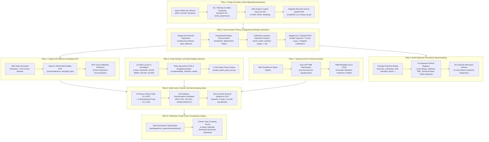

# Computational Methodology and Pipeline Reference Guide

## Executive Overview & Master Pipeline Architecture

This document provides a comprehensive, publication-grade technical and mathematical reference for the computational methods, statistical models, perturbation engines, and benchmarking suites implemented across the `tme_analysis` repository.

The computational framework integrates single-cell neighborhood differential abundance (Milo / milopy), high-resolution pseudobulk deconvolution, regularized simplex estimation, multi-replicate perturbation stress-testing, Bayesian hyperparameter optimization (HPO), finite-sample stability selection, somatic mutation dynamics, and multi-cohort clinical trial benchmarking across 9 clinical trials ($N = 1,097$), 5 TCGA baseline cohorts ($N = 2,932$), and matched clinical biopsy cohorts.



---

## 1. Single-Cell Atlas Preprocessing & Graph Differential Abundance (Milo)

### 1.1 Quality Control and Community Detection
Single-cell RNA sequencing datasets from solid tumor biopsies are ingested and normalized across standardized quality filters:
- **UMI and Feature Thresholds**: Cells are filtered to retain library depths between 500 and 50,000 UMIs, with detected genes $n_{\text{genes}} \in [200, 8,000]$.
- **Mitochondrial and Ribosomal Proportions**: Cells exhibiting mitochondrial read fractions $f_{\text{mito}} > 15\%$ or ribosomal read fractions $f_{\text{ribo}} < 3\%$ are discarded to eliminate apoptotic debris.
- **Transcriptional Invariant Normalization**: Counts are library-size scaled to $10^4$ transcripts per cell (CP10K) and stabilized via $\log_{1p}$ transformation.
- **Lineage Partitioning**: Unsupervised graph community detection (Leiden algorithm) is evaluated across multi-resolution parameters $\gamma \in [0.1, 1.5]$ to delineate major immune, stromal, and malignant compartments.

### 1.2 Continuous Neighborhood Testing on Single-Cell Graphs (Milo / milopy)
Discrete clustering introduces arbitrary cluster boundaries that obscure phenotypic transitions. Continuous graph testing via Milo (@dann2022differential) models cell abundance directly on a $k$-nearest neighbor ($k\text{NN}$) graph:

1. **Latent Space $k\text{NN}$ Graph Construction**:
   A graph $G = (V_c, E)$ is constructed in latent principal component space ($d = 30$ PCs, $k = 30$ nearest neighbors).

2. **Index Vertex Sampling with Medoid Refinement**:
   To avoid prohibitive computation over all cells while preventing sampling bias, index vertices $v \in V \subset V_c$ are sampled via a probability proportional to graph density, refined by local medoid centering.

3. **Overlapping Neighborhood Formulation**:
   For each sampled index vertex $v$, the neighborhood $\mathcal{N}(v)$ encompasses all cells within graph distance $d_G(v, c) \le d_{\text{max}}$. The neighborhood composition is represented by the sparse binary incidence matrix:
   $$M_{c, v} = \begin{cases} 1 & \text{if } c \in \mathcal{N}(v) \\ 0 & \text{otherwise} \end{cases} \in \{0, 1\}^{C \times V}$$

4. **Hierarchical Patient Count Aggregation**:
   Single-cell pseudo-replication is eliminated by aggregating single cells into a patient-level count matrix $\mathbf{N} \in \mathbb{N}_0^{V \times J}$, where $N_{v,j} = \sum_{c \in \text{Patient}_j} M_{c, v}$.

5. **Quasi-Likelihood Negative Binomial GLM**:
   For each neighborhood $v$, counts are modeled across patient samples $j \in \{1, \dots, J\}$ via:
   $$\log(\mathbb{E}[N_{v,j}]) = \beta_{0,v} + \beta_v^{\text{milo}} Y_j + \log(\text{TotalCells}_j)$$
   where $Y_j \in \{0, 1\}$ denotes binary clinical response (e.g. RECIST responder vs non-responder), and $\log(\text{TotalCells}_j)$ is the sample library-size offset computed via TMM (Trimmed Mean of M-values) normalization.

6. **Empirical Bayes Dispersion Shrinkage & Spatial FDR**:
   Overdispersion parameters $\phi_v$ are regularized via empirical Bayes shrinkage toward a common trend line. Because adjacent neighborhoods overlap, raw p-values are adjusted using Spatial FDR:
   $$\text{Spatial-FDR}(v) = \frac{\sum_{u \in V} w_{uv} \mathbb{I}(p_u \le p_v)}{\sum_{u \in V} w_{uv}} \cdot \frac{p_v}{\hat{F}(p_v)}$$
   where weights $w_{uv} = \frac{|\mathcal{N}(u) \cap \mathcal{N}(v)|}{|\mathcal{N}(u) \cup \mathcal{N}(v)|}$ reflect neighborhood graph overlap Jaccard indices.

### 1.3 Key Scripts
- `scripts/01_download_datasets.py`, `scripts/02_convert_to_sparse_h5.py`, `scripts/03_preprocess_datasets.py`: Raw single-cell data retrieval, AnnData construction, and sparse HDF5 serialization.
- `scripts/05_run_milopy_da.py`: Master CLI pipeline executing Milo graph testing, negative binomial GLM fitting, and Spatial FDR calculation across cohorts.
- `scripts/06_investigate_subtle_datasets.py`: Fine-grained neighborhood sensitivity sweeps across FDR thresholds ($\alpha \in \{0.05, 0.10, 0.15, 0.20\}$).
- `scripts/07_integrate_combined_cohorts.py`: Cross-cohort single-cell integration in latent space with batch effect correction via Harmony.

---

## 2. Pseudobulk Deconvolution Theory, Reference Collinearity & Regularized Simplex Estimation

### 2.1 The Pseudobulk Deconvolution Formulation
Pseudobulk deconvolution models the observed bulk transcriptome $\mathbf{b}_j \in \mathbb{R}^G$ of patient $j$ as a linear combination of cell-state reference expression profiles $\mathbf{\Phi} \in \mathbb{R}^{G \times K}$:
$$\mathbf{b}_j \approx \mathbf{\Phi} \mathbf{f}_j^{\text{mRNA}}, \quad \mathbf{f}_j^{\text{mRNA}} \in \Delta^{K-1}$$
where $\Delta^{K-1} = \{\mathbf{f} \in \mathbb{R}_+^K : \sum_k f_k = 1\}$ is the canonical probability simplex.

#### Decoupling of mRNA Mass Fractions from Cell Count Proportions
Deconvolution inherently estimates mRNA mass fractions $f_{k,j}^{\text{mRNA}}$. When cell lineages differ in per-cell transcriptional yield (cell size / total mRNA content $S_k \in \mathbb{R}_+$), physical cell count proportions $p_{k,j}$ diverge non-linearly:
$$f_{k,j}^{\text{mRNA}} = \frac{p_{k,j} S_k}{\sum_{m=1}^K p_{m,j} S_m} \iff p_{k,j} = \frac{f_{k,j}^{\text{mRNA}} / S_k}{\sum_{m=1}^K f_{m,j}^{\text{mRNA}} / S_m}$$
Ignoring $S_k$ induces severe systemic bias: transcriptionally hyperactive lineages (e.g. plasma cells, macrophages, malignant blasts with $S_k = 10\times\text{--}50\times$) are inflated by orders of magnitude, while quiescent lymphocytes ($S_k = 1\times$) are artificially suppressed.

### 2.2 Mathematical Singularity of Reference Collinearity
In high-resolution deconvolution, fine cell states within a common lineage share core marker programs:
$$\boldsymbol{\phi}_{s_2} = \boldsymbol{\phi}_{s_1} + \boldsymbol{\delta}, \quad \|\boldsymbol{\delta}\|_2 \ll \|\boldsymbol{\phi}_{s_1}\|_2$$
As $\|\boldsymbol{\delta}\|_2 \to 0$, the reference Gram matrix $\mathbf{\Phi}^T \mathbf{\Phi}$ becomes ill-conditioned, driving condition number $\kappa(\mathbf{\Phi}) = \sigma_{\max}(\mathbf{\Phi}) / \sigma_{\min}(\mathbf{\Phi}) \to \infty$.

#### Cramér-Rao Variance Explosion Along the Sibling Difference Vector
Consider the normalized sibling contrast vector $\mathbf{v} = \frac{1}{\sqrt{2}}(\mathbf{e}_{s_1} - \mathbf{e}_{s_2})$. Evaluating the Fisher information matrix $\mathcal{I}(\boldsymbol{\theta})$ along $\mathbf{v}$:
$$\mathbf{v}^T \mathcal{I}(\boldsymbol{\theta}) \mathbf{v} = \sum_{g=1}^G \frac{(\Phi_{g, s_1} - \Phi_{g, s_2})^2}{2 \sum_k \Phi_{g, k} \theta_k} = \mathcal{O}(\|\boldsymbol{\delta}\|_2^2) \to 0$$
By the Cramér-Rao lower bound, the variance of any unbiased estimator $\hat{\boldsymbol{\theta}}$ along $\mathbf{v}$ diverges:
$$\operatorname{Var}(\hat{\theta}_{s_1} - \hat{\theta}_{s_2}) \ge 2 \mathbf{v}^T \mathcal{I}^{-1} \mathbf{v} = \mathcal{O}\left(\frac{1}{\|\boldsymbol{\delta}\|_2^2}\right) \to \infty$$
Because the simplex constraint forces $\sum_s \hat{\theta}_s = 1$, divergent variance along $\mathbf{v}$ forces an exact negative covariance between sibling states:
$$\operatorname{Cov}(\hat{\theta}_{s_1}, \hat{\theta}_{s_2}) \approx -\sqrt{\operatorname{Var}(\hat{\theta}_{s_1}) \operatorname{Var}(\hat{\theta}_{s_2})}$$
This manifests clinically as catastrophic deconvolution cross-talk: an elevation in CD8+ effector memory is erroneously estimated as a spurious depletion in CD8+ resident memory, corrupting biomarker associations.

### 2.3 BayesPrism Hierarchical Aggregation & Null-Space Cancellation
BayesPrism (@chu2022cell) circumvents this singularity through a hierarchical partition mapping $\pi: \mathcal{S} \to \mathcal{T}$ from fine states $\mathcal{S} = \{1, \dots, S\}$ to broad types $\mathcal{T} = \{1, \dots, T\}$ ($T \ll S$), represented by the aggregation operator $\mathbf{M} \in \{0, 1\}^{T \times S}$:
$$M_{t, s} = \begin{cases} 1 & \text{if } \pi(s) = t \\ 0 & \text{otherwise} \end{cases}$$

#### Null-Space Invariance
The collinear contrast vector $\mathbf{v}$ lies identically in the null space of $\mathbf{M}$:
$$\mathbf{M} \mathbf{v} = \frac{1}{\sqrt{2}}(\mathbf{M} \mathbf{e}_{s_1} - \mathbf{M} \mathbf{e}_{s_2}) = \frac{1}{\sqrt{2}}(\mathbf{e}_t - \mathbf{e}_t) = \mathbf{0} \implies \mathbf{v} \in \operatorname{Null}(\mathbf{M})$$
Consequently, the divergent variance terms of order $\mathcal{O}(1/\|\boldsymbol{\delta}\|_2^2)$ cancel identically against the negative covariance terms during broad-type marginalization:
$$\operatorname{Var}(\hat{\theta}_{n,t}^{(0)}) = \sum_{s \in \mathcal{S}_t} \operatorname{Var}(\hat{\theta}_{n,s}) + 2 \sum_{s < s' \in \mathcal{S}_t} \operatorname{Cov}(\hat{\theta}_{n,s}, \hat{\theta}_{n,s'}) = \mathcal{O}(1)$$
BayesPrism then refines broad cell type profiles $\boldsymbol{\psi}_t = \text{Softmax}(\log \boldsymbol{\phi}_t^{\text{type}} + \boldsymbol{\gamma}_t)$ under a zero-mean Gaussian shrinkage prior $\gamma_{t,g} \sim \mathcal{N}(0, \sigma^2)$ before sampling final cell fractions $\boldsymbol{\theta}_n^{(f)}$ on the well-conditioned simplex $\Delta^{T-1}$.

### 2.4 Collinearity-Aware Regularized Deconvolution (`RegDeconv` / `SimplexFISTA`)
While BayesPrism cancels the singularity by collapsing fine states into coarse lineages ($T \ll S$), it loses fine-grained intra-lineage phenotypic resolution. To retain state-level discrimination without suffering condition number collapse, we formulated a regularized non-linear objective defined natively on the simplex:

$$\min_{\boldsymbol{\theta} \in \Delta^{S-1}} \mathcal{L}(\boldsymbol{\theta}) = D_{\text{KL}}(\mathbf{x}, \mathbf{\Phi}^T \boldsymbol{\theta}) + \frac{\lambda_{\text{lap}}}{2} \boldsymbol{\theta}^T \mathbf{L} \boldsymbol{\theta} + \lambda_{\text{fuse}} \sum_{i < j} W_{ij} \psi_\epsilon(\theta_i - \theta_j)$$

where:
1. **Unnormalized Poisson KL Deviance**:
   $$D_{\text{KL}}(\mathbf{x}, \boldsymbol{\mu}) = \sum_{g=1}^G (\mu_g - x_g \log \mu_g), \quad \boldsymbol{\mu} = \mathbf{\Phi}^T \boldsymbol{\theta}$$
   representing the exact log-likelihood deviance under Poisson counting statistics.

2. **Graph-Laplacian Manifold Energy**:
   Let $\mathbf{W} \in \mathbb{R}_+^{S \times S}$ denote the transcriptomic affinity matrix, with entries $W_{ij} = (\operatorname{Corr}(\boldsymbol{\phi}_i, \boldsymbol{\phi}_j)_+)^2$ for distinct states sharing lineage ($M_{t,i} = M_{t,j} = 1$) and $0$ otherwise. The unnormalized Laplacian $\mathbf{L} = \mathbf{D} - \mathbf{W}$ (where $D_{ii} = \sum_j W_{ij}$) induces the quadratic Dirichlet energy:
   $$\boldsymbol{\theta}^T \mathbf{L} \boldsymbol{\theta} = \frac{1}{2} \sum_{i,j} W_{ij} (\theta_i - \theta_j)^2$$
   which penalizes divergent proportion assignments strictly along collinear directions where $W_{ij} \to 1$.

3. **Smoothed Fused Lasso**:
   To prevent over-smoothing across distinct states, the pseudo-Huber smoothed $L_1$ penalty:
   $$\psi_\epsilon(u) = \sqrt{u^2 + \epsilon^2} \quad (\epsilon = 10^{-5})$$
   encourages grouping of closely related states without non-differentiable singularities at $u = 0$.

#### Fast Projected Simplex Solver (FISTA)
The objective is optimized via projected Fast Iterative Shrinkage-Thresholding (FISTA) with Armijo backtracking:
$$\boldsymbol{\theta}^{(k+1)} = \Pi_{\Delta^{S-1}}\left(\mathbf{y}^{(k)} - \alpha_k \nabla \mathcal{L}(\mathbf{y}^{(k)})\right)$$
where $\Pi_{\Delta^{S-1}}$ is the exact Euclidean projection onto the probability simplex computed in $\mathcal{O}(S \log S)$ time via the sorting algorithm of Wang and Carreira-Perpiñán (@wang2013projection).

#### Adaptive Deficit Spectral Calibration
Imposing a static Laplacian penalty forces overregularization in well-conditioned regimes, pulling unequal true proportions toward an artificial midpoint ($0.5, 0.5$). Our adaptive spectral calibration injects curvature strictly proportional to the eigenvalue deficit beyond an operational target condition number $\kappa_{\text{target}}$ (default $2,000$):
$$\sigma_{\text{target}} = \frac{\sigma_{\max}(\mathbf{H}_{\text{nom}})}{\kappa_{\text{target}}}, \quad \Delta \sigma = \max(0, \sigma_{\text{target}} - \sigma_{\min}(\mathbf{H}_{\text{nom}})), \quad \lambda_{\text{lap}} = \frac{\Delta \sigma}{\bar{d}}$$
where $\mathbf{H}_{\text{nom}} = \mathbf{\Phi} \operatorname{diag}(1 / \boldsymbol{\mu}_0) \mathbf{\Phi}^T$ is the nominal Poisson Hessian at the barycentric center $\boldsymbol{\theta}_0 = \frac{1}{S} \mathbf{1}$, and $\bar{d} = \frac{1}{S} \operatorname{Tr}(\mathbf{L})$ is the average node degree.

### 2.5 Seven-Method Benchmark Suite
The deconvolution suite implements standardized runners for 7 deconvolution tools:
1. `Unregularized (NNLS)`: Standard non-negative least squares simplex inversion.
2. `RegDeconv (Graph Lap)`: Our collinearity-regularized Poisson FISTA solver.
3. `Rectangle (DWLS-QP)`: Distance-weighted least squares quadratic programming.
4. `CIBERSORT (reimpl., nu-SVR)`: $\nu$-support vector regression with signature marker selection.
5. `CIBERSORTx (Docker)`: Official CIBERSORTx container deconvolution.
6. `InstaPrism`: Fast analytical EM maximum likelihood deconvolution.
7. `BayesPrism (Gibbs)`: Full Bayesian Markov Chain Monte Carlo deconvolution.

### 2.6 Unified 9-Cohort Pan-Cancer Reference Deconvolution & Milopy Concordance
To test whether a single unified pan-cancer reference constructed from all nine single-cell cohorts ($355$ cell states across $N = 611$ patient samples and $G_{\text{union}} = 4,529$ union marker genes) can deconvolve each cohort's patient pseudobulk mixtures while preserving single-cell Milopy differential abundance effect sizes (`logFC`), we evaluate three reference architectures (documented in full in [`docs/unified_pan_cohort_reference_deconvolution_methodology.md`](file:///Users/halu/Code/tme_analysis/docs/unified_pan_cohort_reference_deconvolution_methodology.md)):
1. **Unified All-9 Concatenated Reference ($\boldsymbol{\Phi}_{\text{all-9}} \in \mathbb{R}_{\ge 0}^{4529 \times 355}$)**: Simultaneous NNLS competition across all $355$ states followed by target-cohort simplex closure, achieving a mean cross-cohort Spearman correlation of **$\bar{\rho} = +0.850$** (vs. **$\bar{\rho} = +0.842$** for within-cohort references, $p_{\text{perm}} = 0.0005$ in all 9 cohorts) and $86.9\%$ directional sign agreement.
2. **Leave-One-Cohort-Out 8-Cohort Reference ($\boldsymbol{\Phi}_{-c}$, LOCO-8)**: Deconvolves target cohort $c$ using exclusively the remaining $8$ cohorts' reference centroids (zero in-cohort reference cells) with lineage-constrained cosine cross-similarity projection $\mathbf{W}_{c, -c}$, achieving **$\bar{\rho} = +0.739$** ($p_{\text{perm}} = 0.0005$ across all 9 cohorts).
3. **Consensus Pan-Cancer Meta-State Reference ($\boldsymbol{\Phi}_{\text{meta}} \in \mathbb{R}_{\ge 0}^{4529 \times 42}$)**: Harmonizes the $355$ cohort-specific states into $K_{\text{meta}} = 42$ canonical functional meta-states via inverse-variance weighting, achieving a global meta-analytic Spearman correlation of **$\rho = +0.901$** ($p_{\text{perm}} = 0.0005$, $90.5\%$ sign agreement) between pooled Milopy $\bar{\tau}_m$ and pooled deconvolution logistic regression $\bar{\beta}_m$.

### 2.7 Key Scripts
- `scripts/regularized_deconv/deconv_runners.py`: Standardized API runners across all 7 deconvolution algorithms.
- `scripts/regularized_deconv/synthetic_data.py`: Synthetic generator parameterized by collinearity index $\alpha \in [0, 0.99]$, lineage hierarchy, and noise levels.
- `scripts/regularized_deconv/benchmark_collinearity_regularized_deconv.py`: Multi-metric evaluation (RMSE, Pearson $r$, Spearman $\rho$, Lin's CCC, Condition number $\kappa$) across algorithms.
- `scripts/sade_feldman_pseudobulk_deconv_benchmark.py`: Within-cohort linear CP10K pseudobulk aggregation, reference construction, NNLS simplex deconvolution, and logistic regression vs. Milopy DA concordance across all 9 single-cell cohorts.
- `scripts/milopy_analysis/pan_cohort_unified_deconv_benchmark.py`: Unified 9-cohort reference atlas construction ($\boldsymbol{\Phi}_{\text{all-9}}$, LOCO-8 $\boldsymbol{\Phi}_{-c}$, and 42-state $\boldsymbol{\Phi}_{\text{meta}}$), three-level statistical concordance verification, and $B=2,000$ label-permutation null calibration.
- `scripts/sade_feldman_deconv_validation/02_deconvolute_iatlas.py`: Bulk deconvolution of 9 clinical trial cohorts using single-cell references.
- `scripts/concordance/06_evaluate_concordance.py`: Empirical concordance evaluation between single-cell Milo DA effects and bulk deconvolution response coefficients.

---

## 3. Multi-Replicate Perturbation Stress-Testing Suite & Distortion Taxonomy

### 3.1 Eight Biological and Technical Distortion Modes
To stress-test deconvolution algorithms under realistic clinical tissue distortion, the simulation suite parameterizes 8 distinct distortion modes across 5 independent replicates per condition ($N = 5$, 485 total simulations):

| Distortion Mode | Parameter Range | Mathematical Mechanism | Biological / Clinical Basis |
| :--- | :---: | :--- | :--- |
| **1. Cell Size / mRNA Asymmetry** | $S_k \in [1\times, 50\times]$ | $f_{k}^{\text{mRNA}} = \frac{p_k S_k}{\sum_m p_m S_m}$ | Divergence in cellular transcriptional volume between small lymphocytes and large blast/myeloid cells. |
| **2. Reference Collinearity** | $\alpha \in [0, 99\%]$ | $\boldsymbol{\phi}_{s_2} = (1 - \alpha)\boldsymbol{\phi}_{s_1} + \alpha \boldsymbol{\phi}_{\text{shared}}$ | Marker program sharing between closely related sub-lineages (e.g. CD8+ Tem vs Tex). |
| **3. Inter-Patient Shift** | $\sigma \in [0, 3.0]$ | $b_{g,j} = \Phi_{g,k} \cdot \exp(\mathcal{N}(0, \sigma^2))$ | Patient-to-patient genetic background and baseline expression drift. |
| **4. State Activation Confounding** | $\gamma \in [1\times, 20\times]$ | $\Phi_{g,k}^{\text{active}} = \Phi_{g,k} \cdot \gamma$ for activation markers | Marker upregulation upon immune checkpoint engagement without cell division. |
| **5. Ghost / Tumor Contamination** | $f_{\text{ghost}} \in [0, 85\%]$ | $\mathbf{b} = (1 - f_{\text{ghost}})\mathbf{\Phi}\mathbf{f} + f_{\text{ghost}}\boldsymbol{\phi}_{\text{tumor}}$ | Bulk tumor biopsy reads originating from unmodeled parenchymal tumor cells. |
| **6. Sampling Sparsity** | $\sigma \in [0, 4.0]$ | $C_j \sim \text{Poisson}(\lambda_0 \exp(\mathcal{N}(0, \sigma^2)))$ | Low-input biopsy yield inequality with severe dropouts and Poisson counting noise. |
| **7. Ambient RNA Soup** | $\eta \in [0, 40\%]$ | $\mathbf{x}_{\text{obs}} = (1 - \eta)\mathbf{x}_{\text{true}} + \eta \bar{\mathbf{x}}_{\text{ambient}}$ | Droplet background lysis RNA diffusing into single-cell reference barcodes. |
| **8. Patient Marker Dysregulation** | $\sigma_{\text{dysreg}} \in [0, 2.0]$ | $\Phi_{g,k,j} = \Phi_{g,k} \cdot \exp(-\text{Uniform}(0, \sigma_{\text{dysreg}}))$ | Patient-specific transcriptional silencing or loss-of-heterozygosity (LOH) in bulk tissue. |

### 3.2 Four Compound Clinical Regimes
Distortions rarely occur in isolation in surgical pathology. We formalized 4 compound clinical regimes evaluated across scaling intensity $\alpha \in [0.0, 1.0]$:
1. **Clinical Core Needle Biopsy**:
   $$\text{Cell Size } (1.0 \times \alpha) + \text{Sampling Sparsity } (0.8 \times \alpha) + \text{Ghost Contamination } (0.7 \times \alpha)$$
2. **Inflamed Tumor Microenvironment**:
   $$\text{Activation Confounding } (1.0 \times \alpha) + \text{Collinearity } (0.8 \times \alpha) + \text{Patient Shift } (0.6 \times \alpha)$$
3. **Single-Cell Technical Noise**:
   $$\text{Ambient Soup } (1.0 \times \alpha) + \text{Sampling Sparsity } (0.6 \times \alpha) + \text{Patient Shift } (0.5 \times \alpha)$$
4. **Triple-Jeopardy Breakdown**:
   $$\text{Cell Size } (1.0 \times \alpha) + \text{Activation Confounding } (1.0 \times \alpha) + \text{Ghost Contamination } (0.8 \times \alpha)$$

### 3.3 Two-Dimensional Factorial Interaction Surfaces
A $5 \times 5$ factorial grid of Cell Size Asymmetry ($S \in \{1\times, 5\times, 10\times, 25\times, 50\times\}$) $\times$ Activation Confounding ($\gamma \in \{1\times, 3\times, 5\times, 10\times, 20\times\}$) across $N = 5$ replicates ($125$ simulations) maps non-linear degradation:
- **Rank Correlation ($\rho$) Degradation**: Cell size asymmetry drives rank loss along the primary axis.
- **Directional Sign Inversion**: Activation confounding drives directional sign flipping ($+ \to -$) independently of cell size.

### 3.4 Key Scripts
- `scripts/synthetic_perturbation_benchmark.py`: Complete perturbation engine evaluating single modes, compound regimes, 2D interaction surfaces, and generating publication SVGs.
- `scripts/synthetic_milo_deconv_benchmark.py`: Direct synthetic comparison of Milo DA graph testing vs pseudobulk deconvolution across varying graph topologies.

---

## 4. Single-Cell Reference Sampling Hyperparameter Optimization (HPO)

### 4.1 Automated Reference Construction & Atlas Screening
The predictive accuracy of deconvolution depends heavily on the quality and composition of the single-cell reference matrix. The reference sampling HPO engine systematically searches over reference construction hyperparameters using Bayesian optimization (Optuna / ASHA scheduler):

1. **Candidate Single-Cell Atlas Selection**:
   Filters and resolves viable memory-safe single-cell atlases matching the target indication (e.g. Melanoma: Sade-Feldman, Jerby-Arnon, Tirosh; RCC: Bi et al.; Bladder: Chen et al.) as well as Pan-Cancer immune references.

2. **Malignant Strategy**:
   - `PATIENT_STRATIFIED`: Captures patient-specific malignant transcriptional states.
   - `POOLED_GENERIC`: Constructs an averaged generic tumor signature.
   - `EXCLUDED_TME_ONLY`: Omits malignant cells to focus exclusively on tumor microenvironment immune/stromal proportions.

3. **Cell Subsampling Depth**:
   Optimizes cell count quotas per lineage $N_{\text{cells}} \in [150, 1,200]$ to balance marker signal-to-noise ratio against sampling variance.

4. **Marker Gene Selection Thresholds**:
   Selects genes using one-vs-rest log fold change ($\log_2\text{FC} \ge 1.0$) and minimum detection fraction ($f_{\text{det}} \ge 0.10$).

### 4.2 Downstream Classifier Optimization & Out-of-Fold (OOF) Prediction
Deconvolution cell proportions are coupled to a downstream classifier HPO loop:
- **Compositional Transforms**: Evaluates Centered Log-Ratio ($\text{CLR}(\mathbf{f}) = [\log(f_k / g(\mathbf{f}))]$), Additive Log-Ratio (ALR), and pairwise log-ratios $\log(f_i / f_j)$.
- **Classifiers**: Ridge Logistic Regression, ElasticNet, Random Forest, LightGBM, and Gradient Boosting.
- **Cross-Validation**: Stratified 5-Fold Cross-Validation computing out-of-fold (OOF) predicted response probabilities.

### 4.3 Key Scripts
- `scripts/reference_sampling_hpo/run_single_cohort_hpo.py`: Single-cohort Bayesian HPO runner for single-cell reference construction and classifier tuning.
- `scripts/reference_sampling_hpo/run_all_cohorts_hpo_and_benchmarking.py`: Master pipeline executing HPO across all 9 clinical cohorts, generating OOF predictions, and pooling results.
- `scripts/reference_sampling_hpo/plotting.py`: Altair visualization of optimization histories, parameter importances, and Pareto frontiers.

---

## 5. Finite-Sample Controlled Stability Selection & Biomarker Curation

### 5.1 Complementary Pairs Stability Selection (CPSS)
High-dimensional transcriptomic datasets ($p \gg n$) suffer from high sample variance: standard Lasso yields high false discovery rates. Stability selection (@meinshausen2010stability) with Complementary Pairs Subsampling (CPSS; @shah2013variable) provides exact finite-sample error bounds:

1. **Subsampling Scheme**:
   The sample set $\{1, \dots, n\}$ is partitioned into complementary halves $I_b, I_b^c$ ($|I_b| = \lfloor n/2 \rfloor$) across $B$ bootstrap cycles ($2B$ subsamples total).

2. **Selection Probability**:
   For any model selection algorithm parameterized by penalty vector $\boldsymbol{\lambda} \in \Lambda$, let $\hat{S}^{\boldsymbol{\lambda}}(I_b) \subseteq \{1, \dots, p\}$ denote the active features selected on subsample $I_b$. The empirical selection probability for feature $k$ is:
   $$\hat{\Pi}_k^{\boldsymbol{\lambda}} = \frac{1}{2B} \sum_{b=1}^{2B} \mathbb{I}(k \in \hat{S}^{\boldsymbol{\lambda}}(I_b))$$

3. **Stable Feature Set**:
   $$\hat{S}^{\text{stable}} = \left\{k \in \{1, \dots, p\} : \max_{\boldsymbol{\lambda} \in \Lambda} \hat{\Pi}_k^{\boldsymbol{\lambda}} \ge \pi_{\text{thr}}\right\}$$
   where $\pi_{\text{thr}} \in (0.5, 1.0]$ is the stability threshold (set to $0.60$ for single cohorts and $0.70$ for multi-cohort pools).

### 5.2 Error Bounds and the Regularization Budgeting Engine

#### Per-Family Error Rate (PFER) Bounding
Under exchangeability of noise variables, the expected number of falsely selected noise variables $\mathbb{E}[V]$ is bounded analytically:
$$\mathbb{E}[V] \le \frac{1}{2 \pi_{\text{thr}} - 1} \frac{q_\Lambda^2}{p}$$
where $q_\Lambda = \mathbb{E}[|\hat{S}^{\boldsymbol{\lambda}}(I)|]$ is the average number of features selected by the base procedure across the path, and $p$ is the feature space dimension ($p = 822$ across 5 immune-oncology gene sets). Under unimodality or $r$-concavity conditions, tighter bounds derived by Shah and Samworth hold:
$$\mathbb{E}[V] \le \frac{q_\Lambda^2}{p} C(\pi_{\text{thr}}, \theta), \quad C(\pi_{\text{thr}}, \theta) < \frac{1}{2 \pi_{\text{thr}} - 1}$$

#### Dynamic Regularization Budgeting
To prevent algorithmic runaway along decreasing regularization paths, the active set capacity $q_{\text{budget}}$ is calibrated from user-specified PFER targets:
$$q_{\text{budget}} = \left\lfloor \sqrt{\text{PFER}_{\text{target}} \cdot p \cdot (2 \pi_{\text{thr}} - 1)} \right\rfloor$$
Path evaluation terminates dynamically once empirical expenditure $\bar{q}(\lambda_l) = \frac{1}{2B}\sum_b |\hat{S}^{(\lambda_l)}(I_b)| \ge q_{\text{budget}}$, ensuring finite-sample error guarantees hold unconditionally.

### 5.3 Thirteen-Fitter Multi-Paradigm Matrix
The framework implements 13 feature selection algorithms across five mathematical paradigms:

1. **Convex Regularized GLMs**:
   - `Lasso`: $L_1$ penalized logistic regression enforcing feature sparsity.
   - `ElasticNet`: $L_1 + L_2$ mixture balancing sparsity and group selection of correlated genes.
   - `Logistic`: Unpenalized logistic regression with top-variable ranking.

2. **Non-Convex & Adaptive Penalization**:
   - `SCAD` & `MCP`: Local linear approximations (LLA) mitigating asymptotic bias for large coefficients.
   - `Adaptive Lasso`: Two-stage reweighted $L_1$ penalization ($w_j = 1/|\hat{\beta}_j^{\text{init}}|^\gamma$) satisfying oracle properties.
   - `Hard Thresholding`: Iterative parameter projection retaining strictly top-$k$ gradient magnitude entries.

3. **Gradient Tree Ensembles**:
   - `Random Forest`: Bagged ensemble using Gini impurity reduction.
   - `LightGBM` & `XGBoost`: Histogram-based gradient boosted decision trees utilizing split gain and coverage.

4. **Cohort-Aware Confounder Partialling & Mixed Models**:
   - `Frisch-Waugh-Lovell Partialled Lasso (LassoFWL)`:
     Let $\mathbf{C} \in \mathbb{R}^{n \times K}$ denote one-hot cohort indicators. The orthogonal projection operator:
     $$\mathbf{M}_{\mathbf{C}} = \mathbf{I}_n - \mathbf{C}(\mathbf{C}^T \mathbf{C})^{-1}\mathbf{C}^T$$
     projects expression matrix $\mathbf{X}^* = \mathbf{M}_{\mathbf{C}}\mathbf{X}$ and response $\mathbf{y}^* = \mathbf{M}_{\mathbf{C}}\mathbf{y}$ into the orthogonal complement of the cohort subspace, purging study-level mean offsets prior to $L_1$ selection.
   - `Mixed Effects Random Forest (MERF)`:
     Decomposes patient outcome into shared non-linear fixed effects and cohort-specific random intercepts:
     $$y_{ij} = f(\mathbf{x}_{ij}) + b_j + \epsilon_{ij}, \quad b_j \sim \mathcal{N}(0, \sigma_b^2)$$
     estimated via Expectation-Maximization (EM).

5. **Ordered Weighted $L_1$ Norms (OWL)**:
   - `OSCAR (Octagonal Shrinkage and Clustering Algorithm)`:
     Uses affine linear weights $w_j = \lambda_1 + \lambda_2(p - j)$ to induce octagonal polytope facets that enforce exact equality on correlated covariates ($|\beta_i - \beta_j| \to 0$).
   - `SLOPE (Sorted L-One Penalized Estimation)`:
     Uses decaying Gaussian quantile weights $w_j = \lambda \cdot \Phi^{-1}(1 - \frac{q_{\text{FDR}} \cdot j}{2p})$ to guarantee exact False Discovery Rate control at level $q_{\text{FDR}} = 0.10$.
   - **Fast Proximal Solver via PAVA**:
     Evaluates the proximal operator $\text{prox}_{\Omega_{\mathbf{w}}}(\mathbf{v}) = \operatorname{diag}(\operatorname{sgn}(\mathbf{v})) \mathbf{P}^T \text{PAVA}_+(\mathbf{z} - \mathbf{w})$ using the Pool Adjacent Violators Algorithm (isotonic regression) in $\mathcal{O}(p \log p)$ time.

### 5.4 Translational Gene Curation & Dossier Tiering
Stable biomarkers are organized into a 4-tier consensus taxonomy:
- **Tier 1 (Pan-Cancer Platinum)**: Stable in $\ge 3$ distinct clinical cohorts and pan-cancer pools across multiple fitter paradigms (e.g. _CXCL9_, _CD8A_, _IFNG_, _HLA-A_).
- **Tier 2 (Indication-Specific Gold)**: Highly reproducible within a specific cancer lineage (e.g. Melanoma or ccRCC).
- **Tier 3 (Emerging Biological Silver)**: Consistently selected by non-linear tree models or grouped regularizers.
- **Tier 4 (Cohort-Restricted Exploratory)**: Signals isolated to a single trial cohort.

### 5.5 Key Scripts
- `scripts/stability_selection_iatlas/run_stability_selection_iatlas.py`: Unified stability selection engine executing single- and multi-fitter matrices across cohorts with disk caching.
- `scripts/stability_selection_iatlas/curate_expert_gene_list.py`: Multi-format dossier generator (Parquet, CSV, Markdown cards, Typst manuscript table).
- `scripts/stability_selection_iatlas/shared.py`: Data loaders, fitter implementations, and CPSS parallel routines.

---

## 6. Multi-Cohort Clinical Trial Benchmarking Suite

### 6.1 Clinical Cohort Overview and Standardized Pooling
The benchmarking framework evaluates 9 primary solid tumor clinical trials ($N = 1,097$) and 3 standardized pooled meta-cohorts:

| Cohort Identifier | Cancer Type | Therapy Stratum | Sample Count ($N$) | Responders ($n_R$) | Non-Responders ($n_{NR}$) | Response Rate |
| :--- | :--- | :--- | :---: | :---: | :---: | :---: |
| **`Choueiri-iAtlas`** | Clear Cell Renal Cell | anti-PD-1 | 16 | 3 | 13 | 18.8% |
| **`McDermott-iAtlas`** | Clear Cell Renal Cell | anti-PD-L1 | 247 | 72 | 175 | 29.1% |
| **`Hugo-iAtlas`** | Cutaneous Melanoma | anti-PD-1 | 27 | 14 | 13 | 51.9% |
| **`Riaz-iAtlas`** | Cutaneous Melanoma | anti-PD-1 | 98 | 20 | 78 | 20.4% |
| **`Gide-iAtlas`** | Cutaneous Melanoma | anti-PD-1 / combo | 91 | 49 | 42 | 53.8% |
| **`Liu-iAtlas`** | Cutaneous Melanoma | anti-PD-1 | 122 | 48 | 74 | 39.3% |
| **`Padron-iAtlas`** | Pancreatic Ductal | chemo + IO | 85 | 38 | 47 | 44.7% |
| **`Anders-iAtlas`** | Triple-Negative Breast | anti-CTLA-4 | 31 | 7 | 24 | 22.6% |
| **`Rosenberg-iAtlas`** | Urothelial Bladder | anti-PD-L1 | 298 | 68 | 230 | 22.8% |
| **`Melanoma-Combined`** | Melanoma Pooled | anti-PD-1 / combo | 338 | 131 | 207 | 38.8% |
| **`RenalCell-Combined`** | Renal Cell Pooled | anti-PD-(L)1 | 263 | 75 | 188 | 28.5% |
| **`PanCancer-Combined`** | All Solid Tumors | anti-PD-(L)1 / combo | 1,015 | 319 | 696 | 31.4% |

#### Cross-Cohort Standardization and Pooling
To eliminate baseline technical shifts when aggregating across trials, prediction scores are normalized via within-cohort $z$-score standardization:
$$z_{i,c} = \frac{s_{i,c} - \bar{s}_c}{\sigma_c}$$
Pooled evaluations are conducted on both raw score concatenations and standardized pools.

### 6.2 Evaluated Predictors Compendium (32 Predictors)
The suite benchmarks 32 response biomarkers categorized into:
- **Cell Deconvolution**: `Deconvolution Inference (Our)` (`Deconvolution_Inference_Our`), `MCP CD8 T cells`, `Jiang CTLs`, `Jiang TAMs Inverted`, `Jiang Texh Inverted`, `Nurmik CAFs Inverted`.
- **Published Transcriptional Signatures**: `Ayers GEP`, `Merck GEP (Cristescu)`, `IFNG 6`, `CYT (Rooney)`, `Teff (Fehrenbacher)`, `Davoli CIS`, `Roh IS`, `Freeman PGM`, `Wu MIAS`, `Kong NetBio PD1`, `Messina CKS (12 Chemokine)`, `Huang NRS`, `IMPRES`, `IPRES Inverted`, `TIDE Inverted`, `CD8 Duo (Chen)`.
- **Single-Gene Expression**: `CD8A`, `CXCL9`, `PDCD1 (PD-1)`, `CD274 (PD-L1)`, `CTLA4`.
- **Genomic & Multi-Omic Composites**: `TMB (Genomic)`, `CXCL9 + TMB (Composite)`, `GEP + TMB (Composite)`, `CXCL9 AP Gated (Composite)`.

### 6.3 Discrimination Metrics & Statistical Inference

1. **ROC-AUC & Hanley-McNeil Confidence Intervals**:
   Given sample size $N$ with $n_R$ responders and $n_{NR}$ non-responders, the finite-sample variance of the Mann-Whitney-Wilcoxon ROC-AUC estimator $\hat{A}$ is computed via the exact Hanley-McNeil formula:
   $$\operatorname{Var}(\hat{A}) = \frac{\hat{A}(1 - \hat{A}) + (n_R - 1)(Q_1 - \hat{A}^2) + (n_{NR} - 1)(Q_2 - \hat{A}^2)}{n_R \cdot n_{NR}}$$
   where $Q_1 = \frac{\hat{A}}{2 - \hat{A}}$ and $Q_2 = \frac{2 \hat{A}^2}{1 + \hat{A}}$. Natural $95\%$ confidence bounds are:
   $$\text{CI}_{95\%} = \left[\hat{A} - 1.96 \sqrt{\operatorname{Var}(\hat{A})}, \quad \hat{A} + 1.96 \sqrt{\operatorname{Var}(\hat{A})}\right]$$

2. **PR-AUC and Excess Precision ($\Delta\text{PR-AUC}$)**:
   In imbalanced cancer cohorts, ROC-AUC can present an overly optimistic impression due to large non-responder pools. The suite evaluates Precision-Recall AUC (PR-AUC) via Average Precision:
   $$\text{PR-AUC} = \sum_k (R_k - R_{k-1}) P_k$$
   Because the uninformative baseline for PR-AUC equals cohort prevalence $\pi = n_R / N$, we evaluate Excess Precision:
   $$\Delta\text{PR-AUC} = \text{PR-AUC} - \pi$$

3. **Brier Calibration Score**:
   $$BS = \frac{1}{N} \sum_{i=1}^N (p_i - y_i)^2$$

### 6.4 Time-to-Event Survival Analysis & Decision Curve Analysis (DCA)

1. **Harrell's Concordance Index (C-Index)**:
   Evaluates discrimination across censored time-to-event outcomes (Overall Survival, OS; Progression-Free Survival, PFS):
   $$C = \frac{\sum_{i,j} \mathbb{I}(T_i < T_j) \cdot \mathbb{I}(\hat{S}_i > \hat{S}_j) \cdot \delta_i}{\sum_{i,j} \mathbb{I}(T_i < T_j) \cdot \delta_i}$$
   with $95\%$ bootstrap confidence intervals across $1,000$ resamples.

2. **Univariable Cox Proportional Hazards Models**:
   Models hazard rate per 1-standard deviation increase in predictor score:
   $$\lambda(t | z) = \lambda_0(t) \exp(\beta z)$$
   reporting Hazard Ratios ($\text{HR} = \exp(\beta)$), 95% CIs, and Wald test p-values.

3. **Decision Curve Analysis (Net Clinical Benefit)**:
   Quantifies clinical clinical utility across threshold probabilities $p_t \in [0.05, 0.95]$:
   $$\text{Net Benefit}(p_t) = \frac{\text{True Positives}}{N} - \frac{\text{False Positives}}{N} \left(\frac{p_t}{1 - p_t}\right)$$
   comparing predictors against standard clinical default strategies ("Treat All Patients" and "Treat No Patients").

### 6.5 Key Scripts
- `scripts/benchmark_iatlas_icb_predictors.py`: Master ICB benchmarking script evaluating all 32 predictors across all cohorts and strata.
- `scripts/integrate_deconvolution_our.py`: Automated ingestion of our deconvolution model, updating benchmark parquets (1,892 records) and regenerating publication figures.
- `scripts/benchmark_survival_and_dca.py`: Time-to-event survival (C-index, Cox HR) and Decision Curve Analysis engine.
- `scripts/update_texh_benchmark.py`: Benchmarking update for T-cell exhaustion and myeloid immunosuppression signatures.

---

## 7. Subclonal VAF Dynamics, TMB Optimization, and Somatic Alterations

### 7.1 Regularized Joint VAF-TMB Optimization
Tumor Mutational Burden (TMB) calculated from bulk exome sequencing is contaminated by subclonal passenger mutations and low-depth sequencing noise. The framework optimizes Variant Allele Frequency (VAF, $t_{\text{vaf}}$) and TMB cutoff thresholds ($t_{\text{tmb}}$) jointly under a regularized Log-Normal prior objective:

$$f_{\text{reg}} = f(t_{\text{vaf}}, t_{\text{tmb}}) - \lambda \left( \left(\log t_{\text{vaf}} - \log 0.05\right)^2 + \left(\log t_{\text{tmb}} - \log 10.0\right)^2 \right)$$

where $f$ denotes the clinical objective (Matthews Correlation Coefficient, MCC, or F1 score), and penalty factor $\lambda = 0.20$ penalizes excessive deviations from clinical baselines ($t_{\text{vaf}} = 0.05$, $t_{\text{tmb}} = 10.0\text{ mut/Mb}$).

### 7.2 Unsupervised VAF Boundary Estimators
Unsupervised VAF thresholds are benchmarked using:
- **Kernel Density Estimation (KDE) Valley Detection**: Identifies local minima separating clonal peaks from subclonal tails.
- **Otsu's Global Binarization**: Maximizes inter-class variance on VAF histograms.
- **Gaussian Mixture Models (GMM)**: Expectation-Maximization fitting of 2-component Gaussian mixtures.

### 7.3 TMB Reliability Score (TRS)
To predict whether a cohort's sequencing profile yields reliable prognostic signal without outcome snooping, we formulated the TMB Reliability Score:
$$\text{TRS} = \text{MER} \times \log_{10}(\text{Median Read Depth})$$
where Mutation Expression Rate (MER) denotes the proportion of somatic mutations with detectable transcripts in bulk RNA-seq.

### 7.4 Somatic Mutation Discovery (_TGM6_)
Somatic mutation status is screened across all sequenced genes via two-sided Fisher's Exact Tests:
$$\text{OR} = \frac{a \cdot d}{b \cdot c}, \quad p = \frac{\binom{a+b}{a}\binom{c+d}{c}}{\binom{n}{a+c}}$$
identifying _TGM6_ missense alterations as a potent predictive biomarker of response (Odds Ratio $= 27.38, p = 8.72 \times 10^{-6}$).

### 7.5 Key Scripts
- `scripts/iAtlas-TMB.py`: Standard TMB calculation and mutation burden profiling.
- `scripts/iAtlas-vaf-tmb-threshold-optimization.py`: 2D grid search optimization of VAF and TMB cutoffs with Log-Normal priors.
- `scripts/iAtlas-vaf-tmb-statistics.py`: Unsupervised KDE, Otsu, and GMM boundary estimators.
- `scripts/iAtlas-vaf-tmb-reliability.py`: TMB Reliability Score (TRS) evaluation across sequencing protocols.
- `scripts/tgm6/`: Focused statistical and functional analysis of _TGM6_ alterations.

---

## 8. Publication-Grade Vector Graphics & Styling Architecture

### 8.1 Nature Methods Minimalist Wireframe Standards
All generated publication vector figures adhere to the *Nature Methods* minimalist wireframe standard:
- **Canvas & Fills**: Pure white background canvas (`#FFFFFF`). Zero drop shadows (`feDropShadow` and filter glows are strictly prohibited).
- **Wireframe Geometry**: Sharp square corners (`rx="0"`, `ry="0"`). Hairline borders ($0.75\text{ pt}$ stroke width, `#94A3B8` / `#CBD5E1`).
- **Color Scales**: Okabe-Ito colorblind-safe palettes for marks, and symmetric red-blue diverging color schemes (`domainMid=0.50` for ROC-AUC, `domainMid=0.35` for PR-AUC).
- **Typography**: Clean standalone unicode symbols (`β`, `Δ`, `ρ`, `θ̂`), standard font stacks (`system-ui, -apple-system, sans-serif`), and zero text overlap.

### 8.2 Canonical Cohort Ordering
Cohorts along visualization axes are ordered deterministically:
1. **Single Clinical Cohorts (Grouped by Cancer Type & Chronology)**:
   - *Clear Cell Renal Cell*: `Choueiri et al., 2016` (Col 1), `McDermott et al., 2018` (Col 2)
   - *Melanoma*: `Hugo et al., 2016` (Col 3), `Riaz et al., 2017` (Col 4), `Gide et al., 2019` (Col 5), `Liu et al., 2019` (Col 6)
   - *Pancreatic Ductal*: `Padron et al., 2022` (Col 7)
   - *Triple-Negative Breast*: `Anders et al., 2022` (Col 8)
   - *Urothelial Bladder*: `Rosenberg et al., 2016` (Col 9)
2. **Combined Standardized Pools**:
   - `Combined Melanoma` (Col 10)
   - `Combined Renal Cell Carcinoma` (Col 11)
   - `Combined Pan Cancer` (Col 12)

### 8.3 Cancer Type Grouping Banner Track (`create_cancer_group_track`)
A dedicated wireframe grouping track spans directly above the heatmap columns:
- Calculates contiguous runs of cohorts sharing the same cancer type.
- Centers horizontal labels (`Clear Cell / Renal Cell`, `Melanoma`, `Pancreatic / Ductal`, `Triple-Neg. / Breast`, `Urothelial / Bladder`, `Combined Standardized / Cohort Pools`) in rectangular wireframe cells.
- Vertically aligned via Altair `vconcat` with identical $65\text{ px}$ step widths ($780\text{ px}$ total matrix width).

### 8.4 Key Modules
- `packages/tme_response/src/tme_response/visualization/heatmap.py`: Publication-grade ROC-AUC and PR-AUC heatmap generators with spanning cancer group tracks.
- `packages/tme_response/src/tme_response/visualization/forest.py`: Pan-cancer summary forest plots and cohort predictability indices.
- `packages/tme_response/src/tme_response/visualization/survival.py`: Harrell's C-index forest plots and Decision Curve Analysis net benefit charts.
- `packages/tme_response/src/tme_response/visualization/display_labels.py`: Canonical cohort ordering and human-readable label mapping.

---

## 9. Comprehensive Script-to-Artifact Cross-Reference Matrix

| Script File Path | Methodological Pillar | Key Theoretical Concept | Primary Input Data | Primary Output Artifacts |
| :--- | :--- | :--- | :--- | :--- |
| `scripts/05_run_milopy_da.py` | 1. Milo DA Testing | $k\text{NN}$ graph testing, Quasi-likelihood NB GLM | Single-cell AnnData H5AD | `results/milopy/{acc}/da_results.parquet`, UMAPs |
| `scripts/06_investigate_subtle_datasets.py` | 1. Milo DA Testing | Multi-FDR threshold sensitivity analysis | Milo DA parquets | Sensitivity summary tables and markdown reports |
| `scripts/07_integrate_combined_cohorts.py` | 1. Milo DA Testing | Harmony batch correction across trials | AnnData cohorts | Integrated single-cell H5AD |
| `scripts/regularized_deconv/deconv_runners.py` | 2. Deconvolution Theory | 7-tool standardized deconvolution API | Bulk counts & scRNA reference | Simplex cell proportions matrix $\mathbf{\Theta} \in \Delta^{S-1}$ |
| `scripts/regularized_deconv/synthetic_data.py` | 2. Deconvolution Theory | Collinear reference generator ($\alpha \in [0, 0.99]$) | Theoretical models | `SyntheticSignature`, mixture counts, true $\mathbf{\Theta}$ |
| `scripts/regularized_deconv/benchmark_collinearity_regularized_deconv.py` | 2. Deconvolution Theory | Simplex FISTA vs BayesPrism, CIBERSORTx, NNLS | Synthetic collinear mixtures | Benchmark metrics parquet, condition numbers |
| `scripts/concordance/06_evaluate_concordance.py` | 2. Deconvolution Theory | Milo DA vs Pseudobulk deconvolution concordance | Single-cell & bulk effects | Concordance summary parquet, diagnostic quadrants |
| `scripts/sade_feldman_pseudobulk_deconv_benchmark.py` | 2. Deconvolution Theory | Within-cohort CP10K pseudobulk & NNLS concordance | 9 single-cell cohorts | `output/results/pseudobulk_deconv_benchmark/{cohort}/` |
| `scripts/milopy_analysis/pan_cohort_unified_deconv_benchmark.py` | 2. Deconvolution Theory | Unified 9-cohort reference ($\boldsymbol{\Phi}_{\text{all-9}}$, LOCO-8, $\boldsymbol{\Phi}_{\text{meta}}$) | 9 cohort references & pseudobulks | `output/results/pseudobulk_deconv_benchmark/unified_pan_cohort/`, SVGs |
| `scripts/synthetic_perturbation_benchmark.py` | 3. Perturbation Suite | 8 distortion modes, 4 compound regimes, 2D grid | Synthetic & empirical bulks | Decay curve SVGs, faceted heatmaps, summary parquets |
| `scripts/reference_sampling_hpo/run_all_cohorts_hpo_and_benchmarking.py` | 4. Reference HPO | Optuna ASHA multi-fidelity search, OOF predictions | AnnData & bulk cBioPortal cohorts | `hpo_evaluations.parquet`, `predictions.parquet` |
| `scripts/stability_selection_iatlas/run_stability_selection_iatlas.py` | 5. Stability Selection | Shah-Samworth CPSS, PFER bounds, 13 fitters | Bulk expression & clinical response | `stability_scores.parquet`, `selection_paths.parquet` |
| `scripts/stability_selection_iatlas/curate_expert_gene_list.py` | 5. Stability Selection | 4-tier biomarker consensus curation & pathway mapping | Stability scores parquet | `curated_expert_gene_dossier.parquet`, Typst table |
| `scripts/benchmark_iatlas_icb_predictors.py` | 6. ICB Benchmarking | 32 predictors, ROC/PR AUC, Hanley-McNeil CI | Multi-omic cohort parquets | `iatlas_benchmark_metrics.parquet`, heatmaps |
| `scripts/integrate_deconvolution_our.py` | 6. ICB Benchmarking | Ingestion of our deconvolution model ($N=1,892$) | Benchmark parquets & table specs | Updated benchmark parquet, all publication SVGs |
| `scripts/benchmark_survival_and_dca.py` | 6. ICB Benchmarking | Harrell's C-index, Cox HR models, DCA Net Benefit | Survival & clinical response data | `survival_benchmark_metrics.parquet`, DCA SVGs |
| `scripts/iAtlas-vaf-tmb-threshold-optimization.py` | 7. Subclonal VAF & TMB | Joint VAF-TMB grid search with Log-Normal prior | MAF mutation files & clinical labels | Optimal cutoffs, Odds Ratio forest plots |
| `scripts/iAtlas-vaf-tmb-reliability.py` | 7. Subclonal VAF & TMB | TMB Reliability Score ($\text{TRS} = \text{MER} \times \log_{10} D$) | MAF depths & bulk RNA-seq | Reliability indices and prognostic signal flags |

---

## 10. Reproduction Commands & CLI Execution Guide

### Environment Configuration
All pipelines run under Python 3.14 on macOS / Linux. Configure environment variables and library paths prior to execution:

```bash
export PYTHONPATH="packages/tme_response/src:packages/tme_datasets/src:packages/instaprism/src:.venv/lib/python3.14/site-packages"
export MPLCONFIGDIR="/tmp/matplotlib"
PYTHON_BIN="/opt/homebrew/bin/python3.14"
```

### Pipeline 1: Single-Cell Neighborhood Differential Abundance (Milo)
```bash
$PYTHON_BIN scripts/05_run_milopy_da.py
$PYTHON_BIN scripts/06_investigate_subtle_datasets.py
```

### Pipeline 2: Regularized & Unified Pan-Cohort Simplex Deconvolution Benchmarks
```bash
$PYTHON_BIN scripts/regularized_deconv/benchmark_collinearity_regularized_deconv.py \
    --kappa-target 2000.0 \
    --n-reps 5 \
    --out-dir output/benchmarks/regularized_deconv

# Unified 9-cohort pan-cancer reference deconvolution & Milopy concordance benchmark:
uv run python scripts/milopy_analysis/pan_cohort_unified_deconv_benchmark.py
```

### Pipeline 3: Multi-Replicate Perturbation Benchmarking Suite
```bash
$PYTHON_BIN scripts/synthetic_perturbation_benchmark.py \
    --n-reps 5 \
    --output-dir output/benchmarks/perturbations
```

### Pipeline 4: Multi-Cohort Reference Sampling HPO (Remote Server `olm`)
```bash
# On remote host 'olm' (sgl07282):
$PYTHON_BIN scripts/reference_sampling_hpo/run_all_cohorts_hpo_and_benchmarking.py \
    --n-trials 12 \
    --n-jobs 32 \
    --out-dir /storage/halu/data-test/output/reference_sampling_hpo

# Local lightweight benchmark mode:
$PYTHON_BIN scripts/reference_sampling_hpo/run_all_cohorts_hpo_and_benchmarking.py \
    --benchmark-mode \
    --force-local
```

### Pipeline 5: Multi-Fitter Stability Selection & Expert Gene Curation
```bash
# Run stability selection across all 13 fitters:
$PYTHON_BIN scripts/stability_selection_iatlas/run_stability_selection_iatlas.py \
    --fitters all \
    --feature-mode immunotherapy \
    --pfer 1.0 \
    --cutoff 0.70 \
    --output-dir output/stability_selection_fitters_benchmark

# Generate expert gene dossier and Typst manuscript tables:
$PYTHON_BIN scripts/stability_selection_iatlas/curate_expert_gene_list.py
```

### Pipeline 6: Systematic Clinical Trial Benchmarking, Survival & DCA
```bash
# Full ICB discrimination benchmark:
$PYTHON_BIN scripts/benchmark_iatlas_icb_predictors.py \
    --out-dir output/benchmarks/iatlas_roc_auc

# Time-to-Event Survival Analysis & Decision Curve Analysis:
$PYTHON_BIN scripts/benchmark_survival_and_dca.py \
    --out-dir output/benchmarks/iatlas_roc_auc

# Master integration of Deconvolution Inference (Our) and publication figure export:
$PYTHON_BIN scripts/integrate_deconvolution_our.py
```

### Pipeline 7: Subclonal VAF & TMB Optimization
```bash
$PYTHON_BIN scripts/iAtlas-vaf-tmb-threshold-optimization.py
$PYTHON_BIN scripts/iAtlas-vaf-tmb-reliability.py
```

### Running the Test Suite
```bash
$PYTHON_BIN -m pytest packages/tme_response/tests/
```
