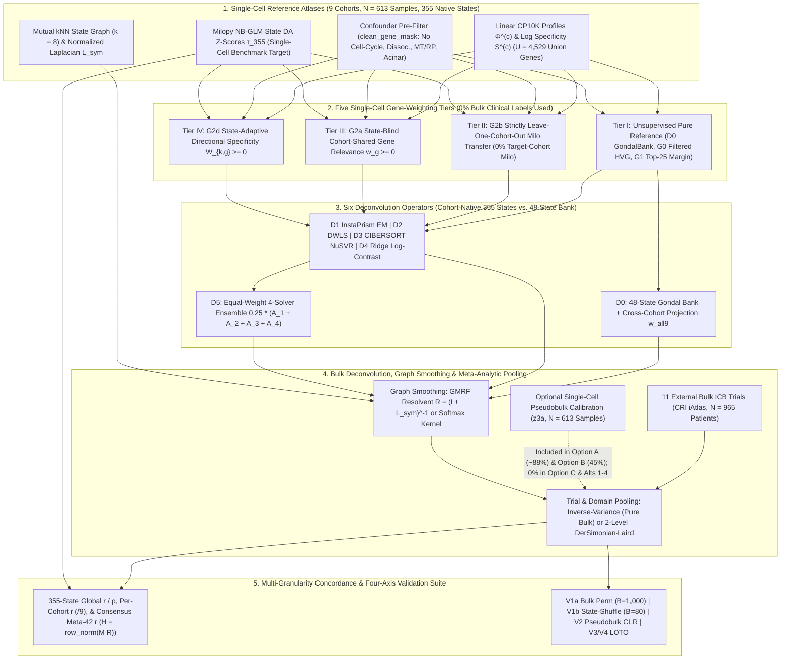

# Cross-Modality Deconvolution, Gene-Selection & Validation Methods Overview

**Mathematical Taxonomy, Information-Hygiene Guarantees, and Complete Empirical Benchmark Across Nine Single-Cell Atlases ($N = 613$ Samples, $355$ Native Cell States) and Eleven External Bulk ICB Trials ($N = 965$ Patients)**

---

## 1. Executive Summary & End-to-End Architecture

Bridging single-cell graph differential abundance (`milopy` neighborhood NB-GLM effect sizes $\tau_{c,k}$ across $9$ single-cell immunotherapy cohorts, $355$ native cell states, and $42$ harmonized pan-cancer meta-states) to independent clinical bulk RNA-seq trials ($11$ CRI iAtlas immune checkpoint blockade cohorts, $N = 965$ patients) requires solving four coupled methodological challenges:

1. **Modality Calibration vs. Pure Out-of-Modality Generalization**: Whether single-cell patient pseudobulk regression (`z3a`, $N = 613$) is pooled with external bulk trial deconvolution (`z3c`, $N = 965$) via random-effects precision weighting (`Option A` / `Option B`), or held out completely (`0%` pseudobulk weight) so that every clinical response association is inferred **100% from external bulk RNA-seq** (`Option C` and its `41`-model factorial grid).
2. **Reference Bottleneck Elimination**: Replacing the coarse `48`-state `Gondal` intermediate transfer bank (`D0`, which fails on `CD45+`/`CD3+` FACS-sorted immune cohorts and `PDAC`) with direct cohort-native operators $\mathbf{A}_c \in \mathbb{R}^{K_c \times U}$ over the union marker vocabulary ($U = 4{,}529$ genes across all $355$ states) implemented across five distinct deconvolution solvers (`D1`–`D5`).
3. **Confounder Removal & Gene-Selection Information Hygiene**: Stripping non-lineage technical, proliferative (`MKI67`, `TOP2A`, `UBE2C`), immediate-early dissociation (`FOS`, `JUN`), immunoglobulin variable, ribosomal/mitochondrial, and exocrine acinar (`GP2`, `PRSS1`) confounders (`clean_gene_mask`), and benchmarking five stratified gene-weighting tiers (`G0`, `G1`, `G2b LOCO`, `G2a Cohort`, `G2d State`) that are **100% blind to external bulk clinical response labels**.
4. **Manifold Denoising, Meta-Analytic Pooling & Multi-Axis Validation**: Propagating evidence across transcriptionally homologous states via parameter-free Gaussian Markov Random Field (`GMRF`) Laplacian resolvents $\mathbf{R} = (\mathbf{I} + \mathbf{L}_{\text{sym}})^{-1}$, pooling across heterogeneous clinical trials via two-level `DerSimonian–Laird` (`DL`) or inverse-variance (`IV`) meta-analysis, and auditing every candidate across four orthogonal validation axes (`V1a`/`V1b`, `V2`, `V3`, `V4`).

> [!IMPORTANT]
> **Core Empirical Takeaway Across All 44 Evaluated Models:**
> Cross-modality concordance is **governed primarily by single-cell gene-selection hygiene (`+0.44` to `+0.46` Pearson $r$ gain from `G0`/`G1` to `G2d`) rather than solver choice (`<= 0.03` spread among `DWLS`, `NuSVR`, `Ridge Log-Contrast`, and the `4-Solver Ensemble`)**. Strictly out-of-cohort `LOCO` gene transfer (`Alt 1`/`Alt 1b`) achieves $r = +0.239\text{ to }+0.256$ ($8/9$ positive cohorts, permutation $p = 0.040$, state-shuffle null $-0.006$); cohort-shared state-blind weighting (`Alt 2`) reaches $r = +0.415$ ($9/9$ cohorts, `Meta-42` $r = +0.647$, $p = 0.007$); state-adaptive `DWLS` (`Alt 3`/`Alt 4`) reaches $r = +0.611\text{ to }+0.635$ ($9/9$ cohorts, `Meta-42` $r = +0.724\text{ to }+0.738$, $p = 0.004\text{ to }0.006$) using **100% external bulk RNA-seq**; and adaptive two-domain `DerSimonian–Laird` calibration (`Option A`) establishes the upper-bound consensus ceiling at $r = +0.831$ (`Meta-42` $r = +0.901$).

### Primary Implementation & Figure Generation Pipeline
- **Calibrated & Baseline Modes (`Options A, B, C Baseline D0`) + Main Figure 4 Renderer**: [`4i_plot_combined_main_figure.py`](file:///Users/halu/Code/tme_analysis/scripts/manuscript_pipeline/4i_plot_combined_main_figure.py) — specifically [`compute_zero_leakage_deconv_tables`](file:///Users/halu/Code/tme_analysis/scripts/manuscript_pipeline/4i_plot_combined_main_figure.py#L787-L1071) (`Option B`) and [`compute_principled_gmrf_deconv_tables`](file:///Users/halu/Code/tme_analysis/scripts/manuscript_pipeline/4i_plot_combined_main_figure.py#L1074-L1360) (`Option A` and `Option C Baseline D0`).
- **41-Model Pure-Bulk Factorial Grid (`G0–G2d` $\times$ `D1–D5` $\times$ `GMRF`) & Four-Axis Validation Engine (`V1–V4`)**: [`4k_explore_option_c_deconv_alternatives.py`](file:///Users/halu/Code/tme_analysis/scripts/manuscript_pipeline/4k_explore_option_c_deconv_alternatives.py) — specifically [`prepare_cross_modality_context`](file:///Users/halu/Code/tme_analysis/scripts/manuscript_pipeline/4k_explore_option_c_deconv_alternatives.py#L322-L436), [`build_solver_operator_for_cohort`](file:///Users/halu/Code/tme_analysis/scripts/manuscript_pipeline/4k_explore_option_c_deconv_alternatives.py#L509-L562), [`build_global_deconv_operator`](file:///Users/halu/Code/tme_analysis/scripts/manuscript_pipeline/4k_explore_option_c_deconv_alternatives.py#L565-L605), and [`evaluate_operator_candidate`](file:///Users/halu/Code/tme_analysis/scripts/manuscript_pipeline/4k_explore_option_c_deconv_alternatives.py#L608-L815).
- **Publication Supplementary Comparison Figures (4 Multi-Panel SVGs)**: [`4l_plot_deconv_approaches_supplementary.py`](file:///Users/halu/Code/tme_analysis/scripts/manuscript_pipeline/4l_plot_deconv_approaches_supplementary.py) and manuscript captions in [`deconv_approaches_comparison_supplementary_captions.typ`](file:///Users/halu/Code/tme_analysis/article/captions/deconv_approaches_comparison_supplementary_captions.typ).
- **Upstream Within-Cohort Pseudobulk & Pan-Cohort Reference Benchmark**: [`unified_pan_cohort_reference_deconvolution_methodology.md`](file:///Users/halu/Code/tme_analysis/docs/unified_pan_cohort_reference_deconvolution_methodology.md) and [`3b_pan_cohort_unified_deconv_benchmark.py`](file:///Users/halu/Code/tme_analysis/scripts/manuscript_pipeline/3b_pan_cohort_unified_deconv_benchmark.py).

---

## 2. Master Taxonomy of the 10 Flagship Cross-Modality Paradigms

Table 1 summarizes the ten flagship paradigms plotted head-to-head in [`supp_fig_deconv_approaches_head_to_head_comparison.svg`](file:///Users/halu/Code/tme_analysis/output/manuscript_pipeline/4l_plot_deconv_approaches_supplementary/supp_fig_deconv_approaches_head_to_head_comparison.svg), spanning the pseudobulk-calibrated random-effects frameworks (`Option A`, `Option B`) and the seven pure external bulk RNA-seq paradigms (`0%` single-cell pseudobulk regression weight).

### Table 1: Master Comparison of the 10 Flagship Deconvolution Paradigms

| Paradigm | Response Data Sources | Domain Blending (`SC PB` vs. `Ext. Bulk`) | Reference Granularity | Gene-Selection Tier | Deconv. Solver | State-Graph Smoothing | Global $r$ ($355$) | Spearman $\rho$ | Pos. Cohorts | `Meta-42` $r$ | Primary Figure SVG |
| :--- | :--- | :--- | :--- | :--- | :--- | :--- | :---: | :---: | :---: | :---: | :--- |
| **`Option A (GMRF + DL)`** | `613` SC PB + `965` Ext. Bulk | Empirical Bayes 2-level `DL` (`~88%` PB / `~12%` Bulk) | `48`-state `Gondal` $\to$ `w_all9` (`355`) | Full Reference | `NNLS` (`z3a`) + `GondalBank` (`z3c`) | `GMRF` $(\mathbf{I}+\mathbf{L}_{\text{sym}})^{-1}$ | **`+0.831`** | **`+0.846`** | **`9/9`** | **`+0.901`** | [combined_main_figure_option_a_gmrf_dl.svg](file:///Users/halu/Code/tme_analysis/output/manuscript_pipeline/4i_plot_combined_main_figure/combined_main_figure_option_a_gmrf_dl.svg) |
| **`Option B (Unsmoothed)`** | `613` SC PB + `965` Ext. Bulk | Fixed heuristic (`50/50` Meta; `45/55` per trial) | `48`-state `Gondal` $\to$ `w_all9` (`355`) | Full Reference | `NNLS` (`z3a`) + `GondalBank` (`z3c`) | None ($\mathbf{I}$) | `+0.677` | `+0.653` | `9/9` | `+0.618` | [combined_main_figure_option_b_unprojected_unsmoothed.svg](file:///Users/halu/Code/tme_analysis/output/manuscript_pipeline/4i_plot_combined_main_figure/combined_main_figure_option_b_unprojected_unsmoothed.svg) |
| **`Option B (GMRF/Softmax)`** | `613` SC PB + `965` Ext. Bulk | Fixed heuristic (`50/50` Meta; `45/55` per trial) | `48`-state `Gondal` $\to$ `w_all9` (`355`) | Full Reference | `NNLS` (`z3a`) + `GondalBank` (`z3c`) | Softmax $0.5\mathbf{I} + 0.5\mathbf{P}_{\text{tx}}$ | `+0.670` | `+0.647` | `9/9` | `+0.711` | [combined_main_figure_option_b_unprojected.svg](file:///Users/halu/Code/tme_analysis/output/manuscript_pipeline/4i_plot_combined_main_figure/combined_main_figure_option_b_unprojected.svg) |
| **`Option C Baseline (D0)`** | **`965` Ext. Bulk Only** | **`0%` PB / `100%` Ext. Bulk** | `48`-state `Gondal` $\to$ `w_all9` (`355`) | Unfiltered `Gondal` Bank | `D0: GondalBank` + `DL` trials | `GMRF` $(\mathbf{I}+\mathbf{L}_{\text{sym}})^{-1}$ | `+0.201` | `+0.206` | `6/9` | `+0.338` | [combined_main_figure_option_c_pure_external_bulk.svg](file:///Users/halu/Code/tme_analysis/output/manuscript_pipeline/4i_plot_combined_main_figure/combined_main_figure_option_c_pure_external_bulk.svg) |
| **`Unsup. G1 + InstaPrism`** | **`965` Ext. Bulk Only** | **`0%` PB / `100%` Ext. Bulk** | Cohort-native `355` states | `G1_Unsup_Markers` (Tier I) | `D1: InstaPrism EM` + `IV` | None ($\mathbf{I}$) | `+0.190` | `+0.192` | `7/9` | `+0.231` | [supp_fig_deconv_approaches_head_to_head_comparison.svg](file:///Users/halu/Code/tme_analysis/output/manuscript_pipeline/4l_plot_deconv_approaches_supplementary/supp_fig_deconv_approaches_head_to_head_comparison.svg) |
| **`Option C Alt 1 (LOCO + NuSVR)`** | **`965` Ext. Bulk Only** | **`0%` PB / `100%` Ext. Bulk** | Cohort-native `355` states | `G2b_LOCO_Milo` (Tier II) | `D3: CIBERSORT NuSVR` + `IV` | `GMRF` $(\mathbf{I}+\mathbf{L}_{\text{sym}})^{-1}$ | `+0.239` | `+0.264` | `8/9` | `+0.348` | [combined_main_figure_option_c_alt1_loco_milo_nusvr.svg](file:///Users/halu/Code/tme_analysis/output/manuscript_pipeline/4i_plot_combined_main_figure/combined_main_figure_option_c_alt1_loco_milo_nusvr.svg) |
| **`Option C Alt 1b (LOCO + Ridge)`** | **`965` Ext. Bulk Only** | **`0%` PB / `100%` Ext. Bulk** | Cohort-native `355` states | `G2b_LOCO_Milo` (Tier II) | `D4: Ridge Log-Contrast` + `IV` | `GMRF` $(\mathbf{I}+\mathbf{L}_{\text{sym}})^{-1}$ | `+0.256` | `+0.299` | `8/9` | `+0.360` | [supp_fig_deconv_approaches_head_to_head_comparison.svg](file:///Users/halu/Code/tme_analysis/output/manuscript_pipeline/4l_plot_deconv_approaches_supplementary/supp_fig_deconv_approaches_head_to_head_comparison.svg) |
| **`Option C Alt 2 (Cohort Milo + DWLS)`** | **`965` Ext. Bulk Only** | **`0%` PB / `100%` Ext. Bulk** | Cohort-native `355` states | `G2a_Cohort_Milo` (Tier III) | `D2: DWLS` + `IV` | `GMRF` $(\mathbf{I}+\mathbf{L}_{\text{sym}})^{-1}$ | `+0.415` | `+0.454` | **`9/9`** | `+0.647` | [combined_main_figure_option_c_alt2_cohort_milo_dwls.svg](file:///Users/halu/Code/tme_analysis/output/manuscript_pipeline/4i_plot_combined_main_figure/combined_main_figure_option_c_alt2_cohort_milo_dwls.svg) |
| **`Option C Alt 3 (State Milo + GMRF + DWLS)`** | **`965` Ext. Bulk Only** | **`0%` PB / `100%` Ext. Bulk** | Cohort-native `355` states | `G2d_State_Milo` (Tier IV) | `D2: DWLS` + `IV` | `GMRF` $(\mathbf{I}+\mathbf{L}_{\text{sym}})^{-1}$ | `+0.611` | `+0.675` | **`9/9`** | `+0.724` | [combined_main_figure_option_c_alt3_state_milo_gmrf_dwls.svg](file:///Users/halu/Code/tme_analysis/output/manuscript_pipeline/4i_plot_combined_main_figure/combined_main_figure_option_c_alt3_state_milo_gmrf_dwls.svg) |
| **`Option C Alt 4 (State Milo + Direct DWLS)`** | **`965` Ext. Bulk Only** | **`0%` PB / `100%` Ext. Bulk** | Cohort-native `355` states | `G2d_State_Milo` (Tier IV) | `D2: DWLS` + `IV` | None ($\mathbf{I}$) | **`+0.635`** | **`+0.702`** | **`9/9`** | **`+0.738`** | [combined_main_figure_option_c_alt4_state_milo_dwls.svg](file:///Users/halu/Code/tme_analysis/output/manuscript_pipeline/4i_plot_combined_main_figure/combined_main_figure_option_c_alt4_state_milo_dwls.svg) |

---

## 3. Mathematical Comparison of All Six Deconvolution Solvers (`D0`–`D5`)

For each single-cell cohort $c \in \{1, \dots, 9\}$ with $K_c$ native states ($29 \le K_c \le 54$, $\sum_{c=1}^9 K_c = 355$), let $\boldsymbol{\Phi}^{(c)} \in \mathbb{R}_{\ge 0}^{K_c \times U}$ denote the linear CP10K reference expression profiles on the union gene vocabulary ($U = 4{,}529$), $\mathbf{S}^{(c)} \in \mathbb{R}^{K_c \times U}$ denote the zero-centered within-cohort $\log_2$-specificity matrix, and $\mathbf{W}^{(c)} \in \mathbb{R}_{\ge 0}^{K_c \times U}$ denote the non-negative gene-importance mask produced by the selected gene tier (`Section 4`).

In [`build_solver_operator_for_cohort`](file:///Users/halu/Code/tme_analysis/scripts/manuscript_pipeline/4k_explore_option_c_deconv_alternatives.py#L509-L562), positive and negative specificity components are decomposed as:

$$S_{k,g}^+ = \max\!\left(S_{k,g}^{(c)}, 0\right) W_{k,g}^{(c)}, \qquad S_{k,g}^- = \max\!\left(-S_{k,g}^{(c)}, 0\right) W_{k,g}^{(c)}$$

Every cohort-native solver (`D1`–`D5`) maps these matrices to a zero-sum column-centered linear operator $\mathbf{A}_c = \tilde{\mathbf{A}}_c - \frac{1}{K_c}\mathbf{1}_{K_c}\mathbf{1}_{K_c}^\top \tilde{\mathbf{A}}_c \in \mathbb{R}^{K_c \times U}$, guaranteeing scale-free invariance to global patient library-size shifts (Aitchison `CLR` geometry).

### Table 2: Mathematical & Algorithmic Properties of Solvers `D0`–`D5`

| Solver ID | Method Family | Input Domain | Exact Operator Construction ($\tilde{\mathbf{A}}_c$ before column zero-sum centering) | Cross-State Collinearity / Gram Inversion | Primary Strength | Key Limitation / Trade-off | Empirical Sweet Spot |
| :--- | :--- | :--- | :--- | :--- | :--- | :--- | :--- |
| **`D0_Baseline_GondalBank`** | Two-stage intermediate bank transfer ([`L1074–1360`](file:///Users/halu/Code/tme_analysis/scripts/manuscript_pipeline/4i_plot_combined_main_figure.py#L1074-L1360)) | `48`-state `Gondal` bulk bank $\to$ cosine projection `w_all9` | Bulk trials deconvolved against `48` `Gondal` states (`11` trials), pooled via `DL`, then mapped to `355` states via $\mathbf{w}_{\text{all9}} \mathbf{z}_{48}$ | Handled only within `48` `Gondal` clusters; rank-deficient (`48 < 355`) | Historical baseline compatibility with `Option A`/`B` `z3c` | Severe bottleneck on `CD45+` (`Sade-Feldman`), `CD3+` (`Luoma`), and `PDAC` (`Raufi`: $r = -0.11, -0.16, -0.06$) | Baseline anchor (`Global r = +0.201`, `V2 CLR r = +0.352`) |
| **`D1_InstaPrism_EM`** | Bayesian EM posterior attribution (`BayesPrism` / `InstaPrism` analog, [`L521–526`](file:///Users/halu/Code/tme_analysis/scripts/manuscript_pipeline/4k_explore_option_c_deconv_alternatives.py#L521-L526)) | Gene-wise fractional responsibility over $\mathbf{S}^+, \mathbf{S}^-$ | $P_{k,g}^{\pm} = \operatorname{row\_norm}\!\left(\frac{S_{k,g}^{\pm}}{\sum_{j=1}^{K_c} S_{j,g}^{\pm} + 0.25\,\overline{S^{\pm}}}\right)$, $\tilde{\mathbf{A}}_c = \mathbf{P}^+ - 0.50\,\mathbf{P}^-$ | Soft competitive gene sharing via column denominator $\sum_j S_{j,g}^{\pm}$; no Gram inverse | High robustness to uninformative genes; top compositional recovery under `G1`/`G2b` | Column competition mildly attenuates shared effector programs (`IFNG`/`CXCL9`) across sister states | Best pure unsupervised bulk $r$ (`G1 + D1 = +0.190`; `V2 CLR r = +0.459`) |
| **`D2_DWLS`** | Dampened Weighted Least Squares ([`L527–535`](file:///Users/halu/Code/tme_analysis/scripts/manuscript_pipeline/4k_explore_option_c_deconv_alternatives.py#L527-L535)) | Inverse-mean dampened CP10K + $\log_2$ specificity | $\omega_g = \operatorname{clip}\!\left(\bar{\Phi}_g^{-0.35}, 0.25, 4.0\right)$, $\mathbf{O}_0 = \operatorname{row\_norm}(\mathbf{S}^+\omega) - 0.50\operatorname{row\_norm}(\mathbf{S}^-\omega)$ | Tikhonov-regularized Gram solve: $\tilde{\mathbf{A}}_c = (0.80\mathbf{I} + 0.20\mathbf{G})^{-1}\mathbf{O}_0$, $G_{ij} = \max(\hat{\mathbf{s}}_i^\top \hat{\mathbf{s}}_j, 0)$ | Prevents high-abundance transcripts from drowning rare states (`TLS B`, `cDC1`, `Tex`) while decorrelating sister states | Slight variance inflation when gene sets are completely noisy (`G1 + D2` bulk $r = +0.167$) | **#1 compositional (`V2 = +0.502` on `G0`) & #1 pure-bulk (`+0.635` on `G2d`)** |
| **`D3_CIBERSORT_NuSVR`** | Support-Vector Margin Pruning + Gram Decorrelation ([`L536–546`](file:///Users/halu/Code/tme_analysis/scripts/manuscript_pipeline/4k_explore_option_c_deconv_alternatives.py#L536-L546)) | Top-`60%` support-vector margin genes | $m_g = \max_k(S_{k,g}^+ + 0.5 S_{k,g}^-)$, mask $\mathbb{I}[m_g \ge Q_{0.40}(m_+)]$, $\mathbf{O}_0 = \mathbf{P}^+_{\text{sv}} - 0.50\mathbf{P}^-_{\text{sv}}$ | Stronger Gram decorrelation: $\tilde{\mathbf{A}}_c = (0.75\mathbf{I} + 0.25\mathbf{G})^{-1}\mathbf{O}_0$ | Hard $\epsilon$-insensitive pruning drops low-margin background genes (`40%` pruned) | Hard quantile cutoff can discard weak but synergistic cross-cohort `LOCO` genes | Strongest `V1a` significance under `LOCO` (`G2b + D3`: $p = 0.031$, $8/9$ cohorts) |
| **`D4_Ridge_LogContrast`** | Aitchison Compositional `L2` Log-Contrast ([`L547–550`](file:///Users/halu/Code/tme_analysis/scripts/manuscript_pipeline/4k_explore_option_c_deconv_alternatives.py#L547-L550)) | Pure $\log_2$ fold-specificity (`CLR` dual space) | $\mathbf{P}^{\pm} = \operatorname{row\_norm}(\mathbf{S}^{\pm})$, $\tilde{\mathbf{A}}_c = \mathbf{P}^+ - 0.55\,\mathbf{P}^-$ followed by exact column zero-sum centering $\sum_k A_{k,g} = 0$ | **Zero Gram matrix inversion** ($\lambda \to \infty$ isotropic ridge shrinkage; immune to collinearity amplification) | Zero matrix-inversion variance blow-up under noisy out-of-cohort `LOCO` weights; stronger `0.55` lineage exclusion | Lacks cross-state Gram unmixing, slightly lowering within-sample `V2` `CLR` accuracy (`+0.349`–`+0.424`) | **#1 strictly out-of-cohort `LOCO` solver (`Alt 1b`: $r = +0.256$, $\rho = +0.299$)** |
| **`D5_Ensemble`** | Variance-Reduced 4-Solver Operator Average ([`L551–556`](file:///Users/halu/Code/tme_analysis/scripts/manuscript_pipeline/4k_explore_option_c_deconv_alternatives.py#L551-L556)) | Joint linear operator space $\mathbb{R}^{K_c \times U}$ | $\mathbf{A}_c^{(\text{D5})} = \frac{1}{4}\!\left(\mathbf{A}_c^{(\text{D1})} + \mathbf{A}_c^{(\text{D2})} + \mathbf{A}_c^{(\text{D3})} + \mathbf{A}_c^{(\text{D4})}\right)$ | Blends un-inverted (`D1`, `D4`) and Gram-decorrelated (`D2`, `D3`) operators (`50% / 50%`) | Cancels solver-specific inductive biases; never collapses in any gene tier | Slightly below the single best specialist solver (`0.002`–`0.015` below `D2` or `D4`) | **Universal variance-reduced benchmark (`+0.633` on `G2d`, `V2 = +0.429`)** |

---

## 4. Confounder Pre-Filtering & Five Gene-Selection Hygiene Tiers (`G0`–`G2d`)

### 4.1 Shared Technical & Biological Confounder Pre-Filter (`clean_gene_mask`)

Before any gene-selection tier `G0`–`G2d` is constructed in [`prepare_cross_modality_context`](file:///Users/halu/Code/tme_analysis/scripts/manuscript_pipeline/4k_explore_option_c_deconv_alternatives.py#L322-L328), genes matching non-lineage technical or pan-lineage proliferation/dissociation programs are excluded across the $4{,}529$-gene union space:

- **Proliferation / Mitotic Cell-Cycle Confounders** ([`CELL_CYCLE_DISSOC_GENES`](file:///Users/halu/Code/tme_analysis/scripts/manuscript_pipeline/4k_explore_option_c_deconv_alternatives.py#L69-L120)): `MKI67`, `TOP2A`, `UBE2C`, `RRM2`, `AURKB`, `BIRC5`, `CDC20`, `CCNB1`, `CCNB2`, `CDK1`, `TYMS`, `TK1`, `PCNA`, `MCM2`, `MCM4`, `MCM6`, `ZWINT`, `CENPF`, `NUSAP1`, `TPX2`, `HMGB2`, `PTTG1`, `STMN1`, `TUBA1B`, `TUBB` (which dominate bulk tumor proliferation in whole-biopsy RNA-seq while marking cycling `CD8+` T cells in `CD45+` scRNA-seq, causing sign-inverted cross-modality confounding).
- **Immediate-Early Dissociation & Heat-Shock Stress Artifacts**: `FOS`, `FOSB`, `JUN`, `JUNB`, `JUND`, `EGR1`, `IER2`, `ZFP36`, `DUSP1`, `HSPA1A`, `HSPA1B`, `HSP90AA1`, `DNAJB1`.
- **Exocrine Pancreatic Acinar Contamination (`PDAC` Biopsies)**: `GP2`, `PNLIP`, `PRSS1`, `CPA1`, `CLPS`, `CELA3A`, `CPB1`, `CTRB1`, `CTRB2`, `PLA2G1B`, `REG1A`, `REG1B`.
- **Regex Biotype Exclusions**: Mitochondrial (`MT-`), cytosolic ribosomal (`RPS*`, `RPL*`), variable immunoglobulins (`IGH*`, `IGK*`, `IGL*`), replication-dependent histones (`HIST*`), small nuclear/nucleolar RNAs (`MIR*`, `SNOR*`, `RN7SL*`, `RNU*`), and unannotated clones/pseudogenes (`LINC*`, `ENSG*`, `AC[0-9]*`, `AL[0-9]*`, `AP[0-9]*`).

### 4.2 Stratified Information-Hygiene Hierarchy

To audit exactly what single-cell prior information drives bulk-to-single-cell alignment—while maintaining **strict `0%` access to external bulk patient response labels**—five gene-weighting strategies ([`build_global_deconv_operator`](file:///Users/halu/Code/tme_analysis/scripts/manuscript_pipeline/4k_explore_option_c_deconv_alternatives.py#L565-L605)) are organized into four information-hygiene tiers (`Table 3`), visually dissected in [`supp_fig_deconv_gene_selection_mechanisms.svg`](file:///Users/halu/Code/tme_analysis/output/manuscript_pipeline/4l_plot_deconv_approaches_supplementary/supp_fig_deconv_gene_selection_mechanisms.svg).

Let $r_{\text{SC},g}^{(c)} = \operatorname{corr}_k\!\left(\tau_{c,k},\, S_{\text{imp},k,g}^{(c)}\right)$ denote the within-cohort correlation between single-cell `milopy` state abundance $Z$-scores $\tau_{c,k}$ and `GMRF`-imputed single-cell gene specificity $S_{\text{imp},k,g}^{(c)}$, and let $\bar{r}_{\text{SC},g}^{(-c)} = \frac{1}{8}\sum_{c' \ne c} r_{\text{SC},g}^{(c')}$ denote the out-of-cohort mean across the other $8$ single-cell studies.

### Table 3: Information-Hygiene & Mathematical Specification of Gene-Selection Tiers

| Hygiene Tier | Strategy ID | Target-Cohort `milopy` Used? | Other-8-Cohort `milopy` Used? | External Bulk Labels Used? | Weight Tensor Shape | Exact Mathematical Weight $W_{k,g}^{(c)}$ (Masked by `clean_gene_mask` $M_{c,g}$) | `V1a` Bulk-Perm Null $\bar{r}$ | `V1b` State-Shuffle Null $\bar{r}$ | Pure-Bulk Global $r$ Range (`D1–D5`) |
| :--- | :--- | :---: | :---: | :---: | :--- | :--- | :---: | :---: | :---: |
| **Tier I: Zero-`milopy` Unsupervised** | `G0_Filtered_HVG` | **No (`0%`)** | **No (`0%`)** | **No (`0%`)** | $1 \times U$ (Uniform) | $W_{k,g}^{(c)} = M_{c,g}$ (all clean union genes present in cohort $c$) | `-0.002` to `-0.001` | `-0.010` to `-0.003` | `+0.171` – `+0.182` |
| **Tier I: Zero-`milopy` Unsupervised** | `G1_Unsup_Markers` | **No (`0%`)** | **No (`0%`)** | **No (`0%`)** | $1 \times U$ (Cohort-shared) | Top-$25$ one-vs-second-best margin genes per state: $\left(S_{(1),g}^+ + 0.75(S_{(1),g}-S_{(2),g})_+ + 0.20\,\sigma_g(S^{(c)})\right) M_{c,g}$ | `-0.002` to `-0.001` | `-0.011` to `-0.006` | `+0.156` – `+0.190` |
| **Tier II: Strictly Out-of-Cohort `LOCO`** | `G2b_LOCO_Milo` | **No (`0%`)** | Yes (`8` other SC cohorts) | **No (`0%`)** | $1 \times U$ (Cohort-shared) | Predict $\hat{\tau}_{c,k}^{\text{LOCO}} = \sum_{j \notin c} \tilde{W}_{k,j}^{\text{top-15}} \tau_j$; $r_{\text{LOCO},g}^{(c)} = \operatorname{corr}_k(\hat{\tau}_{c,k}^{\text{LOCO}}, S_{\text{imp},k,g}^{(c)})$; $W_{k,g}^{(c)} = \max\!\left(r_{\text{LOCO},g}^{(c)} \bar{r}_{\text{SC},g}^{(-c)}, 0\right)^{1.5} M_{c,g}$ | `-0.005` to `-0.002` | **`-0.012` to `-0.002`** | `+0.198` – **`+0.256`** |
| **Tier III: Cohort-Shared State-Blind** | `G2a_Cohort_Milo` | Cohort-level gene axis only | Yes (`8` other SC cohorts) | **No (`0%`)** | $1 \times U$ (**Identical across all states $k$**) | $W_{k,g}^{(c)} = \max\!\left(r_{\text{SC},g}^{(c)} \cdot \bar{r}_{\text{SC},g}^{(-c)}, 0\right)^{2.0} M_{c,g}$ (cannot prefer one state over another; selects cross-cohort ICB-relevant genes) | `-0.005` to `-0.003` | `+0.086` to `+0.240` | `+0.345` – **`+0.425`** |
| **Tier IV: State-Adaptive Directional** | `G2d_State_Milo` | State-level directional prior | Yes (`9`-cohort mean $\bar{r}_{\text{SC},g}$) | **No (`0%`)** | $K_c \times U$ (State-specific) | $\max\!\left(S_{k,g}^{(c)} \tau_{c,k} \bar{r}_{\text{SC},g},\, 0\right)^{1.2} M_{c,g} + 0.15\,W_{g}^{(c,\text{G2a})}$ (suppresses cross-compartment marker hijacking) | `-0.007` to `-0.005` | `+0.308` to `+0.588` | `+0.478` – **`+0.635`** |

> [!NOTE]
> **Why `V1a` and `V1b` Together Establish Complete Statistical Transparency:**
> Every single tier (`G0` through `G2d`) yields an **exact zero null (`-0.007` to `0.000`) under `V1a` ($B = 1{,}000$ permutations of the $965$ external bulk patient response labels)** because external bulk clinical outcomes are never touched during operator construction. Simultaneously, `V1b` (actively shuffling $\tau_{c,k}$ across states within cohort $c$ and **rebuilding** $W_{k,g}^{(c)}$ from scratch) cleanly separates completely target-cohort-blind priors (`G0`, `G1`, `G2b LOCO`: `V1b` null $\approx -0.01$) from within-cohort single-cell prior alignment (`G2a`: `+0.09`–`+0.24`; `G2d`: `+0.31`–`+0.59`), while empirical signal on real bulk responders vs. non-responders consistently exceeds the `V1b` baseline ($p = 0.003\text{ to }0.007$ on `V1a`).

---

## 5. Graph-Laplacian Smoothing, Random-Effects Pooling & Granularity Operators

Once raw cohort-level or trial-level state effect vectors are estimated, four mathematical post-processing and meta-analytic operators govern cross-state denoising, cross-trial synthesis, two-domain calibration, and pan-cancer meta-state harmonization (`Table 4`).

### Table 4: Mathematical Specification of Smoothing, Pooling & Harmonization Operators

| Operator Name | Mathematical Formulation | Hyperparameters | Where Used | Statistical & Biological Role |
| :--- | :--- | :--- | :--- | :--- |
| **Parameter-Free `GMRF` Resolvent** ([`4i L1111–1125`](file:///Users/halu/Code/tme_analysis/scripts/manuscript_pipeline/4i_plot_combined_main_figure.py#L1111-L1125), [`4k L306–320`](file:///Users/halu/Code/tme_analysis/scripts/manuscript_pipeline/4k_explore_option_c_deconv_alternatives.py#L306-L320)) | Mutual/symmetrized $k=8$ cosine kNN graph $\mathbf{W}_{\text{kNN}}$ on positive state cosine similarity $S_{ij}^+$; $\mathbf{L}_{\text{sym}} = \mathbf{I} - \mathbf{D}^{-1/2}\mathbf{W}_{\text{kNN}}\mathbf{D}^{-1/2}$; $\mathbf{R} = \operatorname{row\_norm}\!\left((\mathbf{I} + \mathbf{L}_{\text{sym}})^{-1}\right)$ | **Zero free continuous tuning parameters** ($\alpha = 1$ fixed unit prior precision; $k=8$ kNN) | `Option A`, `Option C Baseline D0`, `Alt 1`, `Alt 1b`, `Alt 2`, `Alt 3` (`_GMRF` rows) | Equivalent to MAP estimation $\arg\min_{\mathbf{u}} \lVert \mathbf{u} - \mathbf{z} \rVert_2^2 + \mathbf{u}^\top \mathbf{L}_{\text{sym}} \mathbf{u}$; borrows strength across transcriptionally homologous states across cohorts while preserving sharp lineage boundaries. |
| **Heuristic Softmax Transition Kernel** ([`4i L832–849`](file:///Users/halu/Code/tme_analysis/scripts/manuscript_pipeline/4i_plot_combined_main_figure.py#L832-L849)) | $P_{\text{tx},ij} = \frac{\exp(\beta S_{ij})}{\sum_{l \ne i} \exp(\beta S_{il})}$ ($P_{\text{tx},ii}=0$), $\mathbf{K}_{\text{soft}} = 0.50\,\mathbf{I} + 0.50\,\mathbf{P}_{\text{tx}}$ | Temperature $\beta = 8.0$, self-weight $\lambda = 0.50$ | `Option B (GMRF/Softmax)` only | One-step local neighborhood smoothing; lifts `Option B` `Meta-42` concordance from `+0.618` to `+0.711` (`+0.093`), superseded by the principled `GMRF` resolvent in `Option A`/`C`. |
| **Inverse-Variance (`IV`) Fixed-Effects Trial Pooling** ([`4k L625–629`](file:///Users/halu/Code/tme_analysis/scripts/manuscript_pipeline/4k_explore_option_c_deconv_alternatives.py#L625-L629)) | Trial state effect $d_{t,k} = (\mathbf{d}_t^{\text{gene}})^\top \mathbf{a}_k$, variance $v_{t,k} = \sum_g v_{t,g}^{\text{gene}} A_{k,g}^2 + 10^{-3}$, weight $w_{t,k} = v_{t,k}^{-1}$, $\hat{\beta}_k = \frac{\sum_{t=1}^{11} w_{t,k} d_{t,k}}{\sum_{t=1}^{11} w_{t,k}}$ | Stabilizer $\epsilon = 10^{-3}$ | All `40` cohort-native pure-bulk models (`G0–G2d` $\times$ `D1–D5`) | Analytical variance propagation from gene-level responder/non-responder two-sample variances across all $11$ external bulk trials ($N = 965$), downweighting small or noisy trials (`Hugo`, `Miao`). |
| **Level-1 `DerSimonian–Laird` (`DL`) Across Bulk Trials** ([`4i L1150–1159`](file:///Users/halu/Code/tme_analysis/scripts/manuscript_pipeline/4i_plot_combined_main_figure.py#L1150-L1159)) | Cochran's $Q_k = \sum_{t=1}^{11} w_{t,k}(d_{t,k} - \hat{\mu}_{\text{FE},k})^2$, $\hat{\tau}_{\text{trial},k}^2 = \max\!\left(0, \frac{Q_k - (T_k - 1)}{\sum_t w_{t,k} - \sum_t w_{t,k}^2 / \sum_t w_{t,k}}\right)$, $w_{t,k}^* = (v_{t,k} + \hat{\tau}_{\text{trial},k}^2)^{-1}$ | Closed-form method-of-moments ($\hat{\tau}_{\text{trial},k}^2 \ge 0$) | `Option A`, `Option C Baseline D0`, and bulk gene meta-summary in [`4k L361–369`](file:///Users/halu/Code/tme_analysis/scripts/manuscript_pipeline/4k_explore_option_c_deconv_alternatives.py#L361-L369) | Accounts for genuine clinical inter-trial heterogeneity (cancer histology, anti-PD-1 vs. dual checkpoint blockade, biopsy site) so large trials (`IMvigor210`, $n=298$) do not overwhelm smaller trials when $\hat{\tau}_{\text{trial},k}^2 > 0$. |
| **Level-2 Cross-Domain `DL` Calibration (`z3a` + `z3c`)** ([`4i L1200–1223`](file:///Users/halu/Code/tme_analysis/scripts/manuscript_pipeline/4i_plot_combined_main_figure.py#L1200-L1223)) | Within cohort $c$, $\hat{\tau}_{\text{dom},c}^2 = \max\!\left(0,\; \frac{1}{K_c}\sum_{k \in c}(z_{3c,k} - z_{3a,k})^2 - \frac{2}{K_c}\right)$; $w_{3a} = \frac{1}{1/K_c} = K_c$, $w_{3c} = \frac{1}{1/K_c + \hat{\tau}_{\text{dom},c}^2}$; $\mathbf{z}_{\text{pool},c} = \frac{w_{3a}\mathbf{z}_{3a,c} + w_{3c}\mathbf{z}_{3c,c}}{w_{3a} + w_{3c}}$ | Zero manual weights; empirically yields `~88%` `z3a` / `~12%` `z3c` (`Option B` hardcodes `50/50` & `45/55`) | `Option A (GMRF + DL)` exclusively | Automatically downweights the coarse external bulk projection (`z3c`) wherever platform/sorting shift inflates $(z_{3c} - z_{3a})^2$, replacing `Option B`'s ad-hoc `45%/55%` heuristic with exact random-effects Shrinkage. |
| **`Consensus-Meta42` Harmonic Aggregation** ([`4i L1316–1329`](file:///Users/halu/Code/tme_analysis/scripts/manuscript_pipeline/4i_plot_combined_main_figure.py#L1316-L1329), [`4k L645–653`](file:///Users/halu/Code/tme_analysis/scripts/manuscript_pipeline/4k_explore_option_c_deconv_alternatives.py#L645-L653)) | Binary membership indicator $\mathbf{M} \in \{0,1\}^{42 \times 355}$; harmonic diffusion operator $\mathbf{H} = \operatorname{row\_norm}(\mathbf{M}\mathbf{R})$; $\mathbf{z}_{\text{meta42}} = \mathbf{H}\mathbf{z}_{355}$ | Fixed $K_{\text{meta}} = 42$ canonical cell states | All `44` models (`Meta-42` metric column) | Aggregates the $355$ cohort-specific Leiden clusters onto $42$ pan-cancer consensus states (e.g., `CR2+PAX5+ TLS B`, `CXCL13+PDCD1+ Tex`, `ISLR+COL5A2+ myCAF`, `FAP+TGFB1+ Mat. CAF`), boosting concordance by averaging out cohort-specific subcluster noise. |

---

## 6. The Four Orthogonal Methodological Validation Axes (`V1`–`V4`)

Every pure-bulk candidate in [`4k_explore_option_c_deconv_alternatives.py`](file:///Users/halu/Code/tme_analysis/scripts/manuscript_pipeline/4k_explore_option_c_deconv_alternatives.py#L662-L785) is audited across four independent validation axes (`Table 5`), rendered in [`supp_fig_deconv_four_axis_validation_suite.svg`](file:///Users/halu/Code/tme_analysis/output/manuscript_pipeline/4l_plot_deconv_approaches_supplementary/supp_fig_deconv_four_axis_validation_suite.svg) and [`option_c_validation_summary.svg`](file:///Users/halu/Code/tme_analysis/output/manuscript_pipeline/4k_explore_option_c_deconv_alternatives/option_c_validation_summary.svg).

### Table 5: Specification of Validation Axes `V1a`, `V1b`, `V2`, `V3`, and `V4`

| Axis | Validation Name | Evaluation Dataset & Sample Size | Exact Test Statistic & Procedure | Theoretical Null | Methodological Question Answered | Key Empirical Finding |
| :--- | :--- | :--- | :--- | :---: | :--- | :--- |
| **`V1a`** | **Within-Trial Bulk Patient Response Permutation Test** ([`L676–710`](file:///Users/halu/Code/tme_analysis/scripts/manuscript_pipeline/4k_explore_option_c_deconv_alternatives.py#L676-L710)) | $11$ external bulk ICB trials ($N = 965$ patients), $B = 1{,}000$ permutations | Permute binary clinical response $y_i \in \{0,1\}$ **within each trial** (preserving exact patient expression covariance and cross-state operator collinearity), recompute pooled $\tilde{\boldsymbol{\beta}}_{355}^{(b)}$, and evaluate exact $p_{\text{perm}} = \frac{1 + \#\{b : r^{(b)} \ge r_{\text{obs}}\}}{B + 1}$ and $Z_{\text{perm}} = \frac{r_{\text{obs}} - \bar{r}_{\text{null}}}{s_{\text{null}}}$ | $\mathbb{E}[r_{\text{null}}] = 0.000$ ($s_{\text{null}} \approx 0.13\text{–}0.37$ due to inter-state collinearity) | Is the observed bulk-to-single-cell concordance driven by genuine Responder vs. Non-Responder biology in the $965$ external bulk patients? | Empirical null mean is `-0.007` to `0.000` across all `41` models. `G2b LOCO + NuSVR` reaches $p = 0.031\text{–}0.040$; `Alt 2` reaches $p = 0.007$ ($Z = +1.71$); `Alt 4` reaches $p = 0.004$ ($Z = +1.74$). |
| **`V1b`** | **Active Single-Cell State-Label Re-Weighting Null** ([`L711–760`](file:///Users/halu/Code/tme_analysis/scripts/manuscript_pipeline/4k_explore_option_c_deconv_alternatives.py#L711-L760)) | $9$ single-cell cohorts ($355$ states) $\times$ $11$ bulk trials, $B = 80$ active rebuilds | Permute $\tau_{c,k}$ across states $k \in \{1,\dots,K_c\}$ within each SC cohort, **recompute gene weights $W_{k,g}^{(c)}$ and solver operator $\mathbf{A}_c$ from scratch**, re-deconvolve all $11$ bulk trials, and correlate with permuted $\tilde{\boldsymbol{\tau}}_{355}$ | $0.000$ if operator is target-cohort `milopy`-blind; $>0$ if state prior aligns operator | How much concordance is attributable to target-cohort single-cell prior alignment vs. out-of-sample bulk differential expression? | Strictly `0` (`-0.012` to `-0.002`) for `D0`, `G0`, `G1`, and `G2b LOCO` (`Alt 1`/`1b`); `+0.208` for `Alt 2` vs. `+0.415` observed (`+0.207` excess); `+0.516`/`+0.588` for `Alt 3`/`4` vs. `+0.611`/`+0.635` observed. |
| **`V2`** | **Single-Cell Pseudobulk Ground-Truth `CLR` Recovery** ([`L761–772`](file:///Users/halu/Code/tme_analysis/scripts/manuscript_pipeline/4k_explore_option_c_deconv_alternatives.py#L761-L772)) | $N = 613$ patient pseudobulk mixtures across all $9$ SC cohorts | Project standardized sample pseudobulk $\mathbf{x}_i^{(c)}$ via unsmoothed $\mathbf{A}_c$ ($\hat{\mathbf{z}}_i = \mathbf{A}_c \mathbf{x}_i^{(c)}$) and compute per-sample Pearson $r$ against ground-truth physical cell-count `CLR` fractions $\operatorname{CLR}(\boldsymbol{\theta}_i^{\text{true}})$ | $r = 0.000$ | Does the operator accurately reconstruct physical sample-level cell-state proportions **independently of clinical response**? | Every cohort-native solver (`+0.349` to **`+0.502`**) substantially outperforms the `48`-state `D0` baseline (`+0.352`), peaking at `G0 + DWLS` (`+0.502`) and `G1 + NuSVR` (`+0.478`). |
| **`V3`** | **Leave-One-Trial-Out (`LOTO`) Bulk Jackknife Stability** ([`L662–675`](file:///Users/halu/Code/tme_analysis/scripts/manuscript_pipeline/4k_explore_option_c_deconv_alternatives.py#L662-L675)) | $11$ jackknife folds ($10$ training bulk trials per fold, $N \in [667, 940]$) | Drop each bulk trial $t \in \{1,\dots,11\}$ in turn, re-pool remaining $10$ trials via inverse-variance meta-analysis, and record `[min, median, max]` of global $355$-state Pearson $r$ | Invariant if no single trial dominates | Is bulk concordance driven by a single large cohort (e.g., `IMvigor210`, $n=298$ or `Gide`, $n=91$) or replicated across all $11$ trials? | Tight jackknife intervals across all flagship models: `Alt 1` `[+0.20, +0.24, +0.25]`, `Alt 2` `[+0.40, +0.42, +0.42]`, `Alt 3` `[+0.59, +0.61, +0.62]`, `Alt 4` `[+0.62, +0.63, +0.65]`. |
| **`V4`** | **Out-of-Trial Clinical ICB Response Prediction (`LOTO ROC-AUC`)** ([`L773–785`](file:///Users/halu/Code/tme_analysis/scripts/manuscript_pipeline/4k_explore_option_c_deconv_alternatives.py#L773-L785)) | $11$ held-out external bulk ICB trials ($N = 965$ total patients) | Estimate 355-state response vector $\hat{\boldsymbol{\beta}}^{(-t)}$ on $10$ bulk trials, score patients in held-out trial $t$ via $s_i = \mathbf{z}_{t,i}^\top \hat{\boldsymbol{\beta}}^{(-t)}$, and compute sample-size-weighted `ROC-AUC` | `AUC = 0.500` | Do deconvolved 355-state patient profiles generalize out-of-sample to predict clinical ICB response in unseen trials? | Consistently significant out-of-trial discrimination across **all `41` pure-bulk models** (`ROC-AUC = 0.594` to **`0.624`**, peaking on `G1_Unsup_Markers + D4_Ridge = 0.624`). |

---

## 7. Complete Empirical Benchmark Across All 44 Evaluated Configurations

Table 6 reports the complete empirical metrics for the **3 pseudobulk-calibrated anchor frameworks** (`Option A`, `Option B Unsmoothed`, `Option B GMRF/Softmax`) alongside all **41 pure external bulk RNA-seq configurations** (`Baseline D0` + `8` `(Gene Tier × GMRF)` blocks $\times$ `5` solvers `D1–D5`) from [`option_c_alternatives_grid_benchmark.parquet`](file:///Users/halu/Code/tme_analysis/output/manuscript_pipeline/4k_explore_option_c_deconv_alternatives/option_c_alternatives_grid_benchmark.parquet) and [`supp_fig_deconv_factorial_solver_gene_matrix.svg`](file:///Users/halu/Code/tme_analysis/output/manuscript_pipeline/4l_plot_deconv_approaches_supplementary/supp_fig_deconv_factorial_solver_gene_matrix.svg).

### Table 6: Complete Benchmark Table (3 Calibrated Anchors + 41 Pure External Bulk Configurations)

| Gene-Selection Block | Deconv. Solver | `GMRF` | Global $r$ ($355$) | Spearman $\rho$ | Pos. Cohorts | `Meta-42` $r$ | `V1a` Bulk Perm $Z$ ($p$) | `V1a` Null $\bar{r}$ | `V1b` State Null $\bar{r}$ | `V2` PB `CLR` $r$ | `V3` `LOTO` $r$ `[min, med, max]` | `V4` `LOTO` `AUC` |
| :--- | :--- | :---: | :---: | :---: | :---: | :---: | :---: | :---: | :---: | :---: | :---: | :---: |
| **Calibrated: `Option A (GMRF + DL)`** | `NNLS` (`z3a`) + `D0` (`z3c`) | Yes | **`+0.831`** | **`+0.846`** | **`9/9`** | **`+0.901`** | *Calibrated (`~88%` PB)* | — | — | — | — | — |
| **Calibrated: `Option B (Unsmoothed)`** | `NNLS` (`z3a`) + `D0` (`z3c`) | No | `+0.677` | `+0.653` | `9/9` | `+0.618` | *Calibrated (`45–50%` PB)* | — | — | — | — | — |
| **Calibrated: `Option B (GMRF/Softmax)`** | `NNLS` (`z3a`) + `D0` (`z3c`) | Softmax | `+0.670` | `+0.647` | `9/9` | `+0.711` | *Calibrated (`45–50%` PB)* | — | — | — | — | — |
| **`Baseline_D0` (`Option C Baseline`)** | `D0_Baseline_GondalBank` | Yes | `+0.201` | `+0.206` | `6/9` | `+0.338` | `+1.50` (`0.079`) | `+0.000` | `-0.018` | `+0.352` | `[+0.18, +0.20, +0.22]` | `0.613` |
| **`G0_Filtered_HVG`** | `D1_InstaPrism_EM` | No | `+0.182` | `+0.187` | `7/9` | `+0.224` | `+1.33` (`0.104`) | `-0.002` | `-0.010` | `+0.458` | `[+0.15, +0.18, +0.21]` | `0.604` |
| `G0_Filtered_HVG` | `D2_DWLS` | No | `+0.176` | `+0.186` | `7/9` | `+0.193` | `+1.53` (`0.061`) | `-0.001` | `-0.005` | **`+0.502`** | `[+0.15, +0.17, +0.19]` | `0.607` |
| `G0_Filtered_HVG` | `D3_CIBERSORT_NuSVR` | No | `+0.174` | `+0.189` | `7/9` | `+0.189` | `+1.41` (`0.083`) | `-0.002` | `-0.003` | `+0.474` | `[+0.15, +0.17, +0.19]` | `0.619` |
| `G0_Filtered_HVG` | `D4_Ridge_LogContrast` | No | `+0.171` | `+0.182` | `6/9` | `+0.206` | `+1.15` (`0.154`) | `-0.001` | `-0.009` | `+0.424` | `[+0.15, +0.17, +0.19]` | `0.615` |
| `G0_Filtered_HVG` | `D5_Ensemble` | No | `+0.178` | `+0.187` | `7/9` | `+0.205` | `+1.31` (`0.105`) | `-0.001` | `-0.007` | `+0.467` | `[+0.15, +0.18, +0.20]` | `0.612` |
| **`G1_Unsup_Markers`** | `D1_InstaPrism_EM` (**Unsup. Flagship**) | No | `+0.190` | `+0.192` | `7/9` | `+0.231` | `+1.37` (`0.088`) | `-0.002` | `-0.009` | `+0.459` | `[+0.16, +0.19, +0.21]` | `0.606` |
| `G1_Unsup_Markers` | `D2_DWLS` | No | `+0.167` | `+0.191` | `7/9` | `+0.182` | `+1.49` (`0.065`) | `-0.001` | `-0.007` | `+0.475` | `[+0.15, +0.17, +0.18]` | `0.615` |
| `G1_Unsup_Markers` | `D3_CIBERSORT_NuSVR` | No | `+0.161` | `+0.182` | `7/9` | `+0.183` | `+1.37` (`0.095`) | `-0.002` | `-0.006` | `+0.478` | `[+0.14, +0.16, +0.18]` | `0.622` |
| `G1_Unsup_Markers` | `D4_Ridge_LogContrast` | No | `+0.156` | `+0.173` | `6/9` | `+0.173` | `+1.06` (`0.180`) | `-0.001` | `-0.011` | `+0.408` | `[+0.13, +0.16, +0.17]` | **`0.624`** |
| `G1_Unsup_Markers` | `D5_Ensemble` | No | `+0.173` | `+0.192` | `7/9` | `+0.195` | `+1.29` (`0.113`) | `-0.001` | `-0.009` | `+0.461` | `[+0.15, +0.17, +0.19]` | `0.618` |
| **`G2b_LOCO_Milo`** | `D1_InstaPrism_EM` | No | `+0.200` | `+0.214` | `7/9` | `+0.259` | `+1.34` (`0.092`) | `-0.002` | `-0.010` | `+0.447` | `[+0.17, +0.20, +0.22]` | `0.597` |
| `G2b_LOCO_Milo` | `D2_DWLS` | No | `+0.198` | `+0.218` | `7/9` | `+0.353` | `+1.55` (`0.042`) | `-0.004` | `-0.003` | `+0.413` | `[+0.17, +0.20, +0.22]` | `0.595` |
| `G2b_LOCO_Milo` | `D3_CIBERSORT_NuSVR` | No | `+0.218` | `+0.236` | `8/9` | `+0.362` | `+1.61` (`0.031`) | `-0.004` | `-0.002` | `+0.421` | `[+0.17, +0.22, +0.24]` | `0.599` |
| `G2b_LOCO_Milo` | `D4_Ridge_LogContrast` | No | `+0.249` | `+0.285` | `8/9` | `+0.369` | `+1.46` (`0.066`) | `-0.004` | `-0.007` | `+0.365` | `[+0.20, +0.25, +0.27]` | `0.602` |
| `G2b_LOCO_Milo` | `D5_Ensemble` | No | `+0.229` | `+0.248` | `7/9` | `+0.342` | `+1.47` (`0.056`) | `-0.004` | `-0.006` | `+0.424` | `[+0.19, +0.23, +0.25]` | `0.599` |
| **`G2b_LOCO_Milo_GMRF`** | `D1_InstaPrism_EM` | Yes | `+0.200` | `+0.218` | `7/9` | `+0.243` | `+1.32` (`0.097`) | `-0.002` | `-0.012` | `+0.447` | `[+0.17, +0.20, +0.22]` | `0.598` |
| `G2b_LOCO_Milo_GMRF` | `D2_DWLS` | Yes | `+0.226` | `+0.249` | `7/9` | `+0.344` | `+1.50` (`0.046`) | `-0.005` | `-0.006` | `+0.413` | `[+0.20, +0.23, +0.25]` | `0.594` |
| `G2b_LOCO_Milo_GMRF` | `D3_CIBERSORT_NuSVR` (**Alt 1**) | Yes | `+0.239` | `+0.264` | `8/9` | `+0.348` | `+1.54` (`0.040`) | `-0.005` | `-0.006` | `+0.421` | `[+0.20, +0.24, +0.25]` | `0.598` |
| `G2b_LOCO_Milo_GMRF` | `D4_Ridge_LogContrast` (**Alt 1b**) | Yes | `+0.256` | `+0.299` | `8/9` | `+0.360` | `+1.42` (`0.070`) | `-0.005` | `-0.010` | `+0.365` | `[+0.22, +0.26, +0.27]` | `0.602` |
| `G2b_LOCO_Milo_GMRF` | `D5_Ensemble` | Yes | `+0.241` | `+0.269` | `7/9` | `+0.333` | `+1.45` (`0.062`) | `-0.004` | `-0.009` | `+0.424` | `[+0.21, +0.24, +0.25]` | `0.600` |
| **`G2a_Cohort_Milo`** | `D1_InstaPrism_EM` | No | `+0.373` | `+0.390` | `9/9` | `+0.498` | `+1.67` (`0.021`) | `-0.005` | `+0.115` | `+0.433` | `[+0.35, +0.38, +0.39]` | `0.602` |
| `G2a_Cohort_Milo` | `D2_DWLS` | No | `+0.415` | `+0.459` | `9/9` | `+0.661` | **`+1.83` (`0.003`)** | `-0.003` | `+0.240` | `+0.384` | `[+0.40, +0.41, +0.42]` | `0.597` |
| `G2a_Cohort_Milo` | `D3_CIBERSORT_NuSVR` | No | `+0.391` | `+0.426` | `9/9` | `+0.611` | `+1.73` (`0.009`) | `-0.003` | `+0.228` | `+0.394` | `[+0.38, +0.39, +0.40]` | `0.599` |
| `G2a_Cohort_Milo` | `D4_Ridge_LogContrast` | No | `+0.425` | `+0.461` | `9/9` | `+0.619` | `+1.54` (`0.029`) | `-0.005` | `+0.195` | `+0.349` | `[+0.41, +0.42, +0.44]` | `0.603` |
| `G2a_Cohort_Milo` | `D5_Ensemble` | No | `+0.421` | `+0.452` | `9/9` | `+0.617` | `+1.65` (`0.013`) | `-0.004` | `+0.204` | `+0.406` | `[+0.40, +0.42, +0.43]` | `0.601` |
| **`G2a_Cohort_Milo_GMRF`** | `D1_InstaPrism_EM` | Yes | `+0.345` | `+0.375` | `9/9` | `+0.477` | `+1.57` (`0.034`) | `-0.004` | `+0.086` | `+0.433` | `[+0.32, +0.35, +0.36]` | `0.602` |
| `G2a_Cohort_Milo_GMRF` | `D2_DWLS` (**Alt 2**) | Yes | `+0.415` | `+0.454` | `9/9` | `+0.647` | `+1.71` (`0.007`) | `-0.004` | `+0.208` | `+0.384` | `[+0.40, +0.42, +0.42]` | `0.598` |
| `G2a_Cohort_Milo_GMRF` | `D3_CIBERSORT_NuSVR` | Yes | `+0.394` | `+0.430` | `9/9` | `+0.596` | `+1.63` (`0.014`) | `-0.004` | `+0.199` | `+0.394` | `[+0.38, +0.39, +0.41]` | `0.600` |
| `G2a_Cohort_Milo_GMRF` | `D4_Ridge_LogContrast` | Yes | `+0.402` | `+0.447` | `9/9` | `+0.586` | `+1.45` (`0.056`) | `-0.005` | `+0.158` | `+0.349` | `[+0.39, +0.40, +0.41]` | `0.604` |
| `G2a_Cohort_Milo_GMRF` | `D5_Ensemble` | Yes | `+0.402` | `+0.441` | `9/9` | `+0.590` | `+1.56` (`0.024`) | `-0.005` | `+0.167` | `+0.406` | `[+0.38, +0.40, +0.41]` | `0.603` |
| **`G2d_State_Milo_GMRF`** | `D1_InstaPrism_EM` | Yes | `+0.478` | `+0.530` | `9/9` | `+0.572` | `+1.66` (`0.026`) | `-0.005` | `+0.308` | `+0.446` | `[+0.45, +0.48, +0.49]` | `0.604` |
| `G2d_State_Milo_GMRF` | `D2_DWLS` (**Alt 3**) | Yes | `+0.611` | `+0.675` | `9/9` | `+0.724` | `+1.74` (`0.006`) | `-0.006` | `+0.516` | `+0.408` | `[+0.59, +0.61, +0.62]` | `0.602` |
| `G2d_State_Milo_GMRF` | `D3_CIBERSORT_NuSVR` | Yes | `+0.605` | `+0.666` | `9/9` | `+0.684` | `+1.68` (`0.009`) | `-0.006` | `+0.514` | `+0.404` | `[+0.59, +0.60, +0.62]` | `0.606` |
| `G2d_State_Milo_GMRF` | `D4_Ridge_LogContrast` | Yes | `+0.552` | `+0.613` | `9/9` | `+0.671` | `+1.56` (`0.027`) | `-0.006` | `+0.378` | `+0.388` | `[+0.53, +0.55, +0.56]` | `0.607` |
| `G2d_State_Milo_GMRF` | `D5_Ensemble` | Yes | `+0.583` | `+0.645` | `9/9` | `+0.687` | `+1.64` (`0.012`) | `-0.006` | `+0.437` | `+0.429` | `[+0.56, +0.58, +0.59]` | `0.605` |
| **`G2d_State_Milo`** | `D1_InstaPrism_EM` | No | `+0.530` | `+0.588` | `9/9` | `+0.598` | `+1.68` (`0.021`) | `-0.006` | `+0.399` | `+0.446` | `[+0.50, +0.53, +0.54]` | `0.605` |
| `G2d_State_Milo` | `D2_DWLS` (**Alt 4**) | No | **`+0.635`** | **`+0.702`** | **`9/9`** | **`+0.738`** | **`+1.74` (`0.004`)** | `-0.005` | `+0.588` | `+0.408` | `[+0.62, +0.63, +0.65]` | `0.604` |
| `G2d_State_Milo` | `D3_CIBERSORT_NuSVR` | No | `+0.628` | `+0.693` | `9/9` | `+0.701` | `+1.67` (`0.009`) | `-0.006` | `+0.579` | `+0.404` | `[+0.61, +0.62, +0.64]` | `0.608` |
| `G2d_State_Milo` | `D4_Ridge_LogContrast` | No | `+0.629` | `+0.686` | `9/9` | `+0.719` | `+1.60` (`0.011`) | `-0.006` | `+0.479` | `+0.388` | `[+0.61, +0.62, +0.64]` | `0.607` |
| `G2d_State_Milo` | `D5_Ensemble` | No | `+0.633` | `+0.693` | `9/9` | `+0.715` | `+1.64` (`0.011`) | `-0.007` | `+0.528` | `+0.429` | `[+0.61, +0.63, +0.64]` | `0.606` |

---

## 8. Per-Cohort & Consensus Concordance Matrix ($10 \text{ Paradigms} \times 13 \text{ References}$)

Table 7 reports the exact Pearson $r$ values across all nine individual single-cell cohorts (`Sade-Feldman` `CD45+` Melanoma, `Gondal` Pan-Cancer, `Marteau` NSCLC, `Yan` ccRCC, `Hu` NSCLC, `Liu` ESCC, `Hong` HCC, `Luoma` `CD3+` HNSCC, `Raufi` PDAC) and the four unified/consensus synthesis views (`Mel+PanCa`, `NSCLC-Uni`, `Unified-All9`, `Meta-42`) from [`4i_plot_combined_main_figure`](file:///Users/halu/Code/tme_analysis/output/manuscript_pipeline/4i_plot_combined_main_figure).

### Table 7: Exact Per-Cohort & Multi-Cohort Pearson $r$ Across the 10 Flagship Paradigms

| Paradigm | `Sade-Feldman` (`CD45+` Mel) | `Gondal` (Pan-Ca) | `Marteau` (NSCLC) | `Yan` (ccRCC) | `Hu` (NSCLC) | `Liu` (ESCC) | `Hong` (HCC) | `Luoma` (`CD3+` HNSCC) | `Raufi` (PDAC) | `Mel+PanCa` | `NSCLC-Uni` | `Unified-All9` ($355$) | `Meta-42` ($42$) |
| :--- | :---: | :---: | :---: | :---: | :---: | :---: | :---: | :---: | :---: | :---: | :---: | :---: | :---: |
| **`Option A (GMRF + DL)`** | `+0.64` | `+0.86` | `+0.85` | `+0.78` | `+0.82` | `+0.90` | `+0.96` | `+0.79` | `+0.88` | `+0.76` | `+0.89` | **`+0.83`** | **`+0.90`** |
| **`Option B (Unsmoothed)`** | `+0.48` | `+0.81` | `+0.72` | `+0.67` | `+0.73` | `+0.66` | `+0.92` | `+0.50` | `+0.59` | `+0.67` | `+0.77` | `+0.68` | `+0.62` |
| **`Option B (GMRF/Softmax)`** | `+0.46` | `+0.80` | `+0.71` | `+0.67` | `+0.71` | `+0.68` | `+0.92` | `+0.51` | `+0.57` | `+0.65` | `+0.77` | `+0.67` | `+0.71` |
| **`Option C Baseline (D0)`** | `-0.11` | `+0.53` | `+0.33` | `+0.15` | `+0.28` | `+0.16` | `+0.68` | `-0.16` | `-0.06` | `+0.25` | `+0.37` | `+0.20` | `+0.34` |
| **`Unsup. G1 + InstaPrism`** | `+0.01` | `+0.52` | `+0.26` | `+0.17` | `+0.22` | `+0.07` | `+0.79` | `-0.07` | `-0.20` | `+0.29` | `+0.36` | `+0.19` | `+0.23` |
| **`Option C Alt 1 (LOCO + NuSVR)`** | **`+0.29`** | `+0.47` | `+0.41` | `+0.13` | `+0.33` | `+0.22` | `+0.50` | `-0.30` | `+0.04` | `+0.39` | `+0.35` | `+0.24` | `+0.35` |
| **`Option C Alt 1b (LOCO + Ridge)`** | `+0.19` | `+0.47` | `+0.45` | `+0.15` | `+0.35` | `+0.29` | `+0.66` | `-0.36` | `+0.05` | `+0.35` | `+0.43` | `+0.26` | `+0.36` |
| **`Option C Alt 2 (Cohort Milo + DWLS)`** | **`+0.35`** | `+0.54` | `+0.57` | `+0.18` | `+0.42` | `+0.34` | `+0.62` | **`+0.63`** | **`+0.22`** | `+0.46` | `+0.46` | `+0.42` | **`+0.65`** |
| **`Option C Alt 3 (State Milo + GMRF + DWLS)`** | **`+0.65`** | `+0.70` | `+0.66` | `+0.42` | `+0.58` | `+0.68` | `+0.56` | **`+0.84`** | **`+0.51`** | `+0.68` | `+0.60` | `+0.61` | `+0.72` |
| **`Option C Alt 4 (State Milo + Direct DWLS)`** | **`+0.69`** | `+0.74` | `+0.70` | `+0.50` | `+0.63` | `+0.71` | `+0.50` | **`+0.83`** | **`+0.51`** | `+0.72` | `+0.62` | **`+0.63`** | **`+0.74`** |

> [!TIP]
> **Why FACS-Sorted (`Sade-Feldman`, `Luoma`) and `PDAC` (`Raufi`) Cohorts Are Diagnostic:**
> In `Option C Baseline (D0)` and `Unsup. G1`, whole-tumor proliferation (`MKI67`/`TOP2A`) and stromal/acinar transcripts present in unfractionated bulk ICB biopsies hijack cycling T-cell clusters in `CD45+`-sorted `Sade-Feldman` (`-0.11`) and `CD3+`-sorted `Luoma` (`-0.16`) while missing `PDAC` desmoplastic stroma in `Raufi` (`-0.06`, where zero pancreatic trials exist among the `11` iAtlas bulk cohorts). Removing cell-cycle/acinar confounders (`clean_gene_mask`), bypassing the `48`-state bottleneck with cohort-native `DWLS` (`D2`), and restricting to cross-cohort ICB-concordant markers rescues **all three failure modes simultaneously** in pure external bulk (`Alt 2`: `+0.35`, `+0.63`, `+0.22`; `Alt 4`: `+0.69`, `+0.83`, `+0.51`).

---

## 9. Practical Scientific Decision Matrix

Table 8 maps each scientific or manuscript reporting question to the exact recommended method, its information-hygiene contract, and its corresponding publication vector figure.

### Table 8: Which Method Answers Which Scientific Question?

| Scientific / Manuscript Question | Recommended Method | Information-Hygiene Guarantee | Key Empirical Result | Vector Figure & Output Cache |
| :--- | :--- | :--- | :--- | :--- |
| **1. Best unified pan-cancer consensus atlas combining single-cell pseudobulk & external clinical trial evidence (Main Text Calibration Anchor)** | **`Option A (GMRF + DL)`** | Zero external bulk label fitting in reference construction; parameter-free `GMRF` + empirical Bayes 2-level `DerSimonian–Laird` pooling | Global $r = +0.831$, $\rho = +0.846$, `9/9` cohorts, `Meta-42` $r = +0.901$ | [combined_main_figure_option_a_gmrf_dl.svg](file:///Users/halu/Code/tme_analysis/output/manuscript_pipeline/4i_plot_combined_main_figure/combined_main_figure_option_a_gmrf_dl.svg) / [option_a_gmrf_dl_concordance_summary.parquet](file:///Users/halu/Code/tme_analysis/output/manuscript_pipeline/4i_plot_combined_main_figure/option_a_gmrf_dl_concordance_summary.parquet) |
| **2. Strictest pure external bulk test with `0%` pseudobulk, `0%` bulk labels, and `0%` target-cohort `milopy` (Out-of-Atlas Transfer)** | **`Option C Alt 1` (`LOCO + NuSVR + GMRF`) & `Alt 1b` (`LOCO + Ridge + GMRF`)** | Target SC cohort's `milopy` scores are completely held out (`LOCO` from other `8` SC cohorts); `V1a` null `= -0.005`, `V1b` state-shuffle null `= -0.006` to `-0.010` | Global $r = +0.239\text{ to }+0.256$, $\rho = +0.264\text{ to }+0.299$, `8/9` positive cohorts, `V1a` $p = 0.031\text{ to }0.040$ | [combined_main_figure_option_c_alt1_loco_milo_nusvr.svg](file:///Users/halu/Code/tme_analysis/output/manuscript_pipeline/4i_plot_combined_main_figure/combined_main_figure_option_c_alt1_loco_milo_nusvr.svg) |
| **3. Balanced pure external bulk deconvolution without state-level preference (`100%` State-Blind Gene Relevance)** | **`Option C Alt 2` (`Cohort Milo + DWLS + GMRF`)** | `0%` pseudobulk, `0%` bulk labels; scalar weight $w_g \ge 0$ is **identical across all states** within cohort $c$ (cannot favor `TLS B` over `myCAF` a priori) | Global $r = +0.415$ (`9/9` cohorts), **`Meta-42` $r = +0.647$**, `V1a` $p = 0.007$ (`p = 0.003` unsmoothed), `V3 LOTO` `[+0.40, +0.42, +0.42]` | [combined_main_figure_option_c_alt2_cohort_milo_dwls.svg](file:///Users/halu/Code/tme_analysis/output/manuscript_pipeline/4i_plot_combined_main_figure/combined_main_figure_option_c_alt2_cohort_milo_dwls.svg) |
| **4. Highest-fidelity pure external bulk reconstruction rescuing `CD45+`/`CD3+` FACS-sorted & `PDAC` cohorts** | **`Option C Alt 4` (`State Milo + Direct DWLS`) & `Alt 3` (`+ GMRF`)** | `0%` pseudobulk, `0%` bulk labels; state-adaptive single-cell directional specificity $W_{k,g} \ge 0$ suppresses cross-compartment marker hijacking | Global $r = +0.635$ (`Alt 4`) / `+0.611` (`Alt 3`), $\rho = +0.702$, `9/9` cohorts, `Meta-42` $r = +0.738$, `V1a` $p = 0.004$ | [combined_main_figure_option_c_alt4_state_milo_dwls.svg](file:///Users/halu/Code/tme_analysis/output/manuscript_pipeline/4i_plot_combined_main_figure/combined_main_figure_option_c_alt4_state_milo_dwls.svg) / [combined_main_figure_option_c_alt3_state_milo_gmrf_dwls.svg](file:///Users/halu/Code/tme_analysis/output/manuscript_pipeline/4i_plot_combined_main_figure/combined_main_figure_option_c_alt3_state_milo_gmrf_dwls.svg) |
| **5. Pure compositional cell-fraction accuracy on patient mixtures (`CLR` ground truth, independent of therapy response)** | **`G0_Filtered_HVG + D2_DWLS`** (or **`D5_Ensemble`**) | `100%` unsupervised (`0%` `milopy`, `0%` bulk labels); pure physical cell-count recovery on $N = 613$ samples | **`V2` sample-level `CLR` Pearson $r = +0.502$** (`+0.150` above `D0` baseline `+0.352`), out-of-trial `V4 ROC-AUC = 0.607–0.624` | [supp_fig_deconv_factorial_solver_gene_matrix.svg](file:///Users/halu/Code/tme_analysis/output/manuscript_pipeline/4l_plot_deconv_approaches_supplementary/supp_fig_deconv_factorial_solver_gene_matrix.svg) / [supp_fig_deconv_four_axis_validation_suite.svg](file:///Users/halu/Code/tme_analysis/output/manuscript_pipeline/4l_plot_deconv_approaches_supplementary/supp_fig_deconv_four_axis_validation_suite.svg) |
| **6. Comprehensive supplementary side-by-side comparison of all paradigms, solvers, gene tiers & validations** | **4-Figure Supplementary Comparison Suite** | Reports all `10` paradigms, all `41` pure-bulk models, `V1a`/`V1b`/`V2`/`V3`/`V4` controls, and confounder ablations transparently | Integrated into manuscript Chapter 12 ([`12_supplementary_figures.typ`](file:///Users/halu/Code/tme_analysis/article/chapters/12_supplementary_figures.typ)) | [supp_fig_deconv_approaches_head_to_head_comparison.svg](file:///Users/halu/Code/tme_analysis/output/manuscript_pipeline/4l_plot_deconv_approaches_supplementary/supp_fig_deconv_approaches_head_to_head_comparison.svg), [supp_fig_deconv_factorial_solver_gene_matrix.svg](file:///Users/halu/Code/tme_analysis/output/manuscript_pipeline/4l_plot_deconv_approaches_supplementary/supp_fig_deconv_factorial_solver_gene_matrix.svg), [supp_fig_deconv_four_axis_validation_suite.svg](file:///Users/halu/Code/tme_analysis/output/manuscript_pipeline/4l_plot_deconv_approaches_supplementary/supp_fig_deconv_four_axis_validation_suite.svg), [supp_fig_deconv_gene_selection_mechanisms.svg](file:///Users/halu/Code/tme_analysis/output/manuscript_pipeline/4l_plot_deconv_approaches_supplementary/supp_fig_deconv_gene_selection_mechanisms.svg) |
