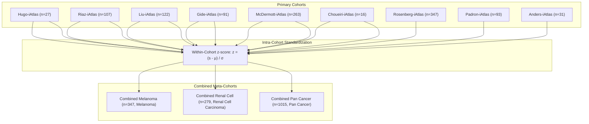

# ICB Benchmarking & Classifier Integration Guide for Autonomous Agents

**Version**: 1.0  
**Target Audience**: Autonomous AI Agents, Quantitative Biologists, ML Engineers  
**Codebase**: `packages/tme_response`, `packages/tme_datasets`, `scripts/`  
**Core Standard**: Functional Python (Pure functions, immutable models, `returns.result.Result`, Polars, Altair SVG)

---

> [!NOTE]
> For the comprehensive mathematical and methodological reference covering single-cell processing, Milo DA graph testing, deconvolution theory, perturbation benchmarks, Bayesian HPO, stability selection, survival analysis, and DCA, see the master guide:
> **[`docs/computational_methodology_and_pipeline_guide.md`](file:///Users/halu/Code/tme_analysis/docs/computational_methodology_and_pipeline_guide.md)**.

## 1. Overview & Architectural Principles

This document provides a comprehensive operational guide for benchmarking immunotherapy response predictors across clinical solid tumor cohorts in this repository. 

Our benchmarking framework evaluates predictive models across **9 primary clinical cohorts** ($N = 1,015$ patients) and **3 combined meta-cohort pools** ($N = 1,015$). It calculates binary discrimination (**ROC-AUC**, **PR-AUC**, **$\Delta\text{PR-AUC}$**, **Brier score** with 1,000 bootstrap iterations), time-to-event survival (**Harrell's $C$-index**, **Univariable Cox Proportional Hazards Hazard Ratios**), clinical net benefit (**Decision Curve Analysis / DCA**), and in silico perturbation stress-testing (**Expression Jitter, Technical Dropout, Effector Dilution, Response Label Noise**).

### Core Invariants:
1. **Functional Core, Imperative Shell**: Prediction functions must be pure: they take an immutable `MultiOmicCohort` and return a `Result[PredictionResult, str]`. They must never mutate input DataFrames.
2. **Within-Cohort Standardization Before Pooling**: Never pool raw unstandardized scores across cohorts. Scores must undergo within-cohort $z$-score standardization before meta-cohort evaluation to eliminate sequencing center batch artifacts.
3. **Zero Underscores in Classifier Display Labels**: Classifier display names must be human-readable and must never contain underscores (`_`). Primary literature citations must appear in parentheses: `FirstAuthor et al., Year`.
4. **Zero Hyphens in Cohort Display Labels**: Cohort display names must never contain hyphens (`-`). They must include citation, sample size $n$, and cancer type: `FirstAuthor et al., Year (n=X, Cancer Type)`.

---

## 2. Complete Catalog of Clinical Validation Cohorts

All cohorts are curated from the CRI iAtlas / cBioPortal repository, harmonized through `tme_datasets`, and synchronized via `load_multi_omic_cohort(cohort_id)` in `packages/tme_response/src/tme_response/data/adapter.py`.

| Cohort Identifier | cBioPortal Study ID | Publication Citation | Cancer Type | Evaluable $N$ | Therapy / Regimen | WES / TMB | CNA | OS (Deaths / Total) | PFS (Events / Total) | RECIST Annotations |
| :--- | :--- | :--- | :--- | :---: | :--- | :---: | :---: | :---: | :---: | :---: |
| **`Hugo-iAtlas`** | `mel_iatlas_hugo_2016` | Hugo et al. (*Cell*, 2016) | Melanoma | $27$ | Anti-PD-1 (pembrolizumab) | Yes | No | $14 / 27$ | Uncurated | CR, PR, PD |
| **`Riaz-iAtlas`** | `mel_iatlas_riaz_2017` | Riaz et al. (*Cell*, 2017) | Melanoma | $107$ | Anti-PD-1 (nivolumab) | Yes | No | $41 / 107$ | Uncurated | CR, PR, SD, PD |
| **`Liu-iAtlas`** | `mel_iatlas_liu_2019` | Liu et al. (*Nature Medicine*, 2019) | Melanoma | $122$ | Anti-PD-1 (nivo / pembro) | Yes | No | $67 / 122$ | $92 / 122$ | CR, PR, SD, PD, MR |
| **`Gide-iAtlas`** | `mel_iatlas_gide_2019` | Gide et al. (*Cancer Cell*, 2019) | Melanoma | $91$ | Anti-PD-1 $\pm$ Anti-CTLA-4 | **No** (Gap) | No | $37 / 91$ | $54 / 91$ | CR, PR, SD, PD |
| **`Rosenberg-iAtlas`** | `bladder_iatlas_rosenberg_2016` | Rosenberg et al. (*Lancet*, 2016) | Bladder Cancer | $347$ | Anti-PD-L1 (atezolizumab) | Yes | No | $239 / 347$ | Uncurated | CR, PR, SD, PD |
| **`McDermott-iAtlas`** | `renalcell_iatlas_mcdermott_2018` | McDermott et al. (*Nature Medicine*, 2018) | Clear Cell Renal Cell Carcinoma | $263$ | Anti-PD-L1 $\pm$ bevacizumab | Yes | No | Uncurated | $142 / 263$ | CR, PR, SD, PD, NE |
| **`Choueiri-iAtlas`** | `renalcell_iatlas_choueiri_2016` | Choueiri et al. (*Annals of Oncology*, 2016) | Renal Cell Carcinoma | $16$ | Anti-PD-1 (nivolumab) | Yes | No | $9 / 16$ | $13 / 16$ | CR, PR, SD, PD |
| **`Padron-iAtlas`** | `panc_iatlas_padron_2022` | Padron et al. (*Nature Medicine*, 2022) | Pancreatic Adenocarcinoma | $93$ | Gemcitabine/Nab-Paclitaxel + Anti-PD-1 $\pm$ CD40 | Yes | No | $65 / 93$ | $74 / 93$ | CR, PR, SD, PD |
| **`Anders-iAtlas`** | `brca_iatlas_anders_2022` | Anders et al. (*JITC*, 2022) | Breast Cancer | $31$ | Chemotherapy + Anti-PD-1 | Yes | No | $17 / 31$ | $20 / 31$ | CR, PR, SD, PD |

### Cohort-Specific Data Availability Caveats:
1. **Gide-iAtlas Lacks WES Somatic Mutation Calls**: In the official cBioPortal iAtlas repository (`mel_iatlas_gide_2019`), only bulk RNA-seq and predicted neoantigen counts were curated. No `data_mutations.txt` or `data_cna.txt` files were deposited. Any predictor requiring TMB or somatic driver mutations cannot be evaluated for Gide, resulting in documented gaps in multi-omic figures.
2. **Survival Annotation Coverage**:
   - **Overall Survival (OS)** is curated in 8 cohorts (all except McDermott).
   - **Progression-Free Survival (PFS)** is curated in 6 cohorts (Liu, Gide, McDermott, Choueiri, Padron, Anders). Rosenberg, Hugo, and Riaz lack curated progression-free survival intervals in cBioPortal.

---

## 3. Combined Meta-Cohort Pools & Standardization Architecture

To evaluate cross-study generalization and statistical power, individual cohorts are aggregated into **3 combined meta-cohort pools**:



### Specifications of Combined Pools:
- **`Melanoma-Combined`** (`Combined Melanoma (n=347, Melanoma)`):
  - Member cohorts: `Hugo-iAtlas`, `Riaz-iAtlas`, `Liu-iAtlas`, `Gide-iAtlas`.
  - Cancer type: `Melanoma`.
  - Total evaluable patients: $27 + 107 + 122 + 91 = 347$.
- **`RenalCell-Combined`** (`Combined Renal Cell (n=279, Renal Cell Carcinoma)`):
  - Member cohorts: `McDermott-iAtlas`, `Choueiri-iAtlas`.
  - Cancer type: `Renal Cell Carcinoma`.
  - Total evaluable patients: $263 + 16 = 279$.
- **`PanCancer-Combined`** (`Combined Pan Cancer (n=1015, Pan Cancer)`):
  - Member cohorts: All 9 cohorts (`Hugo`, `Riaz`, `Liu`, `Gide`, `Rosenberg`, `McDermott`, `Padron`, `Anders`, `Choueiri`).
  - Cancer type: `Pan-Cancer`.
  - Total evaluable patients: $N = 1,015$.

### Why Within-Cohort Standardization is Mathematically Mandatory
Different clinical cohorts suffer from severe platform shifts, library preparation differences, and baseline transcriptomic drift. Pooling raw unstandardized scores produces severe batch artifacts:
$$\text{Raw Concatenation: } s_{\text{pooled}} = [s_{\text{cohort } 1}, s_{\text{cohort } 2}, \dots] \implies \text{Severe Confounding \& Bimodal Scores}$$

To eliminate cohort-level confounding while preserving intra-cohort monotonic rankings, scores **must** be standardized within each cohort prior to concatenation:
$$z_{i,c} = \frac{s_{i,c} - \mu_c}{\sigma_c}$$
where $\mu_c = \frac{1}{N_c} \sum_{i=1}^{N_c} s_{i,c}$ and $\sigma_c = \sqrt{\frac{1}{N_c-1} \sum_{i=1}^{N_c} (s_{i,c} - \mu_c)^2}$.

### Pooling Implementation:
Standardization and concatenation are implemented in [`packages/tme_response/src/tme_response/evaluation/pooling.py`](file:///Users/halu/Code/tme_analysis/packages/tme_response/src/tme_response/evaluation/pooling.py):
1. `standardize_prediction_scores(prediction: PredictionResult) -> PredictionResult` computes $z$-scores per prediction series.
2. `pool_cohort_stratum_data(cohort_strata, group_id, cancer_type, standardize=True)` prefixes sample barcodes with `{cohort_id}::` (to prevent identifier collisions) and concatenates standardized scores and harmonized clinical outcomes.

---

## 4. Evaluation Metrics & Statistical Framework

When evaluating a predictor against binary RECIST response, the pipeline supports two clinical stratification filters:
1. **Time Stratum**:
   - `Pre`: Pre-treatment biopsy samples only (avoids on-treatment biological confounding; standard benchmark).
   - `All`: All evaluable samples regardless of biopsy timepoint.
2. **Response Stratum**:
   - `Standard`: Complete/Partial Response (`CR/PR`, binary `1`) vs. Stable/Progressive Disease (`SD/PD`, binary `0`).
   - `Extreme`: Complete/Partial Response (`CR/PR`, binary `1`) vs. Progressive Disease (`PD`, binary `0`), omitting Stable Disease.

### Metrics Computed via `calculate_discrimination_bootstrap`:
- **ROC-AUC**: Empirical Area Under the Receiver Operating Characteristic curve.
- **PR-AUC**: Empirical Area Under the Precision-Recall curve (computed via trapezoidal integration of precision over recall).
- **$\Delta\text{PR-AUC}$**: $\text{PR-AUC} - \text{baseline prevalence}$ (quantifies performance uplift above random classification under class imbalance).
- **Brier Score**: Mean squared calibration error: $\frac{1}{N} \sum_{i=1}^N (\hat{p}_i - y_i)^2$.
- **95% Bootstrap CIs**: 1,000 non-parametric bootstrap resamples (empirical 2.5th and 97.5th percentiles).
- **Empirical $p$-values**: Two-sided empirical bootstrap test versus the null hypothesis ($H_0: \text{ROC-AUC} = 0.50$ and $H_0: \text{PR-AUC} = \text{prevalence}$).

---

## 5. Storage Schema: `iatlas_benchmark_metrics.parquet`

All binary classification benchmark results are saved in [`output/benchmarks/iatlas_roc_auc/iatlas_benchmark_metrics.parquet`](file:///Users/halu/Code/tme_analysis/output/benchmarks/iatlas_roc_auc/iatlas_benchmark_metrics.parquet) and the corresponding `.csv`.

### Column Schema:
| Column Name | Polars Dtype | Description / Example Values |
| :--- | :--- | :--- |
| `cohort_id` | `pl.String` | Machine identifier: `"Gide-iAtlas"`, `"PanCancer-Combined"` |
| `cancer_type` | `pl.String` | Clinical cancer type: `"Melanoma"`, `"Pan-Cancer"` |
| `predictor_name` | `pl.String` | Machine identifier: `"Fehrenbacher_Teff"`, `"My_New_Classifier"` |
| `category` | `pl.String` | `"signature"`, `"cell_deconvolution"`, `"genomic"`, `"composite_synergy"`, `"systems_model"` |
| `time_stratum` | `pl.String` | `"Pre"` (pre-treatment) or `"All"` |
| `response_stratum` | `pl.String` | `"Standard"` (CR/PR vs SD/PD) or `"Extreme"` (CR/PR vs PD) |
| `pooling_strategy` | `pl.String` | `"cohort"` (single study), `"standardized"` (z-score pooled), `"raw"` (unstandardized) |
| `n_samples` | `pl.Int64` | Total evaluable patients in cohort stratum |
| `n_responders` | `pl.Int64` | Number of true responders (`CR/PR`) |
| `n_non_responders` | `pl.Int64` | Number of non-responders (`SD/PD`) |
| `roc_auc` | `pl.Float64` | Empirical ROC-AUC point estimate |
| `roc_auc_ci_lower` | `pl.Float64` | 95% bootstrap CI lower bound (2.5%) |
| `roc_auc_ci_upper` | `pl.Float64` | 95% bootstrap CI upper bound (97.5%) |
| `p_value_vs_half` | `pl.Float64` | Two-sided empirical bootstrap p-value vs 0.50 |
| `pr_auc` | `pl.Float64` | Empirical PR-AUC point estimate |
| `pr_auc_ci_lower` | `pl.Float64` | 95% bootstrap CI lower bound (2.5%) |
| `pr_auc_ci_upper` | `pl.Float64` | 95% bootstrap CI upper bound (97.5%) |
| `baseline_prevalence` | `pl.Float64` | Class imbalance baseline: `n_responders / n_samples` |
| `delta_pr_auc` | `pl.Float64` | `pr_auc - baseline_prevalence` |
| `p_value_prauc` | `pl.Float64` | Two-sided empirical bootstrap p-value vs prevalence |
| `brier_score` | `pl.Float64` | Mean squared probability calibration loss |

---

## 6. How to Register Display Names & Citations (Zero Underscore Enforcement)

To maintain strict publication-grade compliance, raw predictor identifiers (which contain underscores like `Fehrenbacher_Teff`) and cohort identifiers (which contain hyphens like `Gide-iAtlas`) **MUST NEVER** be rendered directly in Altair vector plots.

### Registration in `display_labels.py`:
When introducing a new classifier, open [`packages/tme_response/src/tme_response/visualization/display_labels.py`](file:///Users/halu/Code/tme_analysis/packages/tme_response/src/tme_response/visualization/display_labels.py) and add its mapping to `PREDICTOR_DISPLAY_MAP`:

```python
PREDICTOR_DISPLAY_MAP: dict[str, str] = {
    ...
    # Format: "Machine_Identifier": "Human Readable Name (FirstAuthor et al., Year)"
    "My_Novel_Classifier": "Novel Immune Model (Smith et al., 2024)",
    "SingleGene_CD8B": "CD8B (Single Gene)",
}
```

### Vectorized DataFrame Enrichment:
Visualization modules automatically pass DataFrames through `with_display_labels(df)`:
- Maps `predictor_name` $\to$ `predictor_display` (removes underscores, appends citation).
- Maps `cohort_id` + `n_samples` + `cancer_type` $\to$ `cohort_display` (removes hyphens, formats metadata).
- Converts `category` strings to clean Title Case (`cell_deconvolution` $\to$ `Cell Deconvolution`).

---

## 7. Step-by-Step Recipe: Adding a New Classifier to the Benchmark

Here is the exact, end-to-end Python script template that another agent can execute to benchmark a new classifier across all 9 cohorts and 3 pools, append its metrics to `iatlas_benchmark_metrics.parquet`, and update the publication figures:

```python
#!/usr/bin/env python3
"""Example script for another agent to integrate and benchmark a new ICB classifier."""

from pathlib import Path
import numpy as np
import polars as pl
from returns.result import Success, Failure, Result

from tme_datasets.paths import find_repo_root
from tme_response import (
    MultiOmicCohort,
    PredictionResult,
    PredictorCategory,
    load_multi_omic_cohort,
    evaluate_prediction,
    export_chart_svg,
    create_auc_heatmap,
    create_summary_forest_plot,
)
from tme_response.evaluation.pooling import pool_cohort_stratum_data, standardize_prediction_scores
from tme_response.visualization.display_labels import PREDICTOR_DISPLAY_MAP

# -------------------------------------------------------------
# 1. Define the Pure Predictor Function
# -------------------------------------------------------------
def compute_my_custom_classifier(cohort: MultiOmicCohort) -> Result[PredictionResult, str]:
    """Pure function mapping expression matrix to continuous prediction scores."""
    expr = cohort.expression_tpm
    # Example: Average expression of CD8A and IFNG
    target_genes = [g for g in ["CD8A", "IFNG"] if g in expr.columns]
    if not target_genes:
        return Failure("Target genes missing from expression matrix.")

    scores = expr.select(target_genes).mean_horizontal().to_list()
    pred_df = pl.DataFrame({
        "sample_id": expr["sample_id"],
        "score": scores,
    })

    return Success(
        PredictionResult(
            predictor_name="Custom_CD8_IFNG",
            category=PredictorCategory.SIGNATURE,
            predictions=pred_df,
        )
    )

# -------------------------------------------------------------
# 2. Register Display Label in Memory (or edit display_labels.py)
# -------------------------------------------------------------
PREDICTOR_DISPLAY_MAP["Custom_CD8_IFNG"] = "CD8 + IFNG Pair (Custom et al., 2025)"

# -------------------------------------------------------------
# 3. Benchmark Across All 9 Primary Cohorts & 3 Combined Pools
# -------------------------------------------------------------
repo_root = find_repo_root()
cohort_ids = [
    "Hugo-iAtlas", "Riaz-iAtlas", "Liu-iAtlas", "Gide-iAtlas",
    "Rosenberg-iAtlas", "McDermott-iAtlas", "Choueiri-iAtlas",
    "Padron-iAtlas", "Anders-iAtlas",
]
output_dir = repo_root / "output" / "benchmarks" / "iatlas_roc_auc"

cohort_cache: dict[str, dict] = {}
new_records: list[dict] = []

for cid in cohort_ids:
    cohort = load_multi_omic_cohort(cid, repo_root=repo_root, filter_baseline=True).unwrap()
    pred_res = compute_my_custom_classifier(cohort).unwrap()

    # Pre-treatment standard RECIST clinical stratum
    clin = cohort.clinical_annotations.filter(
        (pl.col("biopsy_timepoint") == "pre") & 
        (pl.col("response_recist").is_in(["CR", "PR", "SD", "PD"]))
    )
    if clin.is_empty():
        continue

    cohort_cache[cid] = {
        "cancer_type": cohort.cancer_type,
        "clinical": clin,
        "prediction": pred_res,
    }

    # Evaluate individual cohort
    res = evaluate_prediction(
        prediction=pred_res,
        clinical_df=clin,
        cohort_id=cid,
        cancer_type=cohort.cancer_type,
        time_stratum="Pre",
        response_stratum="Standard",
        pooling_strategy="cohort",
        n_bootstrap=1000,
    ).unwrap()

    new_records.append({
        "cohort_id": res.cohort_id,
        "cancer_type": res.cancer_type,
        "predictor_name": res.predictor_name,
        "category": res.category.value,
        "time_stratum": res.time_stratum,
        "response_stratum": res.response_stratum,
        "pooling_strategy": res.pooling_strategy,
        "n_samples": res.n_samples,
        "n_responders": res.n_responders,
        "n_non_responders": res.n_non_responders,
        "roc_auc": res.roc_auc,
        "roc_auc_ci_lower": res.roc_auc_ci_lower,
        "roc_auc_ci_upper": res.roc_auc_ci_upper,
        "p_value_vs_half": res.p_value_vs_half,
        "pr_auc": res.pr_auc,
        "pr_auc_ci_lower": res.pr_auc_ci_lower,
        "pr_auc_ci_upper": res.pr_auc_ci_upper,
        "baseline_prevalence": res.baseline_prevalence,
        "delta_pr_auc": res.delta_pr_auc,
        "p_value_prauc": res.p_value_prauc,
        "brier_score": res.brier_score,
    })

# -------------------------------------------------------------
# 4. Standardize and Evaluate Combined Pools
# -------------------------------------------------------------
pools = {
    "Melanoma-Combined": (["Hugo-iAtlas", "Riaz-iAtlas", "Liu-iAtlas", "Gide-iAtlas"], "Melanoma"),
    "RenalCell-Combined": (["McDermott-iAtlas", "Choueiri-iAtlas"], "Renal Cell Carcinoma"),
    "PanCancer-Combined": (cohort_ids, "Pan-Cancer"),
}

for pool_id, (members, ctype) in pools.items():
    tuples = [(m, cohort_cache[m]["clinical"], [cohort_cache[m]["prediction"]]) for m in members if m in cohort_cache]
    pooled_clin, pooled_preds = pool_cohort_stratum_data(tuples, group_id=pool_id, cancer_type=ctype, standardize=True).unwrap()

    p_res = evaluate_prediction(
        prediction=pooled_preds[0],
        clinical_df=pooled_clin,
        cohort_id=pool_id,
        cancer_type=ctype,
        time_stratum="Pre",
        response_stratum="Standard",
        pooling_strategy="standardized",
        n_bootstrap=1000,
    ).unwrap()

    new_records.append({
        "cohort_id": p_res.cohort_id,
        "cancer_type": p_res.cancer_type,
        "predictor_name": p_res.predictor_name,
        "category": p_res.category.value,
        "time_stratum": p_res.time_stratum,
        "response_stratum": p_res.response_stratum,
        "pooling_strategy": p_res.pooling_strategy,
        "n_samples": p_res.n_samples,
        "n_responders": p_res.n_responders,
        "n_non_responders": p_res.n_non_responders,
        "roc_auc": p_res.roc_auc,
        "roc_auc_ci_lower": p_res.roc_auc_ci_lower,
        "roc_auc_ci_upper": p_res.roc_auc_ci_upper,
        "p_value_vs_half": p_res.p_value_vs_half,
        "pr_auc": p_res.pr_auc,
        "pr_auc_ci_lower": p_res.pr_auc_ci_lower,
        "pr_auc_ci_upper": p_res.pr_auc_ci_upper,
        "baseline_prevalence": p_res.baseline_prevalence,
        "delta_pr_auc": p_res.delta_pr_auc,
        "p_value_prauc": p_res.p_value_prauc,
        "brier_score": p_res.brier_score,
    })

# -------------------------------------------------------------
# 5. Append to Benchmark Parquet
# -------------------------------------------------------------
parquet_path = output_dir / "iatlas_benchmark_metrics.parquet"
existing_df = pl.read_parquet(parquet_path)
updated_df = pl.concat([existing_df, pl.DataFrame(new_records)])
updated_df.write_parquet(parquet_path)
updated_df.write_csv(output_dir / "iatlas_benchmark_metrics.csv")
print(f"Successfully integrated classifier into benchmark! Total records: {len(updated_df)}")

# -------------------------------------------------------------
# 6. Re-Export Publication Figures (SVG)
# -------------------------------------------------------------
pre_std = updated_df.filter(
    (pl.col("time_stratum") == "Pre") &
    (pl.col("response_stratum") == "Standard") &
    (pl.col("pooling_strategy").is_in(["cohort", "standardized"]))
)
chart = create_auc_heatmap(pre_std, metric="roc_auc", title="Pre-Treatment Standard ICB Response (ROC-AUC)").unwrap()
export_chart_svg(chart, output_dir / "fig_roc_auc_heatmap_pre_standard.svg")
print("Regenerated ROC-AUC Heatmap with your new classifier seamlessly included!")
```

---

## 8. Summary Checklist for Agent Verification

When adding or updating classifiers, always verify the following:
- [ ] Predictor function maps `MultiOmicCohort` $\to$ `Result[PredictionResult, str]` without mutating the expression matrix.
- [ ] Multi-cohort pooling uses within-cohort standardization (`standardize=True`).
- [ ] Display name added to `PREDICTOR_DISPLAY_MAP` in `display_labels.py` without underscores and with citation.
- [ ] All 9 cohorts and 3 pools evaluated in `iatlas_benchmark_metrics.parquet`.
- [ ] XML audit on exported SVGs confirms `0` underscores in text elements and `0` raw cohort hyphens.
- [ ] Full test suite passes: `pytest packages/tme_response/tests`.
