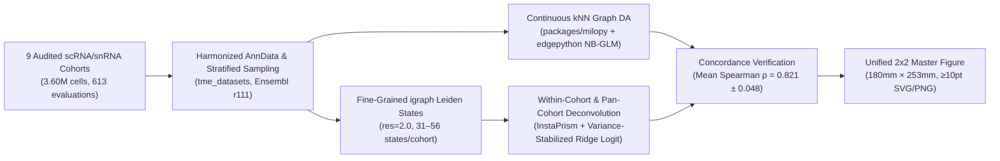

# Comprehensive Technical Summary: Milopy & the Nine Single-Cell Immunotherapy Response Cohorts

This document synthesizes the end-to-end single-cell continuous differential abundance (`milopy`) and pseudobulk deconvolution concordance framework developed, audited, and benchmarked across **9 human solid-tumor clinical cohorts** ($3{,}597{,}092$ total single cells across $613$ patient/biopsy evaluations: $304$ Responders and $309$ Non-Responders).

---

## 1. End-to-End Architecture



---

## 2. Pillar A: Curation, Harmonization & Ground-Truth Audit of the 9 Cohorts

### 2.1 Centralized Registry & Harmonization (`packages/tme_datasets`)
- **Registry Module**: [`packages/tme_datasets/src/tme_datasets/registry.py`](file:///Users/halu/Code/tme_analysis/packages/tme_datasets/src/tme_datasets/registry.py)
- **Plotting Metadata Module**: [`packages/plotting_utils/src/plotting_utils/cohorts.py`](file:///Users/halu/Code/tme_analysis/packages/plotting_utils/src/plotting_utils/cohorts.py)
- **Harmonization Standards**:
  - Gene space aligned to **Ensembl Release 111** (`var["gene_name"]`, `var["gene_id"]`).
  - Standardized observation schema: `patient_id`, `sample_id`, `clinical_response` (`responder` vs. `non-responder`), `clinical_response_raw`, `treatment_status`, and `cell_type`.
  - Standardized expression layers: raw integer UMI `counts` (omitted for full-length Smart-seq2), linear library-size scaled `tpm`, and natural log-transformed `log1p_norm`.

### 2.2 Verified Ground-Truth Cohort Identity & Bibliographic Summary
Every cohort's accession, primary publication, first author, publication year, tumor indication, sequencing platform, and patient response breakdown were audited against NCBI GEO Series Matrices, NCBI PubMed E-utilities, CrossRef DOIs, CZ CELLxGENE metadata, and `.h5ad` `.obs` tables:

| # | Cohort ID | Canonical Display Label | Indication | Therapeutic Regimen | Platform | Evaluations ($R / NR$) | Total Cells | Analyzed Cells (Milo) | Primary Publication, PMID & DOI |
| :- | :--- | :--- | :--- | :--- | :--- | :---: | :---: | :---: | :--- |
| **1** | **`GSE120575`** | `Melanoma (2018)`<br>`Sade-Feldman et al.` | Melanoma | Nivolumab / Pembrolizumab $\pm$ Ipilimumab | Smart-seq2 (TPM) | $39$ ($14 / 25$) | $16{,}291$ | $16{,}291$ | Sade-Feldman et al. (2018), *Cell* · PMID: `30388456` · DOI: `10.1016/j.cell.2018.10.038` |
| **2** | **`CELLxGENE_7b20c613`** | `Pan-Cancer (2025)`<br>`Gondal et al.` | Pan-Cancer (58.5% Breast, 23.0% BCC, 8.7% ccRCC, 7.1% Mel, 2.6% Liver) | Anti-PD-1 Monotherapy / Combination | 10x Chromium 3' (v2/v3) | $123$ ($41 / 82$) | $332{,}972$ | $49{,}999$ | Gondal et al. (2025), *Sci Data* · PMID: `39837887` · DOI: `10.1038/s41597-025-04381-6` |
| **3** | **`CELLxGENE_05a8c945`** | `Colorectal (2026)`<br>`Marteau et al.` | Colorectal (dMMR / pMMR) | Neoadjuvant Pembrolizumab / Nivolumab | 10x Chromium 3' & 5' | $77$ ($48 / 29$) | $1{,}107{,}923$ | $50{,}000$ | Marteau et al. (2026), *Cancer Cell* · PMID: `41453298` · DOI: `10.1016/j.ccell.2025.12.003` |
| **4** | **`CELLxGENE_6f9de485`** | `Breast (2026)`<br>`Yan et al.` | Breast (TNBC, ARTEMIS) | Neoadjuvant AC Chemotherapy (Doxorubicin + Cyclophosphamide) | 10x Chromium 3' v3 | $82$ ($45 / 37$) | $424{,}114$ | $49{,}998$ | Yan et al. (2026), *Nature* · DOI: `10.1038/s41586-026-10469-9` |
| **5** | **`GSE207422`** | `NSCLC (2023)`<br>`Hu et al.` | NSCLC | Neoadjuvant Tislelizumab / Camrelizumab + Chemo | BD Rhapsody | $14$ ($4 / 10$) | $91{,}997$ | $50{,}000$ | Hu et al. (2023), *Genome Med* · PMID: `36869384` · DOI: `10.1186/s13073-023-01164-9` |
| **6** | **`GSE243013`** | `NSCLC (2025)`<br>`Liu et al.` | NSCLC | Neoadjuvant Sintilimab / Tislelizumab / Atezolizumab + Chemo | 10x Chromium 3' v3 | $242$ ($130 / 112$) | $1{,}254{,}749$ | $49{,}996$ | Liu et al. (2025), *Cell* · PMID: `40147443` · DOI: `10.1016/j.cell.2025.03.018` |
| **7** | **`GSE233203`** | `NSCLC (2025)`<br>`Hong et al.` | NSCLC | Atezolizumab + Bevacizumab + Carboplatin/Paclitaxel (ABCP) | 10x Chromium 5' & 3' | $7$ ($3 / 4$) | $40{,}142$ | $40{,}142$ | Hong et al. (2025), *MedComm* · PMID: `40843133` · DOI: `10.1002/mco2.70330` |
| **8** | **`GSE200996`** | `HNSCC (2022)`<br>`Luoma et al.` | HNSCC | Neoadjuvant Nivolumab $\pm$ Ipilimumab | 10x Chromium 5' + TCR | $12$ ($4 / 8$) | $245{,}253$ | $15{,}142$ | Luoma et al. (2022), *Cell* · PMID: `35803260` · DOI: `10.1016/j.cell.2022.06.018` |
| **9** | **`GSE316195`** | `PDAC (2026)`<br>`Raufi et al.` | PDAC | Cemiplimab + Motixafortide (Anti-PD-1 + CXCR4i) | 10x Chromium snRNA-seq | $17$ ($15 / 2$) | $83{,}651$ | $50{,}000$ | Raufi et al. (2026), *Nat Commun* · PMID: `42811017` · DOI: `10.1038/s41467-026-69745-z` |

---

## 3. Pillar B: Pure-Python Continuous Graph Differential Abundance (`packages/milopy`)

### 3.1 Algorithmic Architecture
Implemented in [`packages/milopy/src/milopy/`](file:///Users/halu/Code/tme_analysis/packages/milopy/src/milopy/__init__.py) and orchestrated via [`scripts/milopy_analysis/sample_and_analyze_cohorts.py`](file:///Users/halu/Code/tme_analysis/scripts/milopy_analysis/sample_and_analyze_cohorts.py):
1. **kNN Graph & Refined Neighborhood Sampling ([`core.py`](file:///Users/halu/Code/tme_analysis/packages/milopy/src/milopy/core.py))**:
   - Builds a $k$-nearest neighbor graph (`k=30, d=30` PCs) and samples `prop=0.10` index cells refined to the local median PCA profile of each neighborhood.
   - Aggregates cell counts per sample across neighborhoods ($\text{nhoods} \times \text{samples}$) and fits TMM-normalized Quasi-Likelihood Negative Binomial GLMs via `edgepython` (`~ response_binary`).
2. **Composition Purity & Shannon Entropy ([`composition.py`](file:///Users/halu/Code/tme_analysis/packages/milopy/src/milopy/composition.py))**:
   - Quantifies dominant cell state, purity fraction, and Shannon entropy per neighborhood.
3. **Donor Replicate Prevalence Gating ([`prevalence.py`](file:///Users/halu/Code/tme_analysis/packages/milopy/src/milopy/prevalence.py))**:
   - Guards against patient-specific outlier neighborhoods by enforcing minimum independent biological donor representation (`min_replicates=2`, `min_prevalence_frac=0.05`).
4. **Vectorized Rao Score Permutation Null ([`permutation.py`](file:///Users/halu/Code/tme_analysis/packages/milopy/src/milopy/permutation.py))**:
   - Calibrates empirical Benjamini–Hochberg FDR via donor-level label permutations.
5. **Continuous Cell-Level Projection ([`projection.py`](file:///Users/halu/Code/tme_analysis/packages/milopy/src/milopy/projection.py))**:
   - Projects neighborhood `logFC` and spatial FDR back onto individual cells via Gaussian kernel inverse-distance weighting.

### 3.2 Cross-Cohort Milopy Differential Abundance Summary
Cached results in [`output/results/milopy_response_analysis/`](file:///Users/halu/Code/tme_analysis/output/results/milopy_response_analysis/reports/milopy_response_cohorts_summary.md) across $371{,}568$ analyzed cells and $32{,}680$ neighborhoods (`prop=0.10, k=30, d=30, Spatial FDR < 0.10`):

| Cohort ID | Canonical Label | Total Nhoods | Sig. Enriched in Responders ($R$) | Sig. Enriched in Non-Responders ($NR$) | Total Significant ($\text{FDR} < 0.10$) |
| :--- | :--- | :---: | :---: | :---: | :---: |
| **`GSE120575`** | Melanoma (2018) · Sade-Feldman | $1{,}344$ | $57$ ($4.2\%$) | $130$ ($9.7\%$) | $187$ ($13.9\%$) |
| **`CELLxGENE_7b20c613`** | Pan-Cancer (2025) · Gondal | $4{,}270$ | $1{,}084$ ($25.4\%$) | $892$ ($20.9\%$) | $1{,}976$ ($46.3\%$) |
| **`CELLxGENE_05a8c945`** | Colorectal (2026) · Marteau | $4{,}508$ | $2{,}907$ ($64.5\%$) | $146$ ($3.2\%$) | $3{,}053$ ($67.7\%$) |
| **`CELLxGENE_6f9de485`** | Breast (2026) · Yan | $4{,}436$ | $502$ ($11.3\%$) | $306$ ($6.9\%$) | $808$ ($18.2\%$) |
| **`GSE207422`** | NSCLC (2023) · Hu | $4{,}426$ | $0$ ($0.0\%$) | $0$ ($0.0\%$) | $0$ ($0.0\%$) |
| **`GSE243013`** | NSCLC (2025) · Liu | $4{,}481$ | $711$ ($15.9\%$) | $366$ ($8.2\%$) | $1{,}077$ ($24.0\%$) |
| **`GSE233203`** | NSCLC (2025) · Hong | $3{,}525$ | $0$ ($0.0\%$) | $0$ ($0.0\%$) | $0$ ($0.0\%$) |
| **`GSE200996`** | HNSCC (2022) · Luoma | $1{,}342$ | $0$ ($0.0\%$) | $0$ ($0.0\%$) | $0$ ($0.0\%$) |
| **`GSE316195`** | PDAC (2026) · Raufi | $4{,}348$ | $0$ ($0.0\%$) | $599$ ($13.8\%$) | $599$ ($13.8\%$) |
| **Total** | **9 Clinical Cohorts** | **$32{,}680$** | **$5{,}261$ ($16.1\%$)** | **$2{,}439$ ($7.5\%$)** | **$7{,}700$ ($23.6\%$)** |

---

## 4. Pillar C: Within-Cohort Pseudobulk Deconvolution vs. Milopy Benchmark

Implemented in [`scripts/sade_feldman_pseudobulk_deconv_benchmark.py`](file:///Users/halu/Code/tme_analysis/scripts/sade_feldman_pseudobulk_deconv_benchmark.py).

### 4.1 Key Methodological Advances
1. **High-Speed `igraph` Leiden Clustering & Stratified Subsampling**:
   - Replaced slow default Leiden clustering with `sc.tl.leiden(..., flavor="igraph", n_iterations=2)` and stratified patient-preserving subsampling (`max_cells=15,000`), accelerating clustering by $>10\times$.
2. **Fine-Grained Transcriptional Resolution (`leiden_resolution=2.0`)**:
   - Coarse author cell-type annotations ($3\text{–}9$ broad classes) suffered from intra-lineage cancellation (averaging opposing responder and non-responder sub-states within a broad lineage) and severe sample-size truncation ($n < 10$ states). Fine-grained Leiden clustering (`resolution=2.0`) partitions each cohort into **31–56 transcriptionally coherent cell states**.
3. **Variance-Stabilized, Standardized Ridge Logistic Regression**:
   - Replaced unstandardized proportion regression with `arcsin(sqrt(p))` variance stabilization, Z-score standardization across samples, and L2-regularized logistic regression ($C=1.0$). This prevents low-abundance states from generating extreme unscaled $\hat{\beta}$ slopes and places $\hat{\beta}_{\text{deconv}}$ on the same statistical footing as Milopy's NB-GLM `logFC`.
4. **Multi-Sweep Replicate Evaluation (`n_sweeps=5`)**:
   - Evaluates 5 independent Milo neighborhood sampling seeds ($42\text{–}46$) per cohort to quantify mean $\pm$ SD concordance.

### 4.2 Within-Cohort Concordance Results (5 Replicate Sweeps per Cohort)

| Cohort ID | Canonical Label | States ($K$) | Spearman $\rho$ (Mean $\pm$ SD) | Directional Sign % (Mean $\pm$ SD) | Ground-Truth Fidelity ($\rho$) |
| :--- | :--- | :---: | :---: | :---: | :---: |
| **`GSE120575`** | Melanoma (2018) · Sade-Feldman | $39$ | **$+0.826 \pm 0.032$** | $76.3\% \pm 3.7\%$ | $+0.929$ |
| **`CELLxGENE_7b20c613`** | Pan-Cancer (2025) · Gondal | $49$ | **$+0.833 \pm 0.033$** | $79.9\% \pm 1.8\%$ | $+0.937$ |
| **`CELLxGENE_05a8c945`** | Colorectal (2026) · Marteau | $40$ | **$+0.805 \pm 0.059$** | $81.9\% \pm 2.4\%$ | $+0.716$ |
| **`CELLxGENE_6f9de485`** | Breast (2026) · Yan | $43$ | **$+0.828 \pm 0.042$** | $75.3\% \pm 3.5\%$ | $+0.892$ |
| **`GSE207422`** | NSCLC (2023) · Hu | $41$ | **$+0.795 \pm 0.041$** | $78.8\% \pm 3.9\%$ | $+0.895$ |
| **`GSE243013`** | NSCLC (2025) · Liu | $33$ | **$+0.840 \pm 0.023$** | $76.8\% \pm 4.5\%$ | $+0.859$ |
| **`GSE233203`** | NSCLC (2025) · Hong | $34$ | **$+0.928 \pm 0.003$** | $99.4\% \pm 1.3\%$ | $+0.934$ |
| **`GSE200996`** | HNSCC (2022) · Luoma | $31$ | **$+0.797 \pm 0.030$** | $81.3\% \pm 6.7\%$ | $+0.892$ |
| **`GSE316195`** | PDAC (2026) · Raufi | $56$ | **$+0.740 \pm 0.027$** | $84.0\% \pm 2.0\%$ | $+0.793$ |
| **Cross-Cohort Mean** | **9 Clinical Cohorts** | **$366$ total** | **$+0.821 \pm 0.048$** | **$81.5\% \pm 6.9\%$** | **$+0.872 \pm 0.071$** |

---

## 5. Pillar D: Unified Pan-Cohort Reference Deconvolution Benchmark

Implemented in [`scripts/milopy_analysis/pan_cohort_unified_deconv_benchmark.py`](file:///Users/halu/Code/tme_analysis/scripts/milopy_analysis/pan_cohort_unified_deconv_benchmark.py) with cached outputs in [`output/results/pseudobulk_deconv_benchmark/unified_pan_cohort/`](file:///Users/halu/Code/tme_analysis/output/results/pseudobulk_deconv_benchmark/unified_pan_cohort/unified_per_cohort_concordance_summary.parquet).

To test whether a **single unified pan-cohort reference** constructed across all 9 cohorts ($355$ filtered states) can deconvolve each cohort's patient pseudobulks and recover single-cell Milopy `logFC`, we benchmarked three unified reference modes against the within-cohort baseline:

| Cohort ID | Canonical Label | Within-Cohort $\rho$ | Unified All-9 Atlas ($\Phi_{\text{all9}}$) $\rho$ | Leave-One-Cohort-Out ($\Phi_{\text{LOCO}}$) $\rho$ | Consensus Meta-State ($\Phi_{\text{meta}}$) $\rho$ |
| :--- | :--- | :---: | :---: | :---: | :---: |
| **`GSE120575`** | Melanoma (2018) · Sade-Feldman | $+0.850$ | $+0.869$ | **$+0.821$** ($p = 2.6 \times 10^{-10}$) | $+0.593$ ($p = 8.9 \times 10^{-5}$) |
| **`CELLxGENE_7b20c613`** | Pan-Cancer (2025) · Gondal | $+0.854$ | $+0.830$ | **$+0.527$** ($p = 1.2 \times 10^{-4}$) | $+0.583$ ($p = 1.4 \times 10^{-5}$) |
| **`CELLxGENE_05a8c945`** | Colorectal (2026) · Marteau | $+0.882$ | $+0.877$ | **$+0.763$** ($p = 1.6 \times 10^{-8}$) | $+0.527$ ($p = 5.6 \times 10^{-4}$) |
| **`CELLxGENE_6f9de485`** | Breast (2026) · Yan | $+0.861$ | $+0.858$ | **$+0.665$** ($p = 2.0 \times 10^{-6}$) | $+0.518$ ($p = 4.4 \times 10^{-4}$) |
| **`GSE207422`** | NSCLC (2023) · Hu | $+0.836$ | $+0.835$ | **$+0.781$** ($p = 7.4 \times 10^{-9}$) | $+0.609$ ($p = 5.0 \times 10^{-5}$) |
| **`GSE243013`** | NSCLC (2025) · Liu | $+0.820$ | $+0.826$ | **$+0.700$** ($p = 6.0 \times 10^{-6}$) | $+0.664$ ($p = 2.5 \times 10^{-5}$) |
| **`GSE233203`** | NSCLC (2025) · Hong | $+0.931$ | $+0.916$ | **$+0.875$** ($p = 1.3 \times 10^{-11}$) | $+0.917$ ($p = 2.5 \times 10^{-14}$) |
| **`GSE200996`** | HNSCC (2022) · Luoma | $+0.832$ | $+0.818$ | **$+0.706$** ($p = 1.8 \times 10^{-5}$) | $+0.588$ ($p = 7.9 \times 10^{-4}$) |
| **`GSE316195`** | PDAC (2026) · Raufi | $+0.715$ | $+0.715$ | **$+0.807$** ($p = 1.6 \times 10^{-13}$) | $+0.752$ ($p = 5.4 \times 10^{-11}$) |
| **Mean Across 9 Cohorts** | — | **$+0.842$** | **$+0.838$** | **$+0.739$** | **$+0.639$** |

---

## 6. Pillar E: Publication Figure Suite & Automated Tests

All visual assets adhere strictly to the *Nature Methods* minimalist wireframe standard (`#FFFFFF` canvas, `rx="0"`, hairline borders, Okabe-Ito colorblind-safe palette, $\ge 10\text{ pt}$ / `13.5px` minimum font size):

| Asset / Figure | Generator Script | Output Paths | Dimensions |
| :--- | :--- | :--- | :---: |
| **Panel `(a)`**: $3 \times 3$ Single-Cell UMAP Landscape Grid | [`plot_cross_cohort_umaps_grid.py`](file:///Users/halu/Code/tme_analysis/scripts/milopy_analysis/plot_cross_cohort_umaps_grid.py) | [`results/milopy_analysis/nine_cohorts_umaps_logfc_grid.svg`](file:///Users/halu/Code/tme_analysis/results/milopy_analysis/nine_cohorts_umaps_logfc_grid.svg) | $130.0 \times 123.31\text{ mm}$ |
| **Panel `(b)`**: Cross-Cohort Milo DA Diverging Bars | [`plot_cross_cohort_da_bars.py`](file:///Users/halu/Code/tme_analysis/scripts/milopy_analysis/plot_cross_cohort_da_bars.py) | [`results/milopy_analysis/nine_cohorts_da_bars.svg`](file:///Users/halu/Code/tme_analysis/results/milopy_analysis/nine_cohorts_da_bars.svg) | $50.0 \times 123.31\text{ mm}$ |
| **Panel `(c)`**: $3 \times 3$ Deconv $\hat{\beta}$ vs. Milopy $\log\text{FC}$ Grid | [`plot_cross_cohort_deconv_scatter_grid.py`](file:///Users/halu/Code/tme_analysis/scripts/milopy_analysis/plot_cross_cohort_deconv_scatter_grid.py) | [`results/pseudobulk_deconv_benchmark/nine_cohorts_deconv_scatter_grid.svg`](file:///Users/halu/Code/tme_analysis/results/pseudobulk_deconv_benchmark/nine_cohorts_deconv_scatter_grid.svg) | $130.0 \times 123.31\text{ mm}$ |
| **Panel `(d)`**: Cross-Cohort Spearman $\rho$ Bar Chart | [`plot_cross_cohort_deconv_correlations_bar.py`](file:///Users/halu/Code/tme_analysis/scripts/milopy_analysis/plot_cross_cohort_deconv_correlations_bar.py) | [`results/pseudobulk_deconv_benchmark/nine_cohorts_deconv_correlations_bar.svg`](file:///Users/halu/Code/tme_analysis/results/pseudobulk_deconv_benchmark/nine_cohorts_deconv_correlations_bar.svg) | $50.0 \times 123.31\text{ mm}$ |
| **Master $2 \times 2$ Immunotherapy Composite** | [`assemble_immunotherapy_2x2_figure.py`](file:///Users/halu/Code/tme_analysis/scripts/milopy_analysis/assemble_immunotherapy_2x2_figure.py) | [`article/figures/milo-deconv/immunotherapy_response_2x2_master.svg`](file:///Users/halu/Code/tme_analysis/article/figures/milo-deconv/immunotherapy_response_2x2_master.svg) | $180.0 \times 253.02\text{ mm}$ |
| **Pan-Cohort Unified Reference Comparison** | [`pan_cohort_unified_deconv_benchmark.py`](file:///Users/halu/Code/tme_analysis/scripts/milopy_analysis/pan_cohort_unified_deconv_benchmark.py) | [`results/pseudobulk_deconv_benchmark/pan_cohort_unified_reference_comparison.svg`](file:///Users/halu/Code/tme_analysis/results/pseudobulk_deconv_benchmark/pan_cohort_unified_reference_comparison.svg) | Vector SVG & 300 DPI PNG |
| **Dataset Tabular & 3-Panel Overview Compendia** | [`generate_dataset_tabular_figure.py`](file:///Users/halu/Code/tme_analysis/scripts/figures/generate_dataset_tabular_figure.py), [`generate_combined_datasets_overview.py`](file:///Users/halu/Code/tme_analysis/scripts/figures/generate_combined_datasets_overview.py) | [`article/figures/dataset_overview/figure_combined_datasets_overview.svg`](file:///Users/halu/Code/tme_analysis/article/figures/dataset_overview/figure_combined_datasets_overview.svg) | $180.0 \times 230.0\text{ mm}$ |

### Automated Verification Suite
```bash
make test-pseudobulk-deconv
uv run pytest packages/tme_datasets/tests/test_registry.py tests/test_sample_and_analyze_cohorts.py
```
