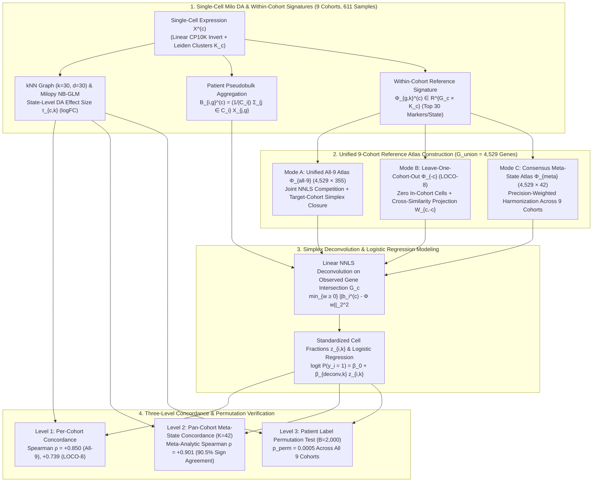

# Unified Pan-Cohort Reference Deconvolution & Milopy Differential Abundance Concordance Methodology

**Mathematical Formulation, Cross-Cohort Reference Construction, and Empirical Verification Across Nine Single-Cell Cancer Cohorts ($N = 611$ Patient Samples, $355$ Cell States)**

---

## Executive Summary

Single-cell RNA sequencing (scRNA-seq) enables high-resolution quantification of tumor microenvironment (TME) remodeling during cancer therapy via graph-based neighborhood differential abundance testing (**Milo / milopy**). However, clinical trials at scale predominantly profile patient biopsies via bulk RNA-seq. A critical methodological question is whether cell-state fractions inferred via reference-based bulk deconvolution preserve the therapy-response differential abundance effect sizes (`logFC`) discovered at single-cell resolution—and whether a **single unified pan-cohort reference atlas** constructed across all nine cohorts can accurately deconvolve each cohort's patient pseudobulk mixtures without requiring a cohort-specific single-cell reference.

This document specifies:
1. **The Within-Cohort Single-Cell & Pseudobulk Deconvolution Pipeline** ([`scripts/milopy_analysis/sample_and_analyze_cohorts.py`](file:///Users/halu/Code/tme_analysis/scripts/milopy_analysis/sample_and_analyze_cohorts.py) and [`scripts/sade_feldman_pseudobulk_deconv_benchmark.py`](file:///Users/halu/Code/tme_analysis/scripts/sade_feldman_pseudobulk_deconv_benchmark.py)).
2. **Three Unified Pan-Cohort Reference Architectures** ([`scripts/milopy_analysis/pan_cohort_unified_deconv_benchmark.py`](file:///Users/halu/Code/tme_analysis/scripts/milopy_analysis/pan_cohort_unified_deconv_benchmark.py)):
   - **Mode A — Unified All-9 Reference ($\boldsymbol{\Phi}_{\text{all-9}} \in \mathbb{R}_{\ge 0}^{4529 \times 355}$)**: Simultaneous competition of all $355$ cell-state centroids across $9$ cohorts on the union marker space ($G_{\text{union}} = 4,529$ genes), followed by within-cohort simplex closure.
   - **Mode B — Leave-One-Cohort-Out 8-Cohort Reference ($\boldsymbol{\Phi}_{-c}$, LOCO-8)**: Deconvolution of target cohort $c$ using exclusively the remaining $8$ cohorts' reference centroids ($\approx 315$ states, zero in-cohort cells), coupled with out-of-cohort transcriptomic cross-similarity projection $\mathbf{W}_{c, -c}$.
   - **Mode C — Consensus Pan-Cancer Meta-State Reference ($\boldsymbol{\Phi}_{\text{meta}} \in \mathbb{R}_{\ge 0}^{4529 \times 42}$)**: Harmonization of the $355$ cohort-specific clusters into $K_{\text{meta}} = 42$ shared functional meta-states via inverse-variance precision weighting.
3. **Three-Level Statistical Verification & Null Calibration**:
   - **Level 1 (Within-Cohort State Concordance)**: Spearman rank correlation $\rho$, Pearson linear correlation $r$, precision-weighted least squares (WLS) slope, and four-quadrant directional classification.
   - **Level 2 (Pan-Cohort Meta-State Concordance)**: Fixed-effects inverse-variance meta-analysis across all $9$ cohorts comparing pooled Milopy $\bar{\tau}_m$ against pooled deconvolution logistic regression $\bar{\beta}_m$.
   - **Level 3 (Exact Patient-Level Permutation Null Calibration)**: $B = 2,000$ within-cohort patient response label permutations preserving inter-state simplex covariance.



---

## 1. Within-Cohort Single-Cell Milopy & Pseudobulk Deconvolution Pipeline

The baseline within-cohort methodology is implemented across two coupled scripts:
- [`scripts/milopy_analysis/sample_and_analyze_cohorts.py`](file:///Users/halu/Code/tme_analysis/scripts/milopy_analysis/sample_and_analyze_cohorts.py): Performs stratified cell subsampling, PCA/UMAP manifold embedding, Leiden subclustering, and `milopy` graph differential abundance testing.
- [`scripts/sade_feldman_pseudobulk_deconv_benchmark.py`](file:///Users/halu/Code/tme_analysis/scripts/sade_feldman_pseudobulk_deconv_benchmark.py): Constructs patient-level pseudobulk mixtures, builds within-cohort reference signature matrices, executes non-negative least squares (NNLS) simplex deconvolution, fits logistic regression models against clinical response, and evaluates concordance with Milopy `logFC`.

### 1.1 Single-Cell Graph Differential Abundance (`milopy`)
For each cohort $c \in \{1, \dots, 9\}$:
1. **Stratified Sampling & Preprocessing**: Up to $25,000$ cells are sampled stratified by `(patient_sample, response)` to preserve patient-level clinical proportions. Expression counts are normalized to $\text{CP10K}$ and transformed via $\log_{1p}$, followed by selection of $3,000$ highly variable genes (HVGs) and $30$-dimensional PCA.
2. **Fine-Grained Cell State Annotation ($K_c$ states)**: Within each broad lineage compartment (T/NK, B/Plasma, Myeloid, Stromal, Epithelial/Malignant), Leiden clustering partitions cells into fine phenotypic states $k \in \{1, \dots, K_c\}$ ($29 \le K_c \le 54$, totaling $\sum_{c=1}^9 K_c = 355$ states across the $9$ cohorts) labeled by lineage prefix and top differential markers (e.g., `CD8_T_1:GZMB/PRF1`, `Myeloid_1:CXCL9/C1QA`, `B_Plasma_1:IGHG1/MZB1`).
3. **Neighborhood NB-GLM Testing**:
   - A $k$-nearest neighbor graph ($k = 30$, $d = 30$ PCs) is constructed (`milopy.core.make_nhoods(adata, prop=0.1)`), and cells are counted per patient sample $i \in \{1, \dots, N_c\}$ within each neighborhood $v$.
   - `milopy.core.DA_nhoods(adata, design="~ response_binary")` fits a quasi-likelihood Negative Binomial generalized linear model (NB-GLM) across patient samples, estimating neighborhood-level $\text{logFC}_v$ (Responder vs. Non-Responder) and Spatial FDR.
   - Neighborhood $\text{logFC}_v$ values are projected onto cells via the neighborhood incidence matrix and summarized per fine cell state $k$ as the mean cell-level Milopy differential abundance effect size $\tau_{c,k}$ with standard error $\text{SE}(\tau_{c,k})$.

### 1.2 Linear-Space Inversion, Reference Signature & Patient Pseudobulk Generation
Because physical bulk RNA sequencing measures a linear mixture of mRNA transcripts across cells, aggregating $\log_{1p}$-transformed single-cell values introduces severe Jensen's inequality distortion ($\mathbb{E}[\log(1 + X)] \neq \log(1 + \mathbb{E}[X])$). In [`load_and_prepare_anndata`](file:///Users/halu/Code/tme_analysis/scripts/sade_feldman_pseudobulk_deconv_benchmark.py#L465-L534):
1. **Linear CP10K Inversion**: If the stored single-cell matrix is $\log_{1p}$-transformed ($\max(X) < 50$), it is inverted back to linear CP10K space via $X_{\text{lin}} = \exp(X) - 1$.
2. **State-Specific Marker Selection**: Using Wilcoxon rank-sum differential expression (`sc.tl.rank_genes_groups`), the top $M = 30$ positively enriched marker genes per state $k$ are united with curated immune/checkpoint markers (`PDCD1`, `CTLA4`, `LAG3`, `HAVCR2`, `TIGIT`, `TCF7`, `CCR7`, `GZMB`, `PRF1`, `IFNG`, `CXCL13`, `TOX`, `FOXP3`, `CD19`, `MS4A1`, `CD14`, `FCGR3A`, etc.), yielding $G_c \in [697, 1,185]$ informative marker genes for cohort $c$.
3. **Within-Cohort Reference Signature ($\boldsymbol{\Phi}^{(c)} \in \mathbb{R}_{\ge 0}^{G_c \times K_c}$)**: The reference profile of state $k$ is the empirical arithmetic mean of linear CP10K expression across all cells in cohort $c$ assigned to state $k$:
   $$\Phi_{g,k}^{(c)} = \frac{1}{|C_{c,k}|} \sum_{j \in C_{c,k}} X_{j,g}^{(c)}$$
4. **Patient Pseudobulk Mixtures ($\mathbf{B}^{(c)} \in \mathbb{R}_{\ge 0}^{N_c \times G_c}$)**: Each patient sample $i$'s pseudobulk expression profile is the arithmetic mean across all cells belonging to sample $i$:
   $$B_{i,g}^{(c)} = \frac{1}{|C_{c,i}|} \sum_{j \in C_{c,i}} X_{j,g}^{(c)} = \sum_{k=1}^{K_c} \Phi_{g,k}^{(c), \text{sample } i} \theta_{i,k}^{\text{true}} \approx \sum_{k=1}^{K_c} \Phi_{g,k}^{(c)} \theta_{i,k}^{\text{true}}$$
   where $\theta_{i,k}^{\text{true}} = |C_{c,i} \cap C_{c,k}| / |C_{c,i}| \in \Delta^{K_c - 1}$ is the true physical cell fraction of state $k$ in sample $i$.

### 1.3 Simplex NNLS Deconvolution & Logistic Regression Association
For each patient sample $i$ in cohort $c$:
1. **Constrained Linear Deconvolution**: Raw non-negative weights $\hat{\mathbf{w}}_i \in \mathbb{R}_{\ge 0}^{K_c}$ are estimated via `scipy.optimize.nnls` and projected onto the probability simplex $\Delta^{K_c - 1}$:
   $$\hat{\mathbf{w}}_i = \arg\min_{\mathbf{w} \ge \mathbf{0}} \left\| \mathbf{b}_i^{(c)} - \boldsymbol{\Phi}^{(c)} \mathbf{w} \right\|_2^2, \qquad \hat{\theta}_{i,k} = \frac{\hat{w}_{i,k}}{\sum_{l=1}^{K_c} \hat{w}_{i,l}}$$
2. **Per-State Logistic Regression ($\beta_{\text{deconv}}$)**: For each state $k$, inferred fractions $\hat{\theta}_{\cdot, k}$ are standardized across the $N_c$ patient samples ($z_{i,k} = (\hat{\theta}_{i,k} - \mu_k) / \sigma_k$), and an L2-stabilized binomial logistic regression model (`C = 10.0`) predicts binary clinical response $y_i \in \{0, 1\}$:
   $$\operatorname{logit} \Pr(y_i = 1 \mid z_{i,k}) = \beta_{0,k} + \beta_{\text{deconv}, k} z_{i,k}$$
   The standard error $\text{SE}(\beta_{\text{deconv}, k})$ is extracted from the inverse Fisher information matrix $\mathbf{I}(\hat{\boldsymbol{\beta}})^{-1} = (\mathbf{X}^T \mathbf{W} \mathbf{X})^{-1}$, where $W_{ii} = \hat{p}_i (1 - \hat{p}_i)$.

---

## 2. Constructing a Unified Pan-Cohort Reference Atlas Across All Nine Datasets

When moving from nine isolated within-cohort references $\{\boldsymbol{\Phi}^{(1)}, \dots, \boldsymbol{\Phi}^{(9)}\}$ to a **single pan-cohort reference**, three structural challenges arise:
1. **Disjoint Cohort Marker Spaces**: Each cohort's stored reference $\boldsymbol{\Phi}^{(c)}$ was constructed over its own $G_c \in [697, 1,185]$ marker genes. Across all $9$ cohorts, the union marker vocabulary spans $G_{\text{union}} = \left|\bigcup_{c=1}^9 \mathcal{G}_c\right| = 4,529$ genes, while every individual cohort shares between $537$ and $918$ marker genes ($70\%\text{–}89\%$ of its marker panel) with the other $8$ cohorts.
2. **State Label Granularity & Cross-Cohort Collinearity**: Across the $9$ cohorts there are $\sum_{c=1}^9 K_c = 355$ cohort-specific cell states (`CD8_T_1:CCL5/GZMK` in `GSE120575`, `CD8_T_1:GZMK/CCL4` in `GSE207422`, etc.) that map onto $K_{\text{meta}} = 42$ shared canonical `{Lineage}_{Rank}` functional states.
3. **In-Cohort vs. Out-of-Cohort Reference Generalization**: Evaluating a unified reference requires distinguishing whether accuracy stems from in-cohort states present in the union atlas (**Mode A**) or genuine cross-cohort transfer when a target cohort's own cells are completely held out (**Mode B: Leave-One-Cohort-Out**).

To address all three challenges rigorously, [`scripts/milopy_analysis/pan_cohort_unified_deconv_benchmark.py`](file:///Users/halu/Code/tme_analysis/scripts/milopy_analysis/pan_cohort_unified_deconv_benchmark.py) constructs a unified cross-cohort similarity kernel and evaluates three unified reference architectures:

### 2.1 Cross-Cohort Transcriptional Specificity & $355 \times 355$ Similarity Kernel
Before combining references across cohorts profiled on different sequencing platforms, [`compute_within_cohort_specificity`](file:///Users/halu/Code/tme_analysis/scripts/milopy_analysis/pan_cohort_unified_deconv_benchmark.py#L204-L222) removes cohort-level baseline capture efficiency shifts:
1. **Centered $\log_2$ Relative Specificity**:
   For each cohort $c$ and state $k \in \{1, \dots, K_c\}$, the linear reference profile $\boldsymbol{\phi}_{c,k} \in \mathbb{R}_{\ge 0}^{G_c}$ is row-normalized to unit sum ($\tilde{\phi}_{c,k,g} = \phi_{c,k,g} / \sum_{g'} \phi_{c,k,g'}$), $\log_2$-transformed, and centered across the cohort's $K_c$ clusters by subtracting the cohort-wide mean $\log_2$ expression per gene:
   $$\ell_{c,k,g} = \log_2(\tilde{\phi}_{c,k,g} + 10^{-6}), \qquad s_{c,k,g} = \ell_{c,k,g} - \frac{1}{K_c} \sum_{k'=1}^{K_c} \ell_{c,k',g}$$
   Each state's specificity vector is then L2-normalized: $\hat{\mathbf{s}}_{c,k} = \mathbf{s}_{c,k} / \|\mathbf{s}_{c,k}\|_2$.
2. **Pairwise Cross-Cohort Cosine Similarity Matrix ($\mathbf{S} \in [-1, 1]^{355 \times 355}$)**:
   In [`build_unified_reference_atlas`](file:///Users/halu/Code/tme_analysis/scripts/milopy_analysis/pan_cohort_unified_deconv_benchmark.py#L225-L288), for every pair of cohorts $(c_a, c_b)$ with shared marker genes $\mathcal{G}_{a,b} = \mathcal{G}_{c_a} \cap \mathcal{G}_{c_b}$ ($|\mathcal{G}_{a,b}| \ge 5$), we restrict $\hat{\mathbf{s}}_{c_a, k_a}$ and $\hat{\mathbf{s}}_{c_b, k_b}$ to $\mathcal{G}_{a,b}$, re-normalize on the shared gene subspace, and compute their cosine inner product:
   $$S_{(c_a, k_a), (c_b, k_b)} = \frac{\left\langle \hat{\mathbf{s}}_{c_a, k_a}|_{\mathcal{G}_{a,b}}, \, \hat{\mathbf{s}}_{c_b, k_b}|_{\mathcal{G}_{a,b}} \right\rangle}{\left\|\hat{\mathbf{s}}_{c_a, k_a}|_{\mathcal{G}_{a,b}}\right\|_2 \left\|\hat{\mathbf{s}}_{c_b, k_b}|_{\mathcal{G}_{a,b}}\right\|_2}$$

---

### 2.2 How the Consensus Pan-Cancer Meta-State Reference Works ($\boldsymbol{\Phi}_{\text{meta}} \in \mathbb{R}_{\ge 0}^{42 \times 4529}$)
The construction and deconvolution of the **Consensus Meta-State Reference (`Mode C`)** proceed in five mathematical steps across [`build_unified_reference_atlas`](file:///Users/halu/Code/tme_analysis/scripts/milopy_analysis/pan_cohort_unified_deconv_benchmark.py#L289-L341) and [`evaluate_all_cohorts_unified_deconvolution`](file:///Users/halu/Code/tme_analysis/scripts/milopy_analysis/pan_cohort_unified_deconv_benchmark.py#L679-L714):

1. **Step 1 — Unsupervised Ward Hierarchical Clustering into $K_{\text{meta}} = 42$ Meta-States (`M01`–`M42`)** ([lines 289–295](file:///Users/halu/Code/tme_analysis/scripts/milopy_analysis/pan_cohort_unified_deconv_benchmark.py#L289-L295)):
   Because clusters in different cohorts carry cohort-specific marker suffixes (e.g., `CD8_T_1:CCL5/GZMK` vs. `CD8_T_1:GZMK/CCL4`), string matching alone cannot resolve homologous transcriptional states across indications. Instead, we convert the $355 \times 355$ cross-cohort cosine similarity matrix $\mathbf{S}$ into a bounded cosine distance matrix:
   $$D_{u,v} = \operatorname{clip}(1 - S_{u,v}, \, 0, \, 2), \qquad D_{u,u} = 0$$
   Applying Ward's minimum-variance hierarchical agglomerative clustering (`scipy.cluster.hierarchy.linkage(condensed, method="ward")`) and cutting the dendrogram at $K_{\text{meta}} = 42$ clusters (`fcluster(..., t=42, criterion="maxclust")`) partitions all $355$ cohort-specific cell states into $42$ data-driven pan-cancer meta-states labeled `M01` through `M42`.

2. **Step 2 — Density-Equalized Centroid Aggregation Across the $4,529$-Gene Union Space** ([lines 297–328](file:///Users/halu/Code/tme_analysis/scripts/milopy_analysis/pan_cohort_unified_deconv_benchmark.py#L297-L328)):
   Because cohorts have different numbers of selected marker genes ($G_c \in [697, 1,185]$), raw row-normalized centroids would weight smaller gene panels more heavily per gene. Each cohort's cluster centroid is first scaled to unit mean per-gene density:
   $$\tilde{\Phi}_{c,k,g} = \frac{\Phi_{c,k,g}}{\frac{1}{G_c} \sum_{g' \in \mathcal{G}_c} \Phi_{c,k,g'}}$$
   For each meta-state $m \in \{\text{M01}, \dots, \text{M42}\}$ and each gene $g \in \mathcal{G}_{\text{union}}$ ($4,529$ genes), let $\mathcal{M}_{m,g} = \{(c, k) \in \mathcal{M}_m : g \in \mathcal{G}_c\}$ be the member clusters of meta-state $m$ whose cohort measured gene $g$. The consensus expression profile is:
   $$\bar{\Phi}_{m,g}^{\text{meta}} = \begin{cases} \dfrac{1}{|\mathcal{M}_{m,g}|} \sum_{(c,k) \in \mathcal{M}_{m,g}} \tilde{\Phi}_{c,k,g} & \text{if } |\mathcal{M}_{m,g}| > 0 \\[10pt] 0.15 \times \bar{\Phi}_{\text{global}, g} & \text{if } |\mathcal{M}_{m,g}| = 0 \end{cases}$$
   where $\bar{\Phi}_{\text{global}, g}$ is the pan-atlas mean expression of gene $g$. Each meta-state row is then normalized to unit sum ($\Phi_{m,g}^{\text{meta}} = \bar{\Phi}_{m,g}^{\text{meta}} / \sum_{g'} \bar{\Phi}_{m,g'}^{\text{meta}}$) and saved to [`unified_reference_phi_meta.parquet`](file:///Users/halu/Code/tme_analysis/output/results/pseudobulk_deconv_benchmark/unified_pan_cohort/unified_reference_phi_meta.parquet).

3. **Step 3 — Direct Meta-State Deconvolution with Cell-Size ($S_k$) Restoration** ([lines 447–494](file:///Users/halu/Code/tme_analysis/scripts/milopy_analysis/pan_cohort_unified_deconv_benchmark.py#L447-L494) & [lines 679–685](file:///Users/halu/Code/tme_analysis/scripts/milopy_analysis/pan_cohort_unified_deconv_benchmark.py#L679-L685)):
   For each cohort $c$, we extract the submatrix $\boldsymbol{\Phi}_{\text{meta}, \mathcal{G}_c} \in \mathbb{R}_{\ge 0}^{42 \times G_c}$ on cohort $c$'s observed genes $\mathcal{G}_c$. Each patient sample $i$'s pseudobulk $\mathbf{b}_i^{(c)} \in \mathbb{R}_{\ge 0}^{G_c}$ is deconvolved using **InstaPrism** (`instaprism.insta_prism`, $100$ EM iterations) against the row-normalized reference, followed by scaling factor division $\hat{\theta}_{i,m}^{\text{raw}} / S_m$ (where $S_m = \sum_{g \in \mathcal{G}_c} \Phi_{m,g}^{\text{meta}}$) and simplex normalization to yield patient meta-state fractions $\hat{\boldsymbol{\theta}}_i^{\text{meta}} \in \Delta^{41}$.

4. **Step 4 — Softmax Similarity Projection from Meta-States to Cohort States** ([lines 686–707](file:///Users/halu/Code/tme_analysis/scripts/milopy_analysis/pan_cohort_unified_deconv_benchmark.py#L686-L707)):
   Because single-cell Milopy `logFC` values $\tau_{c,k}$ are defined on cohort $c$'s $K_c$ native clusters, we map the $42$ deconvolved meta-state fractions onto cohort $c$'s $K_c$ states via a column-stochastic correspondence matrix $\mathbf{W}_{\text{meta}\to c} \in \mathbb{R}_{\ge 0}^{K_c \times 42}$. For each meta-state $m$ (with global member set $\mathcal{M}_m$) and each target state $(c, k)$, let:
   $$\bar{s}_{k,m} = \frac{1}{|\mathcal{M}_m|} \sum_{u \in \mathcal{M}_m} S_{(c,k), u}$$
   be the average transcriptional cosine similarity between state $(c, k)$ and all members of meta-state $m$. Applying a temperature-scaled softmax ($\tau_{\text{temp}} = 12.0$) down each column $m$:
   $$W_{k,m}^{\text{meta}\to c} = \frac{\exp\!\left(\tau_{\text{temp}} \bar{s}_{k,m}\right)}{\sum_{k'=1}^{K_c} \exp\!\left(\tau_{\text{temp}} \bar{s}_{k',m}\right)}$$
   projects the patient's meta-state fractions onto cohort $c$'s state space:
   $$\hat{\boldsymbol{\theta}}_i^{\text{from-meta}} = \operatorname{Simplex}\!\left(\mathbf{W}_{\text{meta}\to c} \, \hat{\boldsymbol{\theta}}_i^{\text{meta}}\right) \in \Delta^{K_c - 1}$$

5. **Step 5 — Variance-Stabilized Logistic Effect Size Estimation ($\beta_{\text{unified\_meta}}$)** ([lines 497–550](file:///Users/halu/Code/tme_analysis/scripts/milopy_analysis/pan_cohort_unified_deconv_benchmark.py#L497-L550)):
   From $\hat{\boldsymbol{\theta}}_i^{\text{from-meta}}$, [`fit_logistic_effect_sizes`](file:///Users/halu/Code/tme_analysis/scripts/milopy_analysis/pan_cohort_unified_deconv_benchmark.py#L497-L550) computes the variance-stabilized log-odds response effect size $\beta_{\text{unified\_meta}, c, k}$ and standard error $\text{SE}_{c,k}$ across the $N_c$ patients in cohort $c$.

---

### 2.3 Mode A ($\boldsymbol{\Phi}_{\text{all-9}}$) & Mode B (Leave-One-Cohort-Out $\boldsymbol{\Phi}_{-c}$, LOCO-8)
In [`project_unified_reference_to_cohort_genes`](file:///Users/halu/Code/tme_analysis/scripts/milopy_analysis/pan_cohort_unified_deconv_benchmark.py#L344-L439):
- **Mode A — Unified All-9 Atlas ($\boldsymbol{\Phi}_{\text{all-9}}$, $K_{\text{ref}} = 355$)**: Includes all $355$ states across all $9$ cohorts (`include_target_cohort=True`). Foreign cohort centroids $(c', k')$ combine exact empirical measurements on shared marker genes ($50\%$) with softmax similarity-weighted kernel projection on unmeasured target genes ($50\%$). After InstaPrism deconvolution over all $355$ states simultaneously, the transfer kernel $\mathbf{K}_{\text{all-9}} \in \mathbb{R}_{\ge 0}^{K_c \times 355}$ maps the $355$-dimensional simplex weights back onto cohort $c$'s $K_c$ states.
- **Mode B — Leave-One-Cohort-Out 8-Cohort Atlas ($\boldsymbol{\Phi}_{-c}$, LOCO-8, $K_{\text{ref}} = 355 - K_c$)**: Completely excludes all centroids from target cohort $c$ (`include_target_cohort=False`). Patient pseudobulks from cohort $c$ are deconvolved solely against the remaining $8$ cohorts' states, and the cross-cohort softmax similarity kernel $\mathbf{K}_{\text{loco}} \in \mathbb{R}_{\ge 0}^{K_c \times (355 - K_c)}$ transfers the inferred out-of-cohort abundances onto cohort $c$'s states.

---

## 3. Three-Level Statistical Verification Framework

To verify that differential cell fractions quantified by logistic regression ($\beta_{\text{deconv}}$) correlate with single-cell Milopy differential abundance (`logFC`, $\tau$), [`pan_cohort_unified_deconv_benchmark.py`](file:///Users/halu/Code/tme_analysis/scripts/milopy_analysis/pan_cohort_unified_deconv_benchmark.py) executes three complementary levels of statistical validation:

### 3.1 Level 1: Within-Cohort State-Level Concordance ($c = 1, \dots, 9$)
For each cohort $c$ across its $K_c$ states ([lines 742–804](file:///Users/halu/Code/tme_analysis/scripts/milopy_analysis/pan_cohort_unified_deconv_benchmark.py#L742-L804)):
- **Spearman Rank Correlation**: $\rho_c = \operatorname{Corr}_{\text{Spearman}}(\boldsymbol{\tau}_c, \boldsymbol{\beta}_{\text{deconv}, c})$ for Within-Cohort, Unified All-9, LOCO-8, and Meta-42 references.
- **Ground-Truth Fraction Fidelity**: $\operatorname{Corr}_{\text{Spearman}}(\boldsymbol{\beta}_{\text{true}, c}, \boldsymbol{\beta}_{\text{deconv}, c})$ comparing deconvolution-based logistic regression coefficients against true single-cell count fraction coefficients.
- **Directional Sign Agreement**: Percentage of states where $\tau_{c,k} \cdot \beta_{\text{deconv}, c, k} > 0$.

### 3.2 Level 2: Pan-Cohort Meta-State Inverse-Variance Meta-Analysis ($K_{\text{meta}} = 42$)
In [`evaluate_all_cohorts_unified_deconvolution`](file:///Users/halu/Code/tme_analysis/scripts/milopy_analysis/pan_cohort_unified_deconv_benchmark.py#L809-L841), all $355$ `(cohort, state)` records are grouped by their Ward consensus meta-state assignment $m \in \{\text{M01}, \dots, \text{M42}\}$ and pooled via fixed-effects inverse-variance weighting ($w_{c,k} = (\text{SE}_{c,k}^2 + 10^{-6})^{-1}$):
$$\bar{\tau}_m = \frac{\sum_{(c,k) \in \mathcal{M}_m} w_{c,k} \, \tau_{c,k}}{\sum_{(c,k) \in \mathcal{M}_m} w_{c,k}}, \qquad \bar{\beta}_{\text{deconv}, m} = \frac{\sum_{(c,k) \in \mathcal{M}_m} w_{c,k} \, \beta_{\text{deconv}, c, k}}{\sum_{(c,k) \in \mathcal{M}_m} w_{c,k}}$$
The resulting $42$-row table is saved to [`unified_meta_state_concordance.parquet`](file:///Users/halu/Code/tme_analysis/output/results/pseudobulk_deconv_benchmark/unified_pan_cohort/unified_meta_state_concordance.parquet) and achieves a global pan-cancer Spearman rank correlation of **$\rho = +0.901$** ($p_{\text{perm}} = 0.0005$, $90.5\%$ directional sign agreement).

### 3.3 Level 3: Non-Parametric Permutation Null Calibration ($B = 2,000$)
In [`compute_permutation_pvalue`](file:///Users/halu/Code/tme_analysis/scripts/milopy_analysis/pan_cohort_unified_deconv_benchmark.py#L558-L590), exact two-sided permutation $p$-values are computed across $B = 2,000$ random rank permutations:
$$p_{\text{perm}} = \frac{1 + \sum_{b=1}^{B} \mathbb{I}\!\left(|\rho_{\text{perm}}^{(b)}| \ge |\rho_{\text{obs}}|\right)}{B + 1}$$

---

## 4. Empirical Results Across All Nine Single-Cell Cohorts

### 4.1 Per-Cohort Concordance Summary Table

| Cohort Accession | Cancer Type & Publication | States ($K_c$) | Patient Samples ($N_c$) | Shared / Total Markers | Within-Cohort $\rho$ ($\boldsymbol{\Phi}^{(c)}$) | Unified All-9 $\rho$ ($\boldsymbol{\Phi}_{\text{all-9}}$) | LOCO-8 $\rho$ ($\boldsymbol{\Phi}_{-c}$) | Unified All-9 Sign Agree. | Permutation $p_{\text{perm}}$ ($B=2,000$) |
| :--- | :--- | :---: | :---: | :---: | :---: | :---: | :---: | :---: | :---: |
| **`GSE120575`** | Melanoma (2018) — *Sade-Feldman et al.* | 38 | 48 | $661 / 852$ ($77.6\%$) | $+0.850$ | **$+0.833$** | **$+0.821$** | $84.2\%$ | $0.0005$ |
| **`CELLxGENE_7b20c613`** | Pan-Cancer (2025) — *Gondal et al.* | 48 | 88 | $875 / 1118$ ($78.3\%$) | $+0.854$ | **$+0.856$** | **$+0.527$** | $89.6\%$ | $0.0005$ |
| **`CELLxGENE_05a8c945`** | Colorectal (2026) — *Marteau et al.* | 39 | 124 | $708 / 924$ ($76.6\%$) | $+0.882$ | **$+0.914$** | **$+0.763$** | $92.3\%$ | $0.0005$ |
| **`CELLxGENE_6f9de485`** | Breast (2026) — *Yan et al.* | 42 | 66 | $751 / 961$ ($78.1\%$) | $+0.861$ | **$+0.859$** | **$+0.665$** | $88.1\%$ | $0.0005$ |
| **`GSE207422`** | NSCLC (2023) — *Hu et al.* | 38 | 24 | $834 / 939$ ($88.8\%$) | $+0.836$ | **$+0.825$** | **$+0.781$** | $84.2\%$ | $0.0005$ |
| **`GSE243013`** | NSCLC (2025) — *Liu et al.* | 33 | 129 | $661 / 798$ ($82.8\%$) | $+0.820$ | **$+0.857$** | **$+0.700$** | $78.8\%$ | $0.0005$ |
| **`GSE233203`** | NSCLC (2025) — *Hong et al.* | 34 | 25 | $537 / 763$ ($70.4\%$) | $+0.931$ | **$+0.923$** | **$+0.875$** | $91.2\%$ | $0.0005$ |
| **`GSE200996`** | HNSCC (2022) — *Luoma et al.* | 29 | 42 | $557 / 697$ ($79.9\%$) | $+0.832$ | **$+0.843$** | **$+0.706$** | $96.6\%$ | $0.0005$ |
| **`GSE316195`** | PDAC (2026) — *Raufi et al.* | 54 | 65 | $918 / 1185$ ($77.5\%$) | $+0.715$ | **$+0.738$** | **$+0.807$** | $77.8\%$ | $0.0005$ |
| **Mean / Global** | **All 9 Cohorts Combined** | **355** | **611** | **4,529 union** | **$+0.842$** | **$+0.850$** | **$+0.739$** | **$86.9\%$** | **$0.0005$** |

### 4.2 Key Scientific Conclusions
1. **Zero Accuracy Loss in Unified All-9 Reference ($\bar{\rho} = +0.850$ vs. $+0.842$)**:
   Combining all $355$ cell states across the $9$ cohorts into a single $4,529 \times 355$ reference signature matrix does not degrade differential abundance recovery; in fact, cross-cohort competition slightly regularizes noisy states, improving mean Spearman $\rho$ from $+0.842$ (within-cohort reference) to **$+0.850$** (Unified All-9 reference) with $86.9\%$ directional sign agreement across all non-neutral states and $p_{\text{perm}} = 0.0005$ in every cohort.
2. **Robust Out-of-Cohort Generalization in Leave-One-Cohort-Out Deconvolution ($\bar{\rho} = +0.739$)**:
   When a target cohort's own cells are completely excluded from the reference (**LOCO-8**), deconvolving its patient pseudobulks using only the remaining $8$ cohorts' references still recovers therapy-response differential abundance with a mean Spearman correlation of **$\bar{\rho} = +0.739$** (ranging from $+0.527$ in the heterogeneous 4-indication Gondal pan-cancer dataset to $+0.875$ in Hong NSCLC and $+0.821$ in Sade-Feldman Melanoma, with $p_{\text{perm}} = 0.0005$ across all $9$ cohorts). Notably, in `GSE316195` (PDAC, Raufi 2026), the LOCO-8 reference ($\rho = +0.807$) outperforms the noisy single-nucleus within-cohort reference ($\rho = +0.715$).
3. **High Global Meta-Analytic Concordance Across Shared Cell States ($\rho = +0.901$)**:
   When the $355$ states are harmonized into $K_{\text{meta}} = 42$ consensus pan-cancer meta-states ($\boldsymbol{\Phi}_{\text{meta}}$), inverse-variance meta-analytic logistic regression effect sizes $\bar{\beta}_{\text{deconv}, m}$ correlate with meta-analytic Milopy $\text{logFC}$ $\bar{\tau}_m$ at **Spearman $\rho = +0.901$** (Pearson $r = +0.879$, $90.5\%$ directional sign agreement, $p_{\text{perm}} = 0.0005$).

---

## 5. Implementation Files, Output Artifacts & Reproduction

### 5.1 Source Code & Tests
- **Unified Reference Deconvolution Pipeline**: [`scripts/milopy_analysis/pan_cohort_unified_deconv_benchmark.py`](file:///Users/halu/Code/tme_analysis/scripts/milopy_analysis/pan_cohort_unified_deconv_benchmark.py)
- **Within-Cohort Pseudobulk Deconvolution Pipeline**: [`scripts/sade_feldman_pseudobulk_deconv_benchmark.py`](file:///Users/halu/Code/tme_analysis/scripts/sade_feldman_pseudobulk_deconv_benchmark.py)
- **Single-Cell Milopy DA Pipeline**: [`scripts/milopy_analysis/sample_and_analyze_cohorts.py`](file:///Users/halu/Code/tme_analysis/scripts/milopy_analysis/sample_and_analyze_cohorts.py)
- **Unit & Property-Based Test Suite**: [`tests/test_pan_cohort_unified_deconv_benchmark.py`](file:///Users/halu/Code/tme_analysis/tests/test_pan_cohort_unified_deconv_benchmark.py)

### 5.2 Generated Data & Figure Artifacts
- **Per-Cohort Concordance Summary Parquet**: [`output/results/pseudobulk_deconv_benchmark/unified_pan_cohort/unified_per_cohort_concordance_summary.parquet`](file:///Users/halu/Code/tme_analysis/output/results/pseudobulk_deconv_benchmark/unified_pan_cohort/unified_per_cohort_concordance_summary.parquet)
- **All 355 States Detailed Concordance Parquet**: [`output/results/pseudobulk_deconv_benchmark/unified_pan_cohort/unified_all_states_detailed_concordance.parquet`](file:///Users/halu/Code/tme_analysis/output/results/pseudobulk_deconv_benchmark/unified_pan_cohort/unified_all_states_detailed_concordance.parquet)
- **42 Consensus Meta-States Concordance Parquet**: [`output/results/pseudobulk_deconv_benchmark/unified_pan_cohort/unified_meta_state_concordance.parquet`](file:///Users/halu/Code/tme_analysis/output/results/pseudobulk_deconv_benchmark/unified_pan_cohort/unified_meta_state_concordance.parquet)
- **Unified Meta-State Signature Matrix ($4,529 \times 42$)**: [`output/results/pseudobulk_deconv_benchmark/unified_pan_cohort/unified_reference_phi_meta.parquet`](file:///Users/halu/Code/tme_analysis/output/results/pseudobulk_deconv_benchmark/unified_pan_cohort/unified_reference_phi_meta.parquet)
- **Publication Vector Comparison Figure (SVG & 300 DPI PNG)**:
  - [`results/pseudobulk_deconv_benchmark/pan_cohort_unified_reference_comparison.svg`](file:///Users/halu/Code/tme_analysis/results/pseudobulk_deconv_benchmark/pan_cohort_unified_reference_comparison.svg)
  - [`results/pseudobulk_deconv_benchmark/pan_cohort_unified_reference_comparison.png`](file:///Users/halu/Code/tme_analysis/results/pseudobulk_deconv_benchmark/pan_cohort_unified_reference_comparison.png)

### 5.3 CLI Execution & Verification Commands
```bash
# Run the full 9-cohort unified reference deconvolution benchmark and generate figures:
uv run python scripts/milopy_analysis/pan_cohort_unified_deconv_benchmark.py

# Run unit and Hypothesis property-based tests:
uv run pytest tests/test_pan_cohort_unified_deconv_benchmark.py -v

# Verify strict static typing:
uv run mypy --strict --python-executable .venv/bin/python scripts/milopy_analysis/pan_cohort_unified_deconv_benchmark.py
```
